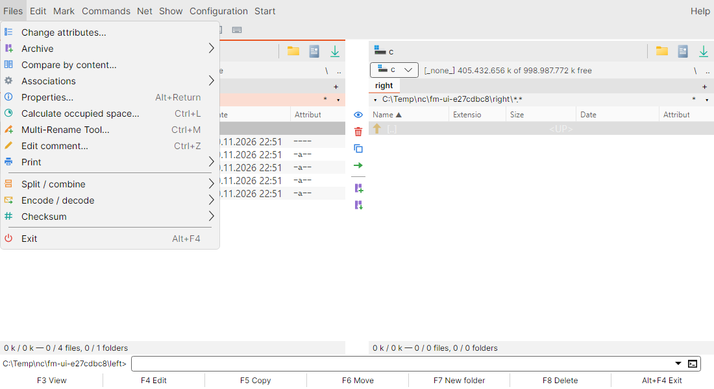
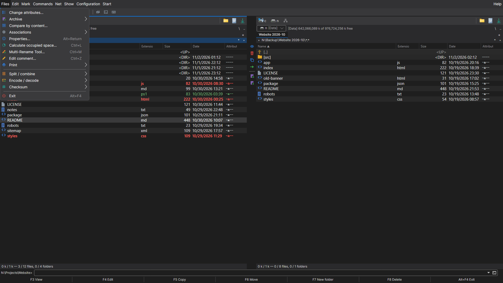
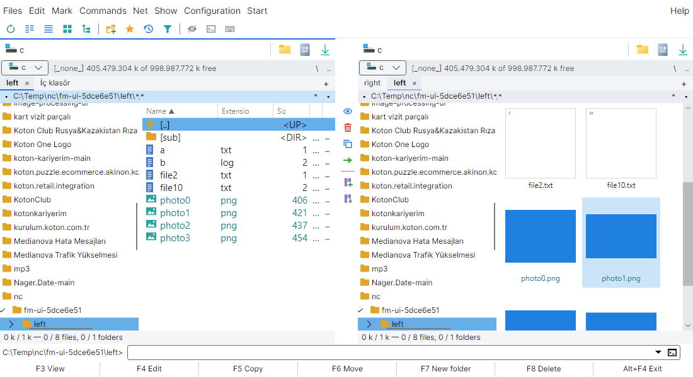
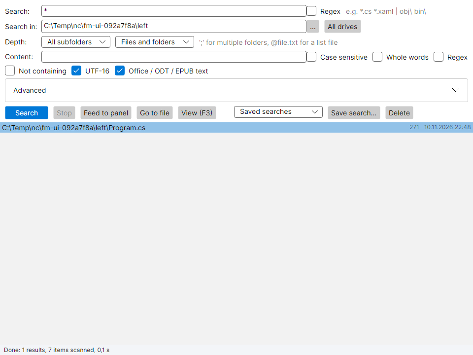
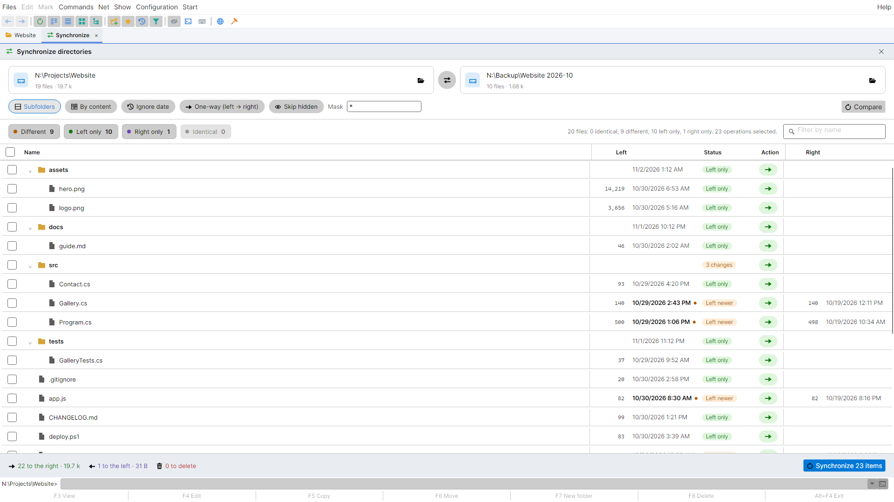
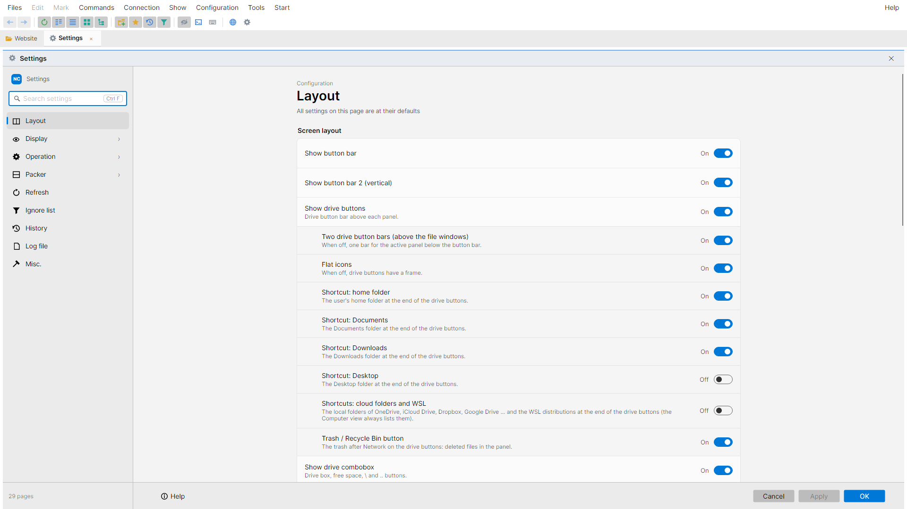
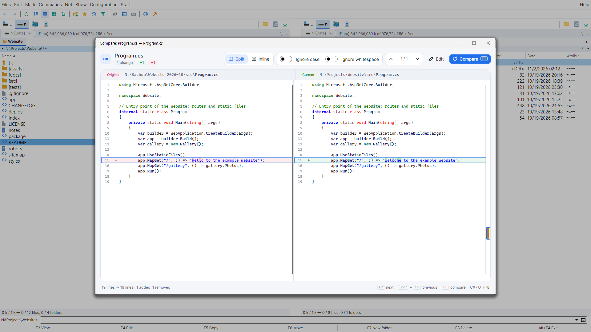
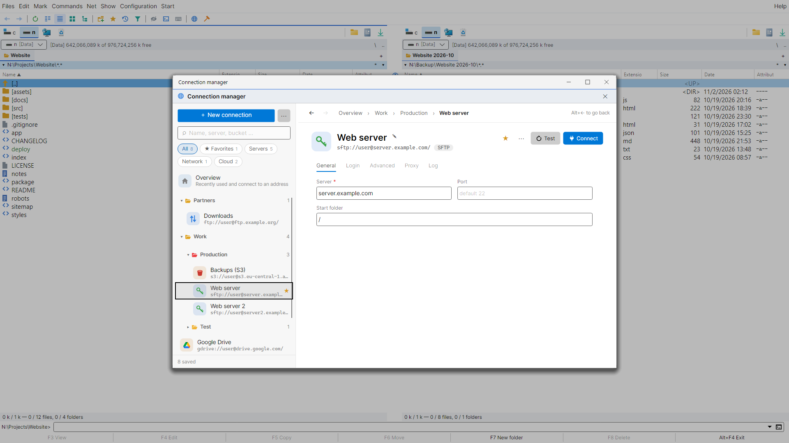

# NextCommander

NextCommander is a dual-pane file manager for Windows, Linux and macOS: two file panels side by side, a menu
bar, a button bar, a command line and the F3 … F8 function keys at the bottom, everything reachable from the
keyboard. The [Getting started](docs/guide/getting-started.md) guide walks you through it.

## Highlights

### Two panels and tabs
- Two file lists side by side; copy, move and compare between them with one key.
- Folder tabs in each panel: open, close, reorder by dragging, lock, rename, save and load tab sets.
- Brief, full, comments and thumbnail views; a folder tree inside the panel; custom column sets
  (for example photo dimensions, music tags or line counts).
- Folder history, most frequently used folders and a Hotlist of favorite folders.
- Quick search and quick filter while you type; Branch View shows the files of all subfolders in one list.

### File operations
- Copy, move, rename and delete with the F keys, by drag and drop or through the clipboard.
- Copy and move jobs run in the background with a progress window, a queue, pause and a speed limit;
  copies can be verified after writing.
- When an operation fails because of missing rights, NextCommander offers to retry it with administrator
  rights through the system's own dialog.
- On Windows, a right click can open Windows Explorer's own context menu.

### Viewer and editor
- Lister (F3) shows text with syntax colors, binary and hex views, images (including camera RAW previews),
  audio and video (with VLC installed), and Markdown, HTML and RTF previews.
- Quick View (Ctrl+Q) shows the file under the cursor in place of the other panel.
- A built-in text editor (F4) that keeps the file's encoding and line endings.

### Search and tools
- Find files by name, content, size, date and attributes; also inside Office and OpenDocument files.
- An optional file index makes searches and folder sizes nearly instant.
- Multi-Rename Tool, Synchronize directories, Compare by content, Duplicate files, Folder sizes with a treemap,
  checksums, split and combine, and a built-in terminal.

### Archives
- Open zip, 7z, rar, tar and other archives like folders; change zip files in place.
- Pack to zip, tar and (with 7-Zip installed) 7z, with passwords; unpack and test archives.

### Remote and cloud
- FTP, FTPS, SFTP, SCP, WebDAV, SMB, Amazon S3 (and compatible stores), Azure Blob Storage, Azure Files,
  Google Drive, OneDrive, Dropbox and Box, all in the same panels as local files; ready-made settings for
  well-known S3 and WebDAV services.
- Web server folder listings (`http://`, `https://`) open like folders; the remotes of an installed rclone too.
- Android phones over ADB (USB debugging) as drives; shortcuts to the local folders of OneDrive, iCloud Drive,
  Dropbox, Google Drive ... and to WSL distributions.
- PC link: two computers running NextCommander work on each other's shared folders over a USB or Ethernet cable
  (or the network), encrypted, paired once with a code shown on both screens.
- A connection manager, saved passwords protected by an optional master password, and a view of the
  machines on your local network.
- Browse the trash / Recycle Bin in a panel: restore, copy out, delete for good, empty.
- Phones, cameras and players connected over USB (MTP) appear as drives: copy photos off a phone, put files on it,
  make folders, rename and delete (Windows; on Linux the folders GNOME mounts for them).

### Customization
- Color themes: follow the system's light/dark mode, a Dark theme, macOS and Ubuntu looks, or your own.
- Three icon packs (Colored, Monochrome, Fluent) or your own.
- English, Turkish, German, Spanish, French and Chinese (Simplified) built in; add your own language with a single file.
- Change every shortcut, edit the button bars, and adjust many options in the Configuration window.

## Screenshots

| | | |
|---|---|---|
|  Dark theme |  Ubuntu theme, Files menu |  macOS Dark theme, Files menu |
|  Tree panel and thumbnails |  Quick View |  Inside a zip archive |
|  Find files |  Multi-Rename Tool |  Synchronize directories |
|  Folder sizes |  Duplicate files |  Configuration |
|  Compare by content |  Connection manager |  About |

## Guides

- [Getting started](docs/guide/getting-started.md): the window, moving around, selecting, the basic operations,
  right click, drag and drop, administrator rights.
- [Keyboard shortcuts](docs/guide/keyboard-shortcuts.md): the default shortcuts and how to change them.
- [Tools](docs/guide/tools.md): Lister, editor, find files, multi-rename, synchronize, compare, duplicates,
  folder sizes, checksums, terminal and more.
- [Archives](docs/guide/archives.md): opening, packing and unpacking archives.
- [Connections](docs/guide/connections.md): FTP, SFTP, SCP, WebDAV, SMB, S3, Azure, cloud drives, ADB and rclone.
- [Configuration](docs/guide/configuration.md): a tour of the Configuration window.
- [Color themes](docs/guide/themes.md): choosing a theme and making your own.
- [Icon packs](docs/guide/icon-packs.md): choosing an icon pack and making your own.
- [Languages](docs/guide/languages.md): choosing the language and translating NextCommander.
- [Plugins](docs/guide/plugins.md): installing and managing plugins, and writing your own (file systems, columns,
  packers, viewers).
- [Settings folder](docs/guide/settings-folder.md): where your settings live, and portable mode.

## Download and start

Packages are made for each platform; see the Releases page.

- **Windows:** a setup program (`-setup.exe`), a zip, a portable zip and an MSIX package. The setup program
  installs for your user without administrator rights (or for all users, if you choose), adds a Start menu entry,
  optionally a desktop icon and "Open in NextCommander" in Explorer's folder menu, and can be removed in *Settings
  > Apps*; your settings stay. You can also unpack the zip anywhere and start `NextCommander.exe`, or install the
  MSIX package.
- **Linux:** a `.tar.gz` package (an AppImage when available). Unpack it and start `NextCommander`.
- **macOS:** `NextCommander.app` in a zip or a disk image. Drag it to Applications and open it.
  A copy that is not signed by a registered developer may first need *System Settings > Privacy & Security >
  Open Anyway*.

The packages are self-contained: nothing else needs to be installed. The **portable zip** needs no installation
at all and keeps its settings in its own folder, so you can carry it on a USB stick.

Some features use programs you may already have: 7-Zip (to create 7z archives), VLC (to play audio and video
in Lister), and Everything, plocate or Spotlight (optional for search). Without them, only those features are
turned off.

For developers: see [docs/development.md](docs/development.md).
