# NextCommander

NextCommander is a dual-pane file manager for Windows, Linux and macOS: two file panels side by side, a menu
bar, a button bar, a command line and the F3 … F8 function keys at the bottom, everything reachable from the
keyboard. The [Getting started](docs/guide/getting-started.md) guide walks you through it.

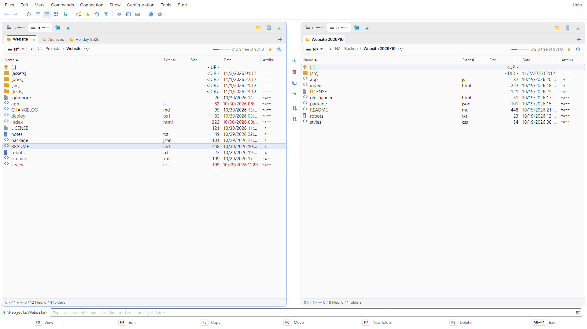

## Highlights

### Two panels and tabs
- Two file lists side by side; copy, move and compare between them with one key.
- Folder tabs in each panel: open, close, reorder by dragging, lock, rename, save and load tab sets.
- Brief, full, comments and thumbnail views; a folder tree inside the panel; custom column sets
  (for example photo dimensions, music tags or line counts).
- Folder history, most frequently used folders and a Hotlist of favorite folders.
- Quick search and quick filter while you type; Branch View shows the files of all subfolders in one list.
- A side can be split into two file panels (side by side or one above the other), up to four panels.
- Saved workspaces: the tabs of both panels and the terminal under a name, opened again with one key.

### File operations
- Copy, move, rename and delete with the F keys, by drag and drop or through the clipboard.
- Copy and move jobs run in the background with a progress window, a queue, pause and a speed limit;
  copies can be verified after writing.
- When an operation fails because of missing rights, NextCommander offers to retry it with administrator
  rights through the system's own dialog.
- On Windows, a right click can open Windows Explorer's own context menu.
- Tags with color labels on files and folders, a Tags column and a filter by tag.
- Rules carried out while the program runs: arriving files moved or copied, folders synchronized every night.
- Delete securely: files overwritten with random data before they are deleted.
- Permissions: Unix mode, owner and group (also over SFTP) and Windows access lists in one dialog.

### Viewer and editor
- Lister (F3) shows text with syntax colors, binary and hex views, images (including camera RAW previews),
  audio and video (with VLC installed), and Markdown, HTML and RTF previews.
- Quick View (Ctrl+Q) shows the file under the cursor in place of the other panel, or below / right of the file list.
- Command palette (Ctrl+Shift+P): any command, folder, Hotlist entry or saved connection found by typing.
- Undo (Ctrl+Z) for copy, move, rename, multi-rename, new folder and deleting into the recycle bin.
- A built-in text editor (F4) that keeps the file's encoding and line endings.

### Search and tools
- Find files by name, content, size, date and attributes; also inside Office and OpenDocument files.
  A saved search opens in a panel like a folder of its results, searched again on every refresh.
- Macros (the commands you run, recorded as a command of your own) and JavaScript scripts as commands, columns and
  file systems (a web service's files in a panel).
- An optional file index makes searches and folder sizes nearly instant.
- Multi-Rename Tool, Synchronize directories, Compare by content, Duplicate files, Folder sizes with a treemap,
  checksums, split and combine, and a built-in terminal.

### Archives
- Open zip, 7z, rar, tar and other archives, and .iso disc images, like folders; change zip files in place.
- Pack to zip, tar, iso and (with 7-Zip installed) 7z, with passwords; unpack and test archives; mount .iso images
  (on Windows also .vhd / .vhdx).
- Virtual machine disks (.vhd, .vhdx, .vmdk, .vdi, .dmg) open like folders of their partitions and files: NTFS,
  FAT, ext, XFS, Btrfs, HFS+ and LVM, read-only, on every system.
- Packages and installers open like folders, read-only: .deb, .rpm, .cab (MSZIP and LZX), .msi (the files at their
  install paths) and container image archives (docker save, OCI: each image's layers and their merged file system);
  F3 shows name, version, dependencies or the image's configuration.
- SQLite databases open like folders of their tables (copy a table out as CSV or JSON); F3 shows the tables, columns
  and first rows. A Git repository's branches, tags and commits open as folders, and Git columns show each file's
  state and last commit.

### Remote and cloud
- FTP, FTPS, SFTP, SCP, WebDAV, SMB, Amazon S3 (and compatible stores), Azure Blob Storage, Azure Files,
  Google Drive, OneDrive, Dropbox and Box, all in the same panels as local files; ready-made settings for
  well-known S3 and WebDAV services.
- Web server folder listings (`http://`, `https://`) open like folders; the remotes of an installed rclone too.
- The files of Docker containers and volumes in a panel (through the installed docker), stopped containers read-only;
  start, stop and restart containers from the right click menu.
- The files of the containers of Kubernetes pods in a panel (through the installed kubectl), context by context and
  namespace by namespace; pod logs, description, deletion and deployment restart from the right click menu.
- GitHub and GitLab repositories (also GitHub Enterprise and self-hosted GitLab) read-only in a panel without
  cloning: branches, tags, releases and files through the web APIs; open in the browser or clone with git.
- Android phones over ADB (USB debugging) as drives; shortcuts to the local folders of OneDrive, iCloud Drive,
  Dropbox, Google Drive ... and to WSL distributions.
- Remote desktop (RDP) sessions in a tab of the main window (Windows, Linux) or the system's client (mstsc, Windows
  App, FreeRDP / Remmina); VNC in the system's viewer (TigerVNC, RealVNC, TightVNC, Screen Sharing); SSH, Telnet and rsh / rlogin sessions and serial port consoles in a tab
  of the internal terminal.
- PC link: two computers running NextCommander work on each other's shared folders over a USB or Ethernet cable
  (or the network), encrypted, paired once with a code shown on both screens.
- Quick View and the Lister preview documents: PDF pages, Word / Excel / PowerPoint and OpenDocument files without
  Office, HTML, Markdown, RTF; other documents (doc, xls, ppt, Visio ...) through LibreOffice when it is installed.
  CSV as a sortable table; JSON, XML and YAML as a tree; e-mails (.eml, .msg), e-books, Jupyter notebooks,
  certificates, programs (version, signer), fonts, contacts and calendars.
- A connection manager with the options of each type (keep-alive, pinned keys, TLS versions, S3 storage classes,
  RDP screen and redirections, Telnet keys ...), saved passwords protected by an optional master password, and a
  view of the machines on your local network.
- Proxies: the system's, HTTP, HTTPS, SOCKS4 / 4a / 5, an SSH tunnel or a PAC script, for the whole program or
  per connection.
- SSH tunnels: local, remote and SOCKS port forwarding through a saved SSH connection, started by hand or with the
  program.
- Browse the trash / Recycle Bin in a panel: restore, copy out, delete for good, empty.
- Phones, cameras and players connected over USB (MTP) appear as drives: copy photos off a phone, put files on it,
  make folders, rename and delete (Windows; Linux: the folders GNOME mounts for them, or through libmtp on other
  desktops; macOS through libmtp, which comes with the app).

### Customization
- Color themes: follow the system's light/dark mode, a Dark theme, macOS and Ubuntu looks, or your own.
- Three icon packs (Colored, Monochrome, Fluent) or your own.
- English, Turkish, German, Spanish, French and Chinese (Simplified) built in; add your own language with a single file.
- Change every shortcut, edit the button bars, and adjust many options in the Configuration window.

## Screenshots

| | | |
|---|---|---|
| 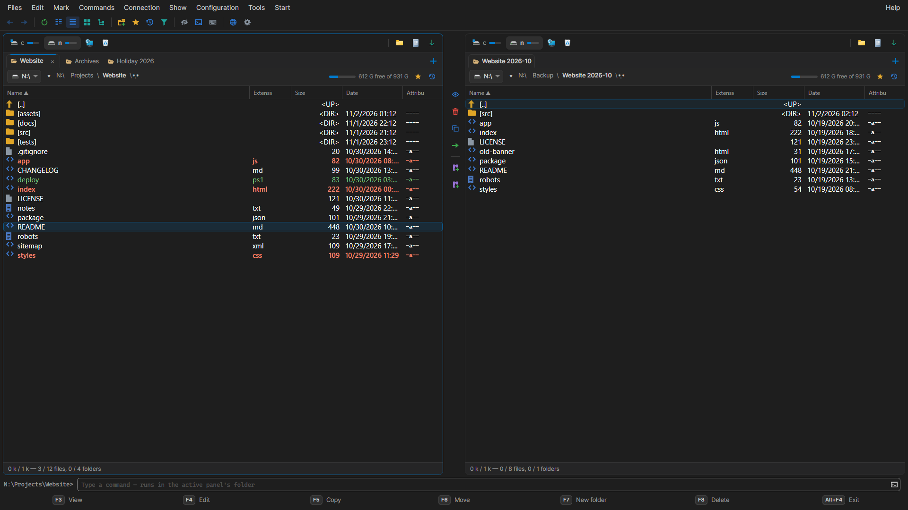 Dark theme |  Ubuntu theme, Files menu |  macOS Dark theme, Files menu |
|  Tree panel and thumbnails | 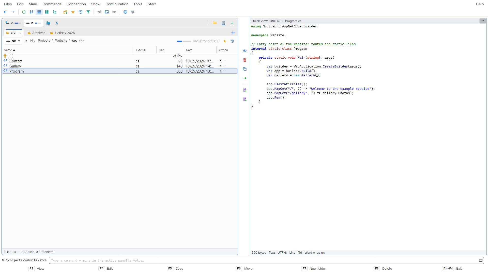 Quick View | 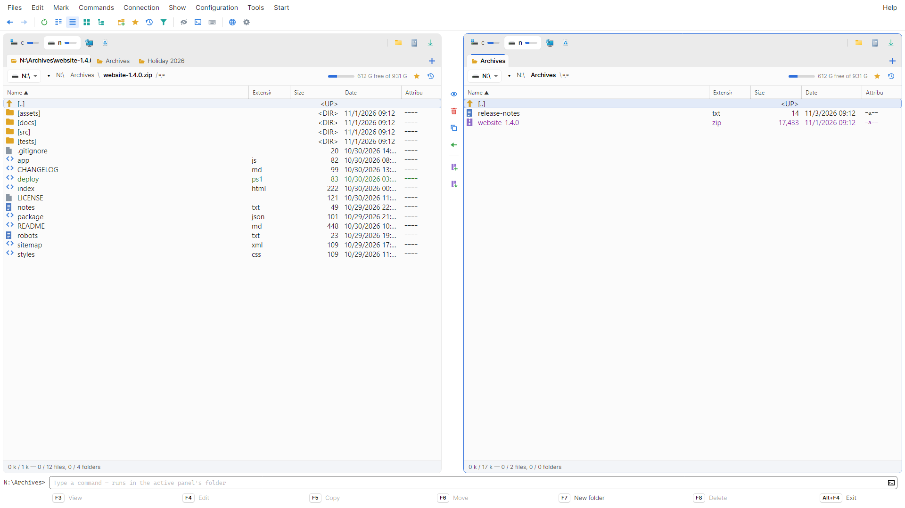 Inside a zip archive |
|  Find files | 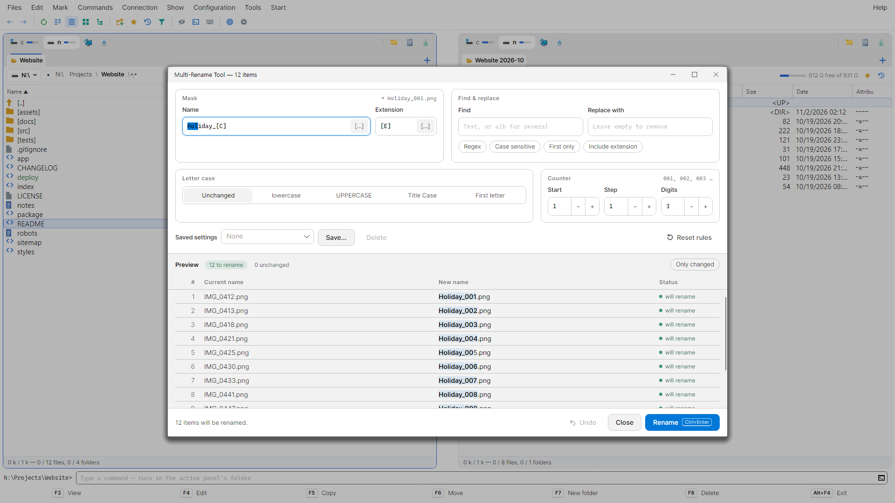 Multi-Rename Tool |  Synchronize directories |
| 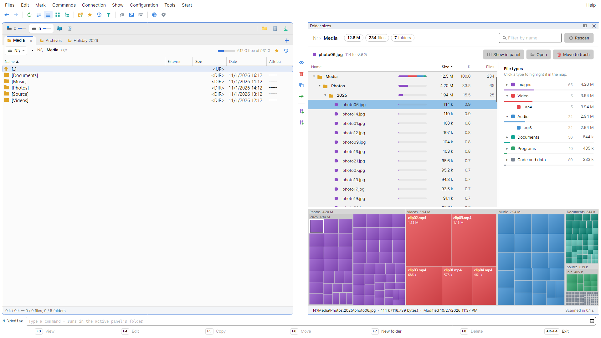 Folder sizes | 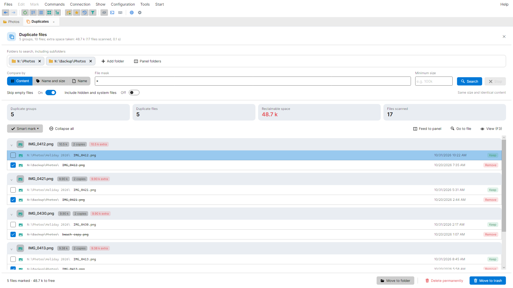 Duplicate files |  Configuration |
|  Compare by content |  Connection manager | 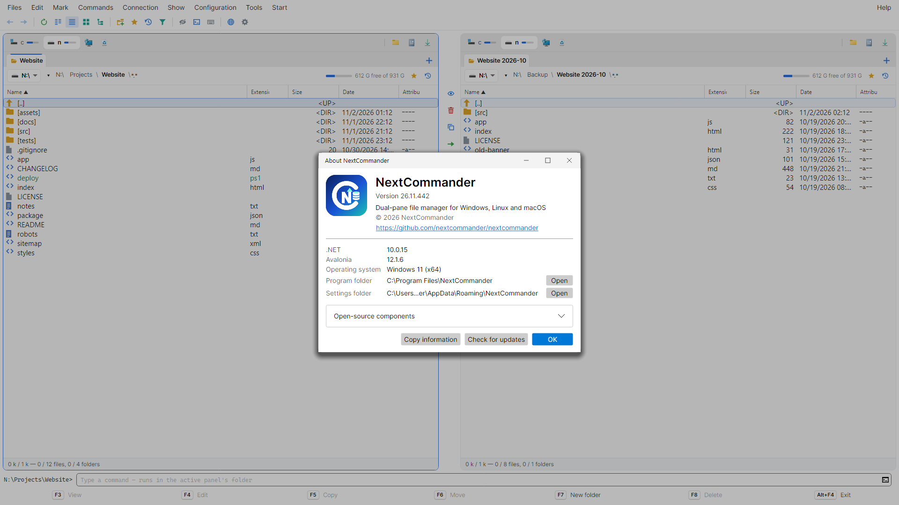 About |
| 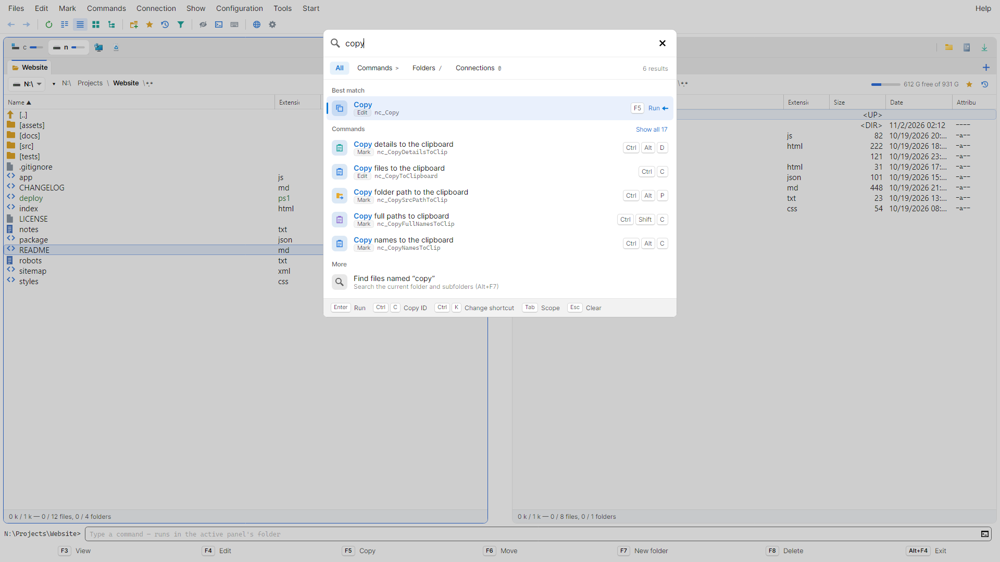 Command palette | 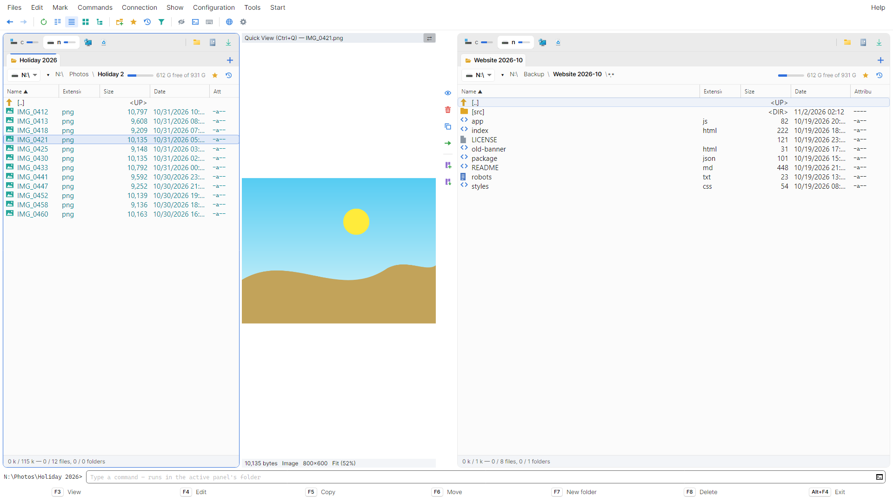 Quick View right of the file list | 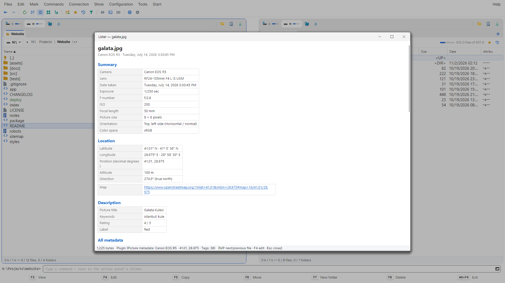 Picture metadata |
| 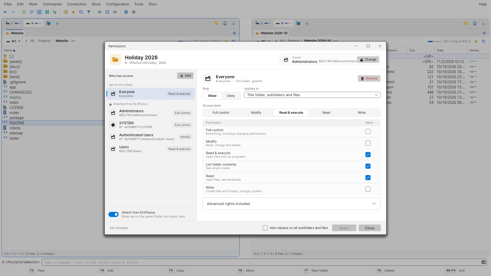 Windows permissions | 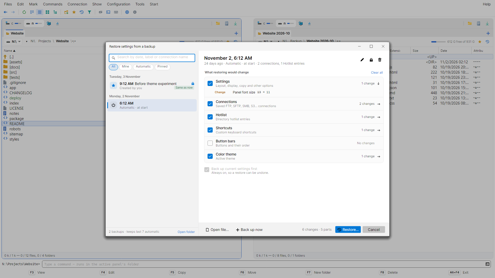 Restore settings from a backup | |

## Guides

- [Getting started](docs/guide/getting-started.md): the window, moving around, selecting, the basic operations,
  right click, drag and drop, administrator rights.
- [Keyboard shortcuts](docs/guide/keyboard-shortcuts.md): the default shortcuts and how to change them.
- [Tools](docs/guide/tools.md): Lister, editor, find files, multi-rename, synchronize, compare, duplicates,
  folder sizes, checksums, terminal and more.
- [Archives](docs/guide/archives.md): opening, packing and unpacking archives.
- [Connections](docs/guide/connections.md): FTP, SFTP, SCP, WebDAV, SMB, S3, Azure, cloud drives, ADB, rclone, RDP, VNC, SSH, Telnet, rsh and serial ports.
- [Configuration](docs/guide/configuration.md): a tour of the Configuration window.
- [Color themes](docs/guide/themes.md): choosing a theme and making your own.
- [Icon packs](docs/guide/icon-packs.md): choosing an icon pack and making your own.
- [Languages](docs/guide/languages.md): choosing the language and translating NextCommander.
- [Macros and scripts](docs/guide/scripts.md): recording macros, JavaScript commands and columns.
- [Plugins](docs/guide/plugins.md): installing and managing plugins, and writing your own (file systems, columns,
  packers, viewers).
- [Settings folder](docs/guide/settings-folder.md): where your settings live, and portable mode.

## Download and start

Packages are made for each platform; see the Releases page.

- **Windows:** a setup program (`-setup.exe`), a zip and a portable zip. The setup program installs for your user
  without administrator rights (or for all users, if you choose), adds a Start menu entry, optionally a desktop icon
  and "Open in NextCommander" in Explorer's folder menu, and can be removed in *Settings > Apps*; your settings
  stay. You can also unpack the zip anywhere and start `NextCommander.exe`.
- **Linux:** a `.deb` (Debian, Ubuntu, Mint ...) and an `.rpm` package (Fedora, RHEL, openSUSE ...): install it
  with `sudo apt install ./NextCommander-<version>-linux-x64.deb` or `sudo dnf install ./NextCommander-<version>-linux-x64.rpm`;
  NextCommander is then in the applications menu and `nextcommander` starts it from a terminal. There is also a
  `.tar.gz` (unpack it and start `NextCommander`) and, when available, an AppImage.
- **macOS:** `NextCommander.app`, also in a zip or a disk image. Drag it to Applications and open it.
  A copy that is not signed by a registered developer may first need *System Settings > Privacy & Security >
  Open Anyway*.

The packages are self-contained: nothing else needs to be installed. The **portable zip** needs no installation
at all and keeps its settings in its own folder, so you can carry it on a USB stick.

Some features use programs you may already have: 7-Zip (to create 7z archives), VLC (to play audio and video
in Lister), and Everything, plocate or Spotlight (optional for search). Without them, only those features are
turned off.

For developers: see [docs/development.md](docs/development.md).
