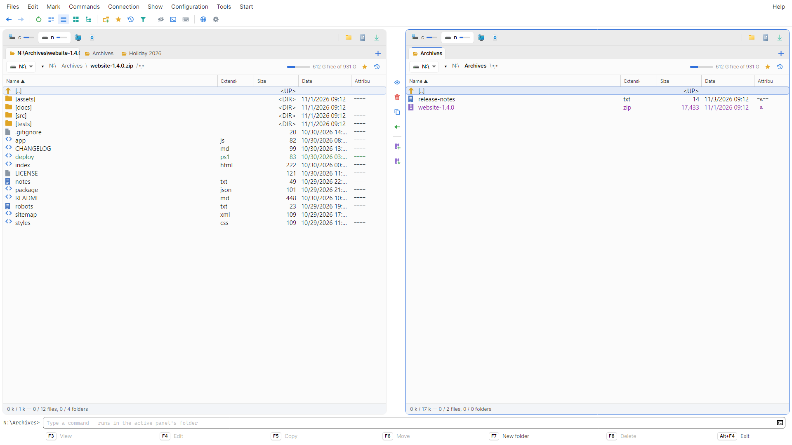
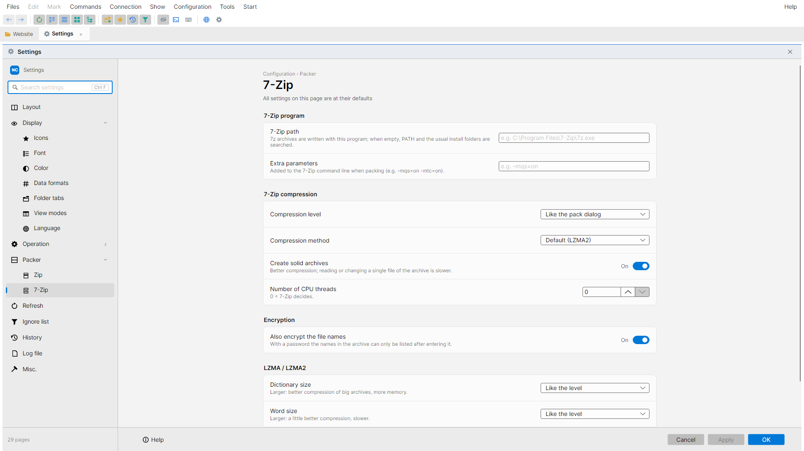

# Archives

[Back to the README](../../README.md)

NextCommander opens archives like folders: you can look inside, view files, copy them out, and change zip files
in place.

## Supported formats

| Format | Open | Change in place | Create (Alt+F5) |
|---|---|---|---|
| zip (also ZIP64, password-protected) | yes | yes | yes |
| 7z | yes | no | with 7-Zip installed |
| rar (including RAR5) | yes | no | no |
| tar, tar.gz, tar.bz2, tar.xz, tar.zst | yes | no | tar, tar.gz, tar.bz2, tar.zst |
| single files: .gz, .bz2, .xz, .zst | yes | no | no |
| disc images: .iso (ISO 9660 with Joliet names, UDF) | yes | no | no |

Plugins can add more formats.

**Split archives:** an archive in volumes (`name.7z.001`, `name.7z.002` ... as 7-Zip's *split into volumes* or a
file splitter writes them; also `name.zip.001` and the other formats) opens from its first volume like a single
archive: Enter on `name.7z.001` shows its contents, read from all volumes in turn (nothing is joined on the disk).
Split archives are read-only. The later volumes do not open by themselves.

**Disc images:** Enter on an `.iso` file shows the files of the disc: CD images by their ISO 9660 file system with
the long (Joliet) names, DVD and Blu-ray images by their UDF file system. Files can be viewed, copied out, searched
and compared like any archive's; the image itself is not changed.

## Opening an archive

- Press **Enter** on an archive to go inside. **Backspace** leaves it, with the cursor on the archive file.
- **Ctrl+Page Down** (*Edit > Open as archive*) also opens files that are zip archives under another name, such
  as `.docx` or `.jar`.
- The path line shows the archive as part of the path, for example `C:\Data\project.zip\src`. You can also type
  such a path.
- Archives inside archives work too.
- Inside an archive, F3 (view), Ctrl+Q (Quick View), copying out and find files work as with normal files.
  Enter on a file opens it with its program.
- If you prefer Enter to open archives with your system's program instead, turn off **Enter opens archives** on
  the *Packer* page of the [Configuration window](configuration.md). Ctrl+Page Down still goes inside.

## Changing zip files

Inside a zip file you can copy files in (F5), delete (F8), rename and move (F6), create folders (F7), and edit a
file with F4 and save it back. The changes are written to the archive in one go; for an archive inside another
archive, the outer one is updated too.

The other formats are read-only.

## Packing (Alt+F5)

*Files > Archive > Pack...* (also **Pack...** in the right-click menu, at the top of Windows Explorer's menu
there too) packs the selected files into a new archive in the other panel. The dialog shows what is packed and its
size at the top, then:

- **Archive**: its path (the folder button picks another folder); the extension follows the format.
- **Format**: cards for ZIP, 7-Zip, TAR, TGZ, TBZ, TZST and packer plugins, each with what it is good for; under
  them what the chosen one can do (encryption, self-extracting, volumes). *Configure packer...* opens the *Packer*
  pages of the configuration. 7-Zip needs the 7-Zip program (see below).
- **Compression**: the level from 0 (store) to 9 (ultra) with its name, and an **estimate** of the archive's size,
  what is saved and how fast it packs. Pictures, media and archives keep their size in the estimate; folders are not
  counted (their size is not known yet). TAR has no level.
- **Options**, each a switch with its settings under it while it is on:
  - **Include subfolders** (off: a selected folder brings its files but not its subfolders), with **Keep folder
    paths inside the archive** (off: every file under its name only);
  - **One archive per selected item**, with **Leave out the base folder when packing folders** (the contents of a
    folder at the top of its archive);
  - **Split into volumes** (7-Zip): parts of 10 MB, 25 MB (e-mail), 100 MB, 700 MB (CD), 4092 MB (FAT32) or any size
    typed (`1.5G`; a plain number is megabytes), with how many parts it makes: `name.7z.001`, `name.7z.002` ... 7-Zip
    (and NextCommander, see [Split archives](#supported-formats)) opens the set from its first part;
  - **Self-extracting archive** (7-Zip, when it has its `7z.sfx` module, as on Windows): a program (`name.exe`) that
    unpacks itself, for computers without 7-Zip; it cannot be split into volumes;
  - **Encrypt with a password**: the password twice (the eye shows it) and its strength; for zip the method (AES-256,
    AES-128 or the weak ZipCrypto that Windows Explorer opens), for 7z whether the file names are encrypted too (the
    defaults come from the *Packer* pages);
  - **Delete originals after packing**: the files are moved into the archive, only when packing succeeds.
- The line at the bottom sums it up (name, format, level, estimated size, the options on); **Pack** (*Pack and
  delete* when the originals go), **Add to queue** and **Cancel**.
- If you pick an existing zip file, the files are added to it.
- An interrupted packing job leaves no half-written archive behind.

### 7z archives

To create 7z archives, install [7-Zip](https://www.7-zip.org/) (on Linux and macOS the `7zz` or `7z`
program). NextCommander finds it automatically; if not, set its location on the *Packer > 7-Zip* page. That
page also sets the compression method, solid archives, the number of CPU threads and the dictionary size, and
shows how much memory packing will need. With a password, 7z archives can also encrypt the file names, so the
contents cannot even be listed without the password.

## Unpacking (Alt+F9)

*Files > Archive > Unpack files...* unpacks the selected archives into the other panel. You can choose which
files to unpack and what to do when a file already exists, as when copying. When an archive has several items at
the top, or when you unpack several archives at once, each archive goes into its own folder named after it.

Files unpacked from an archive that was downloaded from the internet keep the system's "downloaded from the
internet" mark.

## Testing archives (Alt+Shift+F9)

*Files > Archive > Test archives* reads every file of the selected archives to the end and checks it. Damaged
files are listed.

## Passwords

When an archive is encrypted, NextCommander asks for the password, and again if it was wrong. The password is
remembered until you close the program. If a single file is damaged or the password is wrong, you can skip that
file or try again; the rest of the job continues.

## Safety

Archive entries that try to escape the target folder (with `../` or an absolute path) are always unpacked inside
the target folder.
