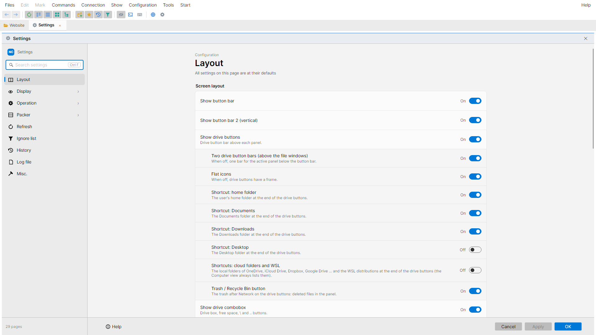
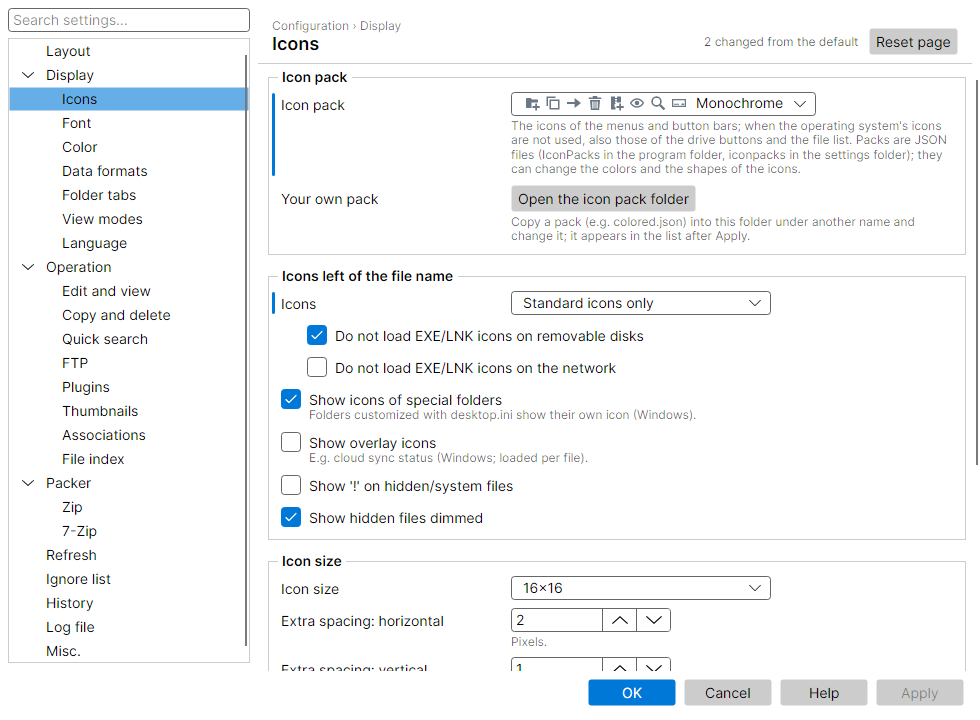
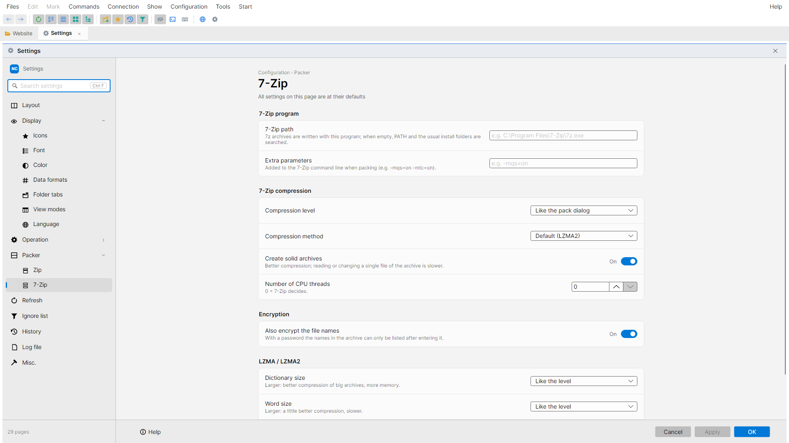

# Configuration

[Back to the README](../../README.md)

Most settings of NextCommander are in the Configuration. Open it with *Configuration > Options...*, Ctrl+Alt+S or
the settings button at the end of the button bar. It opens inside the main window, in place of the two panels, as a
page of its own: a tab strip appears above the panels with the files tab and an **Options** tab, so you can go back to
the files and return to the options without closing them. OK, Cancel, Esc or the tab's `×` close it. Opened from
another dialog (for example *Configure...* in the pack dialog) it is a window of its own.

## Finding your way

- **Pages:** the list on the left shows the pages with their icons. Display, Operation and Packer have sub-pages
  (the arrow shows or hides them). The Configuration opens on the page you used last.
- **Search (Ctrl+F):** type into the box above the pages to find a setting on any page, by its name or its
  description. Accents do not matter, and the search also works with the translated texts. The results are grouped
  by page and can be changed right there; click the title of a group to open its page. Esc clears the search.
- **Where you are:** above the page title you see its place, for example *Configuration › Display*.
- **Changed settings:** under the page title you see how many settings of the page differ from the default, and a
  dot after the name marks each one of them; a dot in the page list marks the pages with such settings.
- **Reset page:** sets every setting of the current page back to its default. Like every other change, this is
  only written when you click Apply or OK.
- **Settings as rows:** each group of a page is a card; a row shows the setting's name and help text on the left and
  its control on the right. On / off settings are switches.
- **Dependent options:** indented rows belong to the switch above them and are grayed out while it is off.

## OK, Apply and Cancel

Changes are not used until you click **Apply** (keeps the Configuration open) or **OK** (applies and closes); the
bottom bar shows how many changes are not applied yet. **Cancel** (or Esc) throws them away. The language changes at once too. A few settings take effect
after a restart; their help text says so.

## Lists

Some settings are lists: color rules (*Display > Color*), editors by file type (*Operation > Edit and view*),
internal associations (*Operation > Associations*), fields under thumbnails by file type (*Operation >
Thumbnails*), the ignore list and the Start menu (*Misc.*). They are edited the same way:

- the entries are on the left; **Add**, **Copy**, **Remove** and **▲ ▼** (the order matters: the first matching
  rule wins),
- the fields of the selected entry are on the right: masks and names as text, colors with a swatch and quick
  colors, programs with a **...** button and quick choices (Built-in, System, Lister ...), check boxes and lists,
- the Start menu also has **Add separator**.

Each entry is checked as you type (for example, a color rule needs a mask and valid colors; an association needs a
mask and a program or command; a Start menu item needs a command). An entry with a mistake is shown in red with a
line telling what is wrong, and **OK and Apply refuse to save while a list has a mistake**, so you cannot break
your settings by accident.

*Operation > Plugins* lists the installed plugins with a check box each: unchecked ones are not loaded after the
next start. *Display > View modes* lists the view modes; **Edit...** opens their editor (columns, the folders that
switch to a mode automatically, colors, commands run on entering and leaving).

## The button bar editor

On the **Layout** page, the *Button bars* group opens the button bar editor for the horizontal and the vertical
bar (also available as *Configuration > Button bar...* and *Configuration > Button bar 2 (vertical)...*, and by
right clicking a bar).

- A preview of the bar is at the top; click a button to edit it, drag it to move it (Ctrl+← / → and Delete
  work there too).
- The buttons above the preview add a button or a separator, move the selected one left or right and delete it;
  the icon size (16 to 48 pixels, separately for each bar) is chosen next to them.
- For each button, under **Action**: the command (a NextCommander command, a program or a folder), parameters and
  start folder; under **Appearance**: the icon (with a preview), a short label shown next to the icon and the
  tooltip. Below them, on Windows, whether the program starts normal, minimized or maximized, and
  **Run as administrator** (the same as a `*` in front of the command).
- On Windows, choosing a file with several icons (exe, dll, icl) lets you pick one of them.
- **Save** keeps the changes, **Cancel** leaves the bar as it was. Changing a single button (right click on the
  bar) opens the same fields in a dialog of their own.

You can also drop a program on the button bar to add it, or right click a button to change, delete or move it.

You never need to know a command's name: wherever a command can be given (the button bar, user commands, the
hotlist, the commands of view modes, internal associations and the Start menu), **Command...** opens the list of
all commands with their icons and descriptions. Type a part of a name or description to find one, then double
click it or press Enter. **...** next to it chooses a program instead, and in the hotlist **Folder...** a folder.

## The pages

| Page | What it covers |
|---|---|
| **Layout** | Which parts of the window are shown: button bars, drive buttons (and the Home, Documents, Downloads and Desktop shortcuts), drive box, folder tabs, path line (clickable parts, opening on hover, history and hotlist buttons), column headers, status bar, command line, function keys, the tree panel, panels above each other, and the button bars themselves. |
| **Display** | Hidden and system files, `[..]` in drive roots, brackets around folder names, sort method, how folders are sorted, the folder tree, tooltips, and automatic folder sizes. |
| Display › **Icons** | The [icon pack](icon-packs.md), which icons the file list shows, overlay icons, dimmed hidden files, icon size and spacing, icons in the main menu, drive icons. |
| Display › **Font** | Fonts and sizes for the file list, the main window, dialogs, Lister and the editor, and the built-in terminal; dialog scaling. |
| Display › **Color** | The [color theme](themes.md), saving your own theme, file type colors and their rules, inverted selection. |
| Display › **Data formats** | Size format, date and time format, separators, column widths, the extension column, header and footer. |
| Display › **Folder tabs** | How tabs look (several rows, same width, title length, icons, locked tabs) and behave (Ctrl+Tab, where new tabs open, double click to close, a filter per tab). |
| Display › **View modes** | Custom column sets and view modes, with their background and tab color. |
| Display › **Language** | The [language](languages.md) of the program. |
| **Operation** | Single window, system tray, progress in the title bar, navigation (single click, path completion, going to the root on drive change), selection with the mouse, the Windows Explorer context menu, what is saved on exit, file comments, updates. |
| Operation › **Edit and view** | Lister options (word wrap, previews, reloading, size limit) and the editor (internal or external, editor per file type). |
| Operation › **Copy and delete** | Recycle bin, confirmations, verify after copying, symbolic links, what to do when a target exists, the Copy dialog on drag and drop, copy buffers and big file mode, using Windows Explorer for copying and deleting (Windows). |
| Operation › **Quick search** | How quick search starts (Ctrl+Alt+letter or letters alone) and matches (beginning, anywhere, fuzzy). |
| Operation › **FTP** | Hidden files, passive mode, retries, transfer type (binary / text), FTP log, active mode ports. |
| Operation › **Proxy** | How web requests (WebDAV, S3, Azure, cloud drives, URL downloads, the update check) reach the internet: the system's proxy, none, or a proxy of your own with user, password and addresses that go directly; a button tries the connection. See [Connections](connections.md#proxy). |
| Operation › **Plugins** | The installed plugins; unchecked ones are not loaded. |
| Operation › **Thumbnails** | Thumbnail size, the disk cache, fields shown under thumbnails, thumbnails of text files and other files. |
| Operation › **Associations** | Internal associations: what Enter does for a file type (a program, Lister, the editor, the system's program or a command). |
| Operation › **File index** | The [file index](tools.md#file-index): on or off, which folders, what to leave out, its state and Rebuild. |
| **Packer** | The default archive format, setting the archive date to its newest file, whether Enter opens archives. |
| Packer › **Zip** | Compression level, UTF-8 file names, the encryption of password-protected zips, temporary files, damaged and partial zips. |
| Packer › **7-Zip** | Where 7-Zip is, compression level and method, solid archives, CPU threads, encrypting file names, dictionary and word size. |
| **Refresh** | Automatic refresh of the file lists (also on network and removable drives), folders left out, refreshing when the window gets the focus. |
| **Ignore list** | Files and folders never shown in the panels. |
| **History** | Length of the folder and command line history, frequently used folders. |
| **Log file** | Whether file operations are logged, where the log goes, which operations, starting a new log file; whether NextCommander writes its own program log. |
| **Misc.** | Ask before closing, the built-in terminal (shell, real terminal), the Start menu, confirmations, a sound when an operation ends, and buttons for *Shortcuts and commands...*, *Hotlist...*, *Column sets...*, *Master password...*, *Export settings...*, *Import settings...* and *Open settings folder*. |

| | |
|---|---|
|  Display › Icons |  Packer › 7-Zip |

## Other configuration commands

The Configuration menu also has:

- **Plugins...:** the loaded plugins and any errors.
- **Dark <-> Normal:** switches between the system colors and the Dark theme.
- **Save position** and **Save settings:** save the window position and all settings now.
- **Commands and shortcuts...:** every command with its shortcut; assign and remove shortcuts
  (see [Keyboard shortcuts](keyboard-shortcuts.md#changing-shortcuts)).
- **Add button to button bar...**, **Add user command (uc_)...**, **Edit Hotlist...**, **Edit column sets...**
- **Color theme:** a quick theme switch.

The **Start** menu holds your own entries for programs and commands; *Start > Change start menu...* edits them.

See also: [Settings folder](settings-folder.md)
