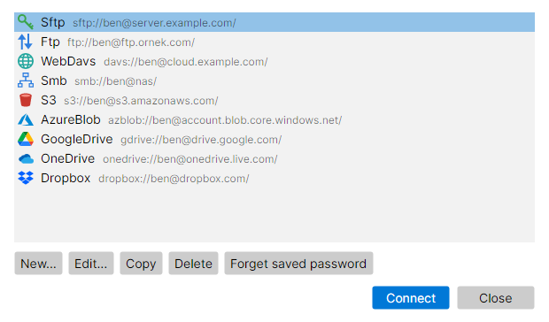

# Connections

[Back to the README](../../README.md)

NextCommander opens servers and cloud storage in the same panels as your local files. Copying, moving,
deleting, renaming, viewing (F3), editing (F4) and opening archives work there too.

Supported types:

| Type | For |
|---|---|
| SFTP (SSH) | Linux and Unix servers, NAS devices |
| FTP / FTPS | FTP servers, with or without encryption (explicit or implicit TLS) |
| WebDAV | Nextcloud, ownCloud, SharePoint, IIS, Apache, NAS devices |
| SMB (Windows share) | Windows shares, Samba, NAS devices; also on Linux and macOS without mounting |
| Amazon S3 / compatible | Amazon S3, MinIO, Cloudflare R2, Wasabi, Backblaze B2, DigitalOcean Spaces |
| Azure Blob Storage | Azure storage accounts |
| Google Drive | Your Drive, "Shared with me" and shared drives |
| OneDrive | Personal and work / school OneDrive, optionally SharePoint sites |
| Dropbox | Your Dropbox |

## The Net menu

- **Connection manager...** (Ctrl+F): your saved connections.
- **New connection:** a submenu with every connection type. The new connection is saved and opened.
- **Saved connections:** opens a saved connection directly.
- **Connect by address...** (Ctrl+N): type an address and connect without saving.
- **Disconnect** (Ctrl+Shift+F): closes the connection of the active panel; the panel goes back to the last local
  folder.
- **Network (machines of the local network)**: see [Network neighborhood](#network-neighborhood).
- **Map network drive...**, **Disconnect network drives...**, **Share current directory...**,
  **Unshare directory...**: the Windows network drive and sharing dialogs (Windows).
- **Download from URL...** and **Download the addresses of a list...**: download files from the web.
- **Show hidden files on FTP**.
- **Master password...**: see [Saved passwords](#saved-passwords-and-the-master-password).

## The connection manager

Each connection is shown with its type's icon. **New...** creates a connection, **Edit...** changes it,
**Copy** duplicates it, **Delete** removes it, and **Forget saved password** removes its stored password.
**Connect** opens it in the active panel.

A connection has a protocol, a server, a port, a user and a start folder, plus options that depend on the type.
The dialog shows hints for each type.

## Typing an address

You can also type an address straight into the path line (Alt+D) or into *Connect by address...*:

| Type | Example |
|---|---|
| SFTP | `sftp://user@server.example.com:2222/home/user` |
| FTP | `ftp://user@ftp.example.com/` |
| WebDAV | `davs://user@cloud.example.com/remote.php/dav/files/user` (`dav://` without encryption) |
| SMB | `smb://DOMAIN;user@server/share` |
| S3 | `s3://ACCESS_KEY@s3.eu-central-1.amazonaws.com/bucket/folder` |
| Azure Blob | `azblob://account@account.blob.core.windows.net/container` |

## Notes per type

### SFTP
Log in with a password or with a private key file (which may have its own passphrase).

### FTP / FTPS
Choose plain FTP, FTPS with explicit TLS, or FTPS with implicit TLS (port 990), and passive or active mode.
More FTP options (transfer type, retries, a log file) are on the *Operation > FTP* page of the
[Configuration window](configuration.md).

### WebDAV
The start folder is the server's WebDAV path, for example `/remote.php/dav/files/<user>` for Nextcloud.
Without a user name the connection is anonymous. File times are kept when copying, where the server allows it.

### SMB
The user is `DOMAIN\user` or just `user`; leave it empty for a guest login. The root lists the machine's
shares.

### Amazon S3 and compatible
- **Server:** the S3 endpoint, for example `s3.eu-central-1.amazonaws.com` or your MinIO server.
- **User:** the access key id. The secret key is asked as the password and can be saved.
- Or choose an **AWS profile**: the keys are then read from your AWS command line settings, and no password is
  asked.
- The root lists your buckets; F7 there creates a bucket. Folders are formed by `/` in the object names.
- Options: the region (usually found automatically), virtual-hosted addresses, and "No TLS" for a local MinIO.

### Azure Blob Storage
The user is the storage account; the password is the account key or a SAS token. The root lists the containers.

### Google Drive, OneDrive and Dropbox
- The first time you connect, your browser opens the service's own sign-in page. With
  **Remember the sign-in** on, you only sign in once.
- The **account name** is just a label (for example `personal` or `work`) to tell several accounts of the same
  service apart.
- **You need your own application id.** NextCommander has no id of its own, so you register a free application
  with the service once and enter its id in the connection. The connection dialog shows the steps:
  - **Google Drive:** in the Google Cloud console, create a project, enable the Google Drive API, set up the
    OAuth consent screen (add your own account as a test user), and create an OAuth client id of type
    *Desktop app*. Enter the client id and the client secret.
  - **OneDrive:** in Microsoft Entra, create an app registration for personal and organizational accounts,
    add the *Mobile and desktop applications* platform with the redirect address `http://localhost`, and give it
    the `Files.ReadWrite` and `offline_access` permissions (for SharePoint also `Files.ReadWrite.All` and
    `Sites.Read.All`). Enter the application (client) id.
  - **Dropbox:** in the Dropbox App Console, create an app with *Scoped access* and *Full Dropbox*, allow the
    `files.metadata.read/write` and `files.content.read/write` permissions, and add the redirect address
    `http://localhost:53682/`. Enter the app key.
- Deleted files go to the service's own trash.
- **Google Drive:** the root shows My Drive plus the folders **Shared with me** and **Shared drives**.
  Google Docs, Sheets and Slides appear as `.docx`, `.xlsx` and `.pptx` files (Drawings as `.pdf`) and are
  converted when you copy or view them; they are read-only.
- **OneDrive:** with *Show SharePoint sites too* (work or school accounts), a `SharePoint` folder at the root
  lists your organization's sites and their document libraries.

## Security

The first time you connect to an SFTP server, or to a server using an encrypted (TLS) connection, NextCommander
shows its key or certificate fingerprint and asks you to trust it. Compare it with what the server's
administrator gives you. If the key changes later, you get a clear warning, because this can mean someone is
intercepting the connection.

## Saved passwords and the master password

- When you log in for the first time you can choose to save the password. It is saved only after a successful
  login, and asked again if it turns out to be wrong.
- Saved passwords are stored encrypted in the [settings folder](settings-folder.md).
- With a **master password** (*Net > Master password...*), the passwords are encrypted with a key made from it.
  It is asked once per session. Leave the new master password empty to remove it.
- Without a master password, the passwords are protected with a key tied to your user account on this computer.

## Network neighborhood

*Net > Network (machines of the local network)*, or `\` in the drive box, shows the machines of your local network
as folders.

- NextCommander looks for known neighbors, devices that announce themselves (NAS, Mac, Linux), and machines
  that answer on the SFTP, FTP, SMB and web ports. Ctrl+R scans again.
- Inside a machine you see its services (SFTP, FTP, WebDAV) and, on Windows, its shared folders. On Linux and
  macOS an "SMB" entry lists the shares.
- Opening a service connects to it: with your saved connection for that machine if there is one, otherwise you
  are asked for a user name and password.
- *Net > Show admin shares* also lists hidden administrative shares such as `C$` (Windows).
- This view is for browsing only; you cannot copy into it or delete from it.

## Proxy

WebDAV, S3, Azure Blob, Google Drive, OneDrive, Dropbox (also their sign-in), URL downloads and the update check
go through the proxy chosen on the *Operation > Proxy* page of the [Configuration window](configuration.md):

- **Use the system's proxy** (default): the proxy of Windows' Internet settings, the macOS network settings, or the
  `http_proxy` / `https_proxy` / `no_proxy` variables on Linux.
- **No proxy**: always directly, even when the system has a proxy.
- **Use this proxy**: an HTTP or SOCKS5 proxy with its server and port (or a full address such as
  `http://proxy:3128` or `socks5://proxy:1080`), a user name and password when the proxy asks for one (the password
  is kept encrypted with your other saved passwords), and the addresses that go directly (`localhost; *.local;
  10.*`; local names without a dot too, if you like). With **Also for FTP, SFTP and SMB connections** (on by
  default) these go through it as well: FTP (also its data connections) and SFTP with their own proxy support, SMB
  through a local port that leads to the proxy. An HTTP proxy has to allow CONNECT to their ports (21, 22, 445 ...);
  a SOCKS5 proxy takes any connection.

**Test** requests an address with the settings as they are in the window and tells whether it went through the
proxy, the answer and how long it took. Connections that are already open keep their way until they connect again.
The system's proxy is used for web requests only.

## Downloading from the web

- If the clipboard holds web addresses, Ctrl+V in a panel offers to download them.
- *Net > Download from URL...* downloads one address, *Download the addresses of a list...* all addresses in a
  text file.
- An interrupted download continues where it stopped. Downloaded files get the system's "downloaded from the
  internet" mark.
