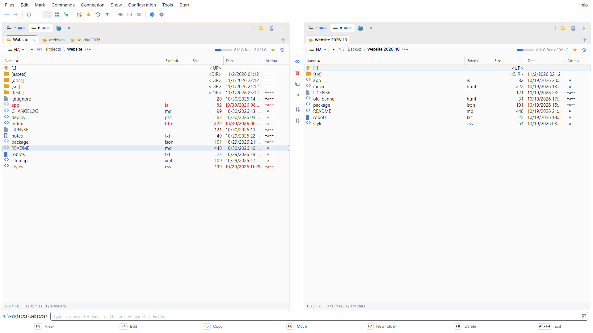
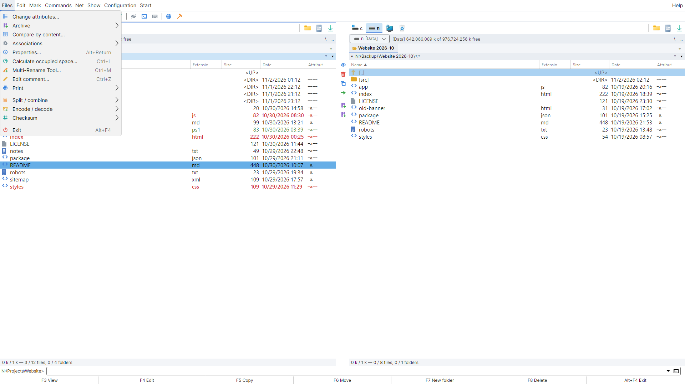
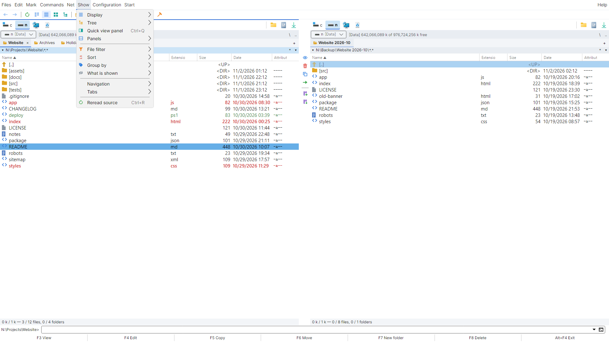
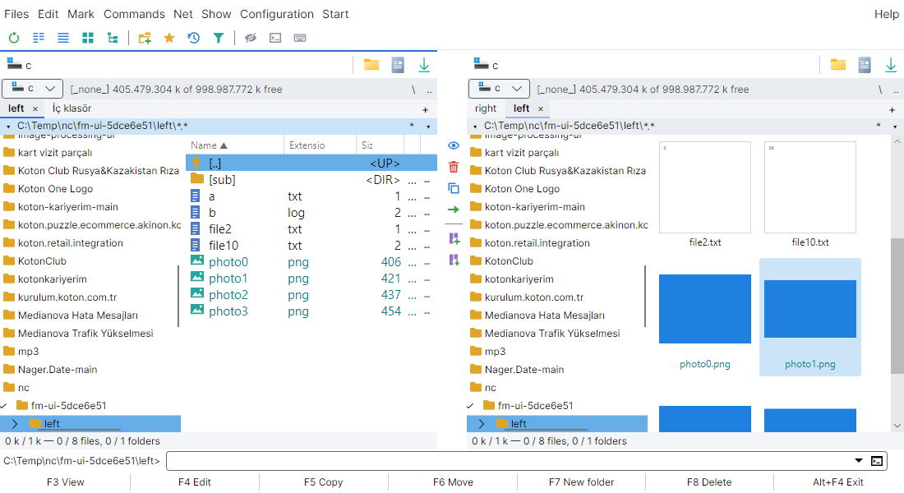
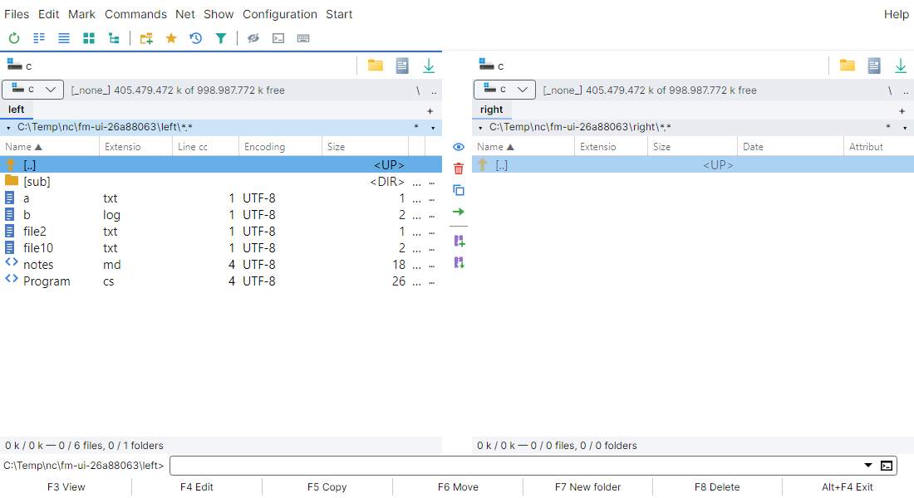

# Getting started

[Back to the README](../../README.md)

This guide explains the main window, how to move around, how to select files and how to do the everyday
file operations.

## The window

From top to bottom:

- **Menu bar:** Files, Edit, Mark, Commands, Net, Show, Configuration, Start, and Help on the right.
- **Button bar:** one-click buttons for common commands (next to the system terminal, the internal terminal opens
  maximized; at the end, the connection manager and the settings). Right click it to add, change or remove buttons,
  or use *Configuration > Button bar...*. A second, vertical button bar sits between the two panels.
- **Page tabs:** while the options or a maximized internal terminal are open next to the file panels, a tab strip
  shows the pages: the files tab (the folder of the active panel, with the icon of its place: a user folder such as
  Downloads with the system's icon, a drive, a server's product mark, an archive ...), **Options** and **Terminal**.
  A click switches; `nc_SwitchWorkspaceTab` goes to the next page.
- **Drive buttons:** one button per drive. At the right end there are shortcuts to your home folder,
  Documents and Downloads (Desktop can be turned on in *Configuration > Options > Layout*). When you plug in or
  remove a USB disk, a memory card or a phone, the drives update by themselves within a second or two;
  a panel showing a removed drive moves to the nearest folder that still exists (on Windows, your home folder).
- **Phones and cameras:** a phone connected over USB in "File transfer" mode (MTP) gets a drive button with a phone
  icon. Its first level is the phone's storages (internal storage, SD card); copy, move, new folder, rename and
  delete work as on a disk. Unlock the phone and allow file transfer when it asks ("Allow access to phone data?"):
  until then the phone shows no storage, and NextCommander opens it again a few times while you answer before it
  says so. On Linux the phone appears as the
  folder the desktop (GNOME) mounts for it; on other desktops (KDE ...) and on macOS NextCommander talks to it itself
  through libmtp (Linux: the package `libmtp`, installed with NextCommander's package; macOS: it comes inside the
  app). On macOS close Photos, Image Capture and Android File Transfer first: the first program
  that takes the phone keeps it.
- **Drive box:** the current drive with its label and free space, plus the `\` (root) and `..` (parent folder)
  buttons. Alt+F1 and Alt+F2 open the drive list of the left and right panel. The list shows each drive's label, or
  what it is ("Local Disk", "Removable Disk", "Network Drive" ...). Below the drives: `+` Computer, `\` Network and
  `×` the trash. The `+` entry lists the drives in the panel (Computer view): the drives in letter order, then external
  disks, then phones, then the trash.
- **Drive icons** are the system's own wherever drives appear (drive buttons, drive box, Computer view): Explorer's on
  Windows (Recycle Bin, This PC and Network too), the desktop's icon theme on Linux, Finder's on macOS. *Configuration >
  Options > Icons* can turn them off (built-in icons then).
- **Right click on a drive** (drive buttons, drive list, Computer view) opens the system's menu of that drive:
  on Windows Explorer's (open, eject, format, properties ...). Shift+right click, or other systems: a short menu of the
  application.
- **Trash / Recycle Bin:** the trash button at the end of the drive bar (it can be hidden in *Configuration > Options >
  Layout*), the `×` entry of the drive box and the end of the Computer view show the
  deleted files in the panel, under their original names with the deletion date. Copy them out (F5), move them
  somewhere (F6), put them back where they were (*Restore from the trash* in the right-click menu), delete them for
  good (F8) or empty the trash (the right-click menu, or the trash button's). On macOS items cannot be put back (Finder keeps their places to
  itself), and reading the Trash needs Full Disk Access.
- **Folder tabs:** each panel can have several tabs. The `+` button opens a new one.
- **Path line:** the current folder. Click a part of the path to go there, click the small arrow between
  parts to pick a subfolder, or click the empty area (or press Alt+D) to type a path.
- **The two panels:** the file lists. The active panel has a highlighted path line; Tab switches between the
  panels. Folders are shown as `[name]`, and `[..]` goes up one level.
- **Status line:** under each panel, the size and count of the selected and all files.
- **Command line:** type a command and press Enter. It runs in the active panel's folder.
- **Function key bar:** F3 View, F4 Edit, F5 Copy, F6 Move, F7 New folder, F8 Delete, Alt+F4 Exit.
  You can click these buttons or press the keys.

Each of these parts can be turned on and off in *Configuration > Options > Layout*.

The Files menu gathers related commands in submenus (Archive, Associations, Print, Split / combine,
Encode / decode, Checksum):

The Show menu holds the views, the tree, Quick View, panel arrangement, file filters, sorting and what is
shown:

## Moving around

- **Up / Down, Page Up / Page Down, Home / End** move the cursor.
- **Enter** opens the folder (or archive) under the cursor, or opens a file with its program.
- **Backspace** or **Ctrl+Page Up** goes to the parent folder; **Ctrl+Backspace** goes to the root.
- **Tab** switches to the other panel.
- **Alt+Left / Alt+Right** go back and forward; **Alt+Down** shows the folder history, and
  **Alt+Shift+Down** your most frequently used folders.
- **Ctrl+D** opens the **Hotlist**, your list of favorite folders. *Show > Navigation > Add this folder to the
  Hotlist...* adds the current folder.
- **Ctrl+Left / Ctrl+Right** opens the folder under the cursor in the left or right panel.
- **Ctrl+U** swaps the two panels. *Commands > Target = Source* makes the other panel show the same folder.
- **Quick search:** hold Ctrl+Alt and type the first letters of a name to jump to it. Up / Down jump to the
  previous / next match. You can make letters alone start the search in
  *Configuration > Options > Operation > Quick search*.
- **Quick filter (Ctrl+S):** type to show only matching files; **Ctrl+Y** clears the filter.

### Tabs

- **Ctrl+T** opens a new tab, **Ctrl+W** closes it, **Ctrl+Shift+T** reopens the last closed tab.
- **Ctrl+Tab / Ctrl+Shift+Tab** switch tabs; **Ctrl+1 … Ctrl+9** jump to a tab.
- **Ctrl+Up** opens the folder under the cursor in a new tab.
- Drag a tab to move it. A middle click closes it.
- *Show > Tabs* has more: lock a tab (folder changes then open in a new tab), rename it, close duplicate tabs,
  and save or load a set of tabs.

### Views

- **Ctrl+F1** brief view (names in several columns), **Ctrl+F2** full view (with size, date and attributes),
  **Ctrl+Shift+F1** thumbnails (Ctrl+mouse wheel changes their size).
- **Ctrl+F8** shows a folder tree inside the panel.
- **Shift+F1** chooses a custom column set, for example with photo or music details.
  Column sets can also switch automatically by folder (*Show > Display > Custom view modes*).
- **Ctrl+F3 … Ctrl+F6** sort by name, extension, time and size. Click a column header to sort by it.
- **Show > Group by** shows the files in groups: by **type** (documents, images, archives ...), by **date** (today,
  yesterday, earlier this week ... older years) or by the **first letter** of the name; folders come first. A
  group's header shows how many files it has; Enter or a double click on it folds the group away and opens it
  again, Insert / Space on it marks all its files. Each tab keeps its own grouping; *No groups* turns it off.
- **Ctrl+H** shows or hides hidden and system files.

A custom column set with line count and encoding columns in the left panel:

## Selecting files

Most operations work on the selected (marked) files, or on the file under the cursor when nothing is selected.

- **Insert** or **Space** marks the file under the cursor and moves down. Space on a folder also calculates its
  size.
- **Shift+Up / Shift+Down** mark while moving.
- **Ctrl+A** (or **Ctrl+Num +**) selects all; **Ctrl+Num -** unselects all.
- **Num +** selects a group by a pattern such as `*.jpg`, **Num -** unselects a group, **Num \*** inverts the
  selection.
- **Alt+Num +** selects all files with the same extension as the file under the cursor.
- **Num /** restores the previous selection.
- With the mouse: Ctrl+click and Shift+click, or drag in an empty area to draw a selection frame.
- By default the **right mouse button marks** files (as in Norton Commander); hold it for a moment to open the
  context menu. This can be turned off in *Configuration > Options > Operation*.

The Mark menu also saves and loads selections, copies file names to the clipboard, and compares the two
panels (*Compare folders*, Shift+F2), which marks the files missing or newer on the other side.

## Basic operations

| Key | What it does |
|---|---|
| F3 | View the file in Lister |
| F4 | Edit the file; Shift+F4 creates a new file |
| F5 | Copy to the other panel |
| F6 | Move to the other panel (or rename) |
| Shift+F6 | Rename in place: the name is edited in the list; Enter renames, Esc gives up, ↑ / ↓ rename and go on to the previous / next file. Clicking once more on the name of the file under the cursor does the same (a moment after the click, so a double click still opens) |
| F7 | New folder (`a/b/c` creates nested folders); Shift+F7 creates it in the other panel |
| F8 or Delete | Delete (to the recycle bin / trash) |
| Shift+Delete | Delete permanently |
| Alt+F4 | Exit |

When you copy or move, a dialog shows the target. You can change the target
folder, or type a new name or a pattern like `*.bak` to rename while copying.

- **Target:** the drop-down lists your kept targets, the other panel and recent targets. **+ F7** (or F7) opens a
  menu: *Add current dir (Position=0)* keeps the target at the top of the list (*Remove current dir* takes it out
  again), and *Directory hotlist* (also Ctrl+D) takes a folder of the hotlist as the target. **Tree** (F10)
  chooses a folder of the target panel from a tree.
- **Only files of this type:** a file filter (`*.jpg *.png`, `| thumbs\` to leave out); the drop-down lists the
  filters used before. **+ F8** (or F8) opens *Find files* over the dialog, searching in the selected folders (or the
  source folder): search by any criteria, then click **Copy the results**. The files found are then copied instead of
  the selection, keeping their folders below the source folder; the filter box shows how many there are. Typing a
  filter again goes back to the selection. The same line shows the size and the number of files and folders
  (folders are counted in the background).
- **Copy NTFS permissions** (Windows) and **Verify** (compare the copy with the original).
- **OK** copies at once, **F2 Queue** adds the files to the queue. A right click on OK or F2 Queue moves instead of
  copying (and copies in the Move dialog).
- **Options >>** opens the advanced options: what to do when a target file exists (ask, overwrite all, skip all,
  overwrite older, rename the copy or the target, copy only larger or only smaller files, rename older targets) (the disk button keeps the
  answer as the default, the pin opens the dialog always with these options), skipping files that cannot be read,
  overwriting read only / hidden / system files without asking, and copying into every folder marked in the
  target panel.

Long jobs show a progress window (with pause and a speed limit). The **queue** window of F2 Queue copies one item
after the other: it shows the file being copied with the progress of the file and of the item, the waiting items
one a line, **+** (queue the files selected in the active panel), **-** (take the selected item out),
**Start** / **Pause**, and a **Speed limit** in kB/s. *Commands > Background transfer manager...* lists every
running job.

### The Edit menu

The Edit menu collects the everyday file commands in one place, with their keys: View, Edit, New file,
Open with..., Open as archive, Copy, Move / rename, Rename in place, New folder, New folder in target panel,
Delete, Delete permanently, Copy to clipboard, Cut to clipboard, Paste from clipboard and
Show list file in panel....

### Clipboard

Ctrl+C, Ctrl+X and Ctrl+V copy, cut and paste files, and work together with your system's file manager.
If the clipboard holds a web address, Ctrl+V offers to download it.

## Right click

- **On Windows**, the context menu of local files is Windows Explorer's own menu, with "Open with",
  "Send to", sharing and the entries of your installed programs. **Shift+right click** opens NextCommander's own
  menu instead. You can turn the Explorer menu off in *Configuration > Options > Operation*
  ("Show the system's context menu").
- **On Linux and macOS**, and for files in archives or on servers, NextCommander's own menu opens.

Remember that with the default settings a short right click marks the file; hold the button to open the menu.
On macOS a right click with the mouse (two fingers, or Ctrl+click) always opens the menu, and Cmd+click marks.

## Drag and drop

- Drag files to the other panel to copy them; hold **Shift** to move them instead.
- Drop on a folder to copy into it, or on a part of the path line to copy into that folder.
- Drag files to and from other programs and your system's file manager.
- Drop a file on the F8 Delete button to delete it.
- Drop a program on the button bar to make a button for it.

## The command line

Anything you type while a panel has the focus goes to the command line. Press Enter to run it in the current
folder; Shift+Enter runs it in a terminal window that stays open.

- `cd path` changes the folder; `md name` creates a folder.
- Tab completes file and folder names.
- Ctrl+Enter adds the name under the cursor to the command line, Ctrl+Shift+Enter adds the full path.
- The arrow at the end of the line (or Alt+F8) lists your last commands.
- The terminal button at the end opens the [built-in terminal](tools.md#built-in-terminal) (Ctrl+`).

## Opening files from outside

You can start NextCommander with a folder or a file: `NextCommander C:\Projects` or
`NextCommander report.txt`. If NextCommander is already running, the folder opens in a new tab of the running
window, and a file opens in its folder with the cursor on it. `NextCommander --lister file` opens only the viewer
and `NextCommander --edit file` only the editor.

## Administrator rights

Some files and folders can only be changed with administrator (root) rights, for example program folders or
files of another user. When copying, moving, deleting, renaming or creating a folder fails because access was
denied, NextCommander asks whether to try again with administrator rights. If you agree, your system shows its
own permission dialog:

- **Windows:** the User Account Control (UAC) prompt.
- **Linux:** the desktop's password prompt (polkit).
- **macOS:** the system's authorization dialog.

Only that one operation runs with the higher rights; NextCommander itself keeps running as you.

On a button bar button, a `*` in front of a program name runs that program as administrator.

## Next steps

- [Keyboard shortcuts](keyboard-shortcuts.md)
- [Tools](tools.md)
- [Configuration](configuration.md)
