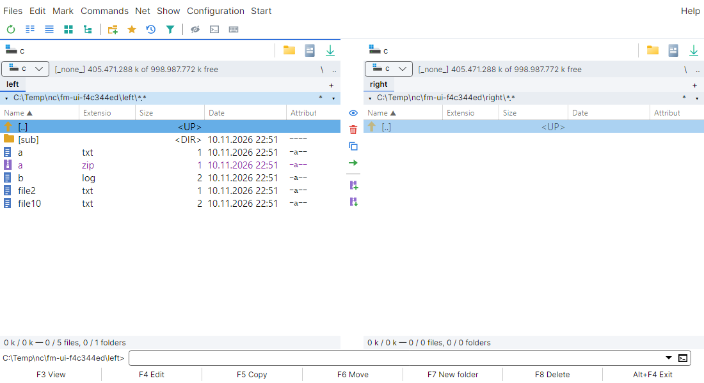
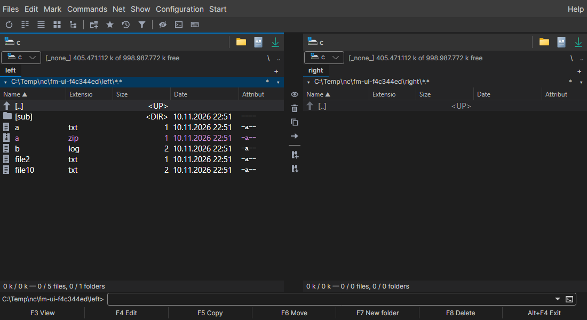
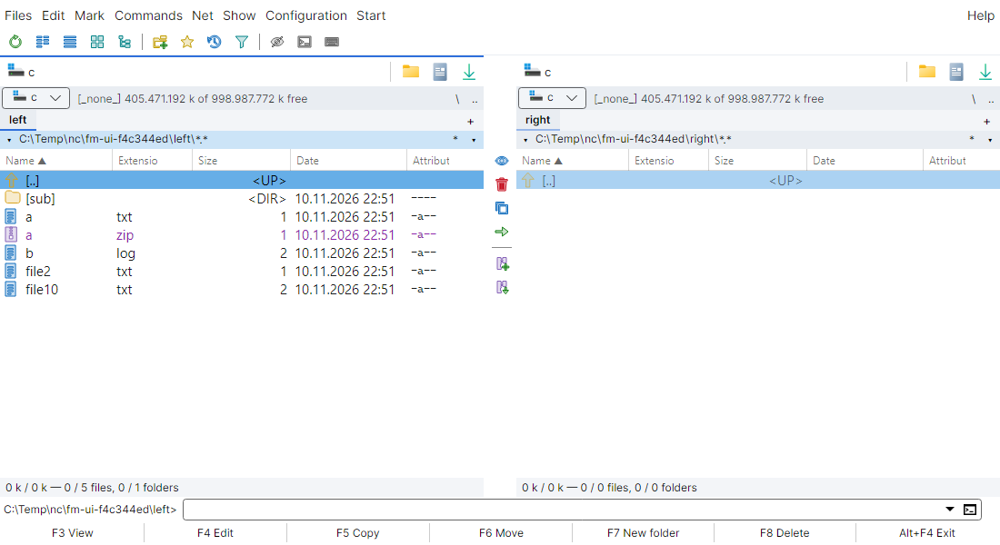
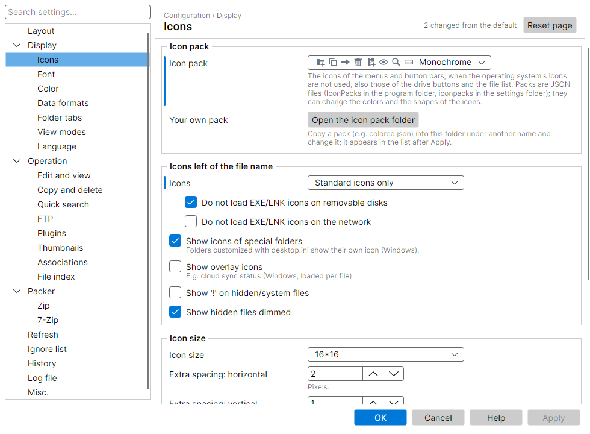

# Icon packs

[Back to the README](../../README.md)

An icon pack decides how the icons of NextCommander look: the menus, the button bars, the drive buttons, and the
file list icons (when the system's own file icons are not used).

## Choosing a pack

Open *Configuration > Options > Display > Icons* and choose an **Icon pack**. Three packs come with
NextCommander:

| Pack | Look |
|---|---|
| Colored | The default. Filled, colorful icons. |
| Monochrome | Every icon in one color, taken from the color theme. Suits both light and dark themes. |
| Fluent | The colors of Windows 11: a thin outline over a light fill, folders and files with rounded corners. |

| | | |
|---|---|---|
|  Colored |  Monochrome (with the Dark theme) |  Fluent |

The same page also chooses which icons the file list shows (for example the system's icons or the standard
ones only), the icon size, and whether the main menu shows icons at all.

## Making your own pack

1. On the *Display > Icons* page, choose the pack to start from.
2. Click **New icon pack...** for a new pack made from it, or **Edit icon pack...** to change it.
3. In the icon pack editor:
   - **Name** and **Icons**: the name in the list and how the icons are drawn: *Colored* (filled, in color),
     *One color* (everything in one color; with **The icon color of the color theme** it follows the theme) or
     *Outline (Fluent)* (a thin outline over a light fill).
   - **Small marks at the corner of menu icons**: the plus, cross and arrow marks.
   - **Colors of the menu and button bar icons**: the eight colors (blue, green, red ...) the menu icons are drawn
     with.
   - **Colors of the file type icons**: folders, archives, images, programs and the other file kinds.
   - **Default** next to a color gives back its built-in color. The **Preview** row shows the icons as you change
     them.
4. Click **Save**. The pack is chosen in the list; click Apply or OK.

Your packs are saved in the `iconpacks` folder of the [settings folder](settings-folder.md). Editing a pack that
comes with NextCommander saves your own copy there. A pack made from another one keeps its icon shapes (for
example the rounded folders of Fluent).
