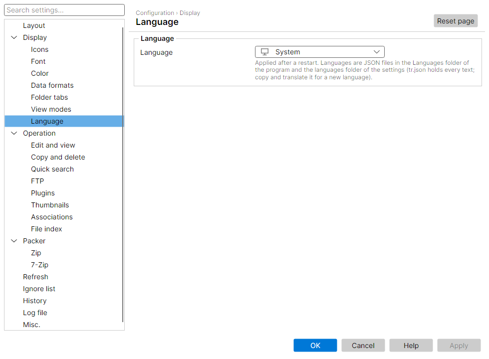
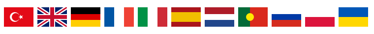

# Languages

[Back to the README](../../README.md)

NextCommander comes in English, Turkish (Türkçe), German (Deutsch), Spanish (Español), French (Français) and Chinese
(中文（简体）, Simplified). You can add any other language with a single text file.

## Choosing the language

Open *Configuration > Options > Display > Language* and pick a language from the list. Each language is shown
with its country's flag; **System** has a monitor icon. The new language is used after you restart NextCommander.

**System** (the default) follows your operating system's language: if NextCommander has a language file for it,
that language is used, otherwise English. On a Turkish system you get Turkish, on a German one German, and so on.

Chinese needs a font with Chinese characters; Windows and macOS have one, on Linux install for example
`fonts-noto-cjk` (Debian, Ubuntu) or `google-noto-sans-cjk-fonts` (Fedora).

Some of the flags the list can show:

## Translating NextCommander into a new language

1. Open *Configuration > Options > Display > Language* and click **Translate...**.
2. In the language editor, choose **New language...** and type the language's code (two or three small letters,
   for example `it` for Italian or `pt-BR` for Brazilian Portuguese) and its name in that language (for example
   *Italiano*). To improve a translation, choose that language instead.
3. Every text of NextCommander is listed in English on the left with a box for the translation on the right.
   **Search** finds a text, and **Only texts not translated yet** hides the ones done. The count shows how many
   texts are translated.
4. Click **Save**. The language is chosen on the Language page; click Apply and restart NextCommander.

The translation is saved as `languages/<code>.json` in the [settings folder](settings-folder.md). A language you
save there is used instead of the shipped one with the same code, so you can also improve the shipped
translations this way. Saving is refused while a translation lacks a placeholder of the English text (see below).

### Tips

- **The small gray name under each text tells you where it is used.** `Menu.nc_...` are menu items, `Command.nc_...`
  are command descriptions (in the command list and button tooltips), `Settings.<Page>.<Setting>` are labels in the
  Configuration window (with `.Description` for the help text below them), and other names start with the window
  that uses the text, for example `CopyDialog.` or `ListerView.`.
- **Keep the placeholders.** `{0}`, `{1}` and so on stand for parts that change, such as a file name or a
  number. Keep them in your translation; you may move them to where they fit in your sentence. `{0:N0}` and
  similar forms are numbers or dates with a format; copy them as they are.
- **Untranslated texts stay in English.** You can translate a part, try it, and continue later.
- File and folder names are never translated.

After a NextCommander update, open your language in the editor and tick **Only texts not translated yet** to find
the texts that were added.
