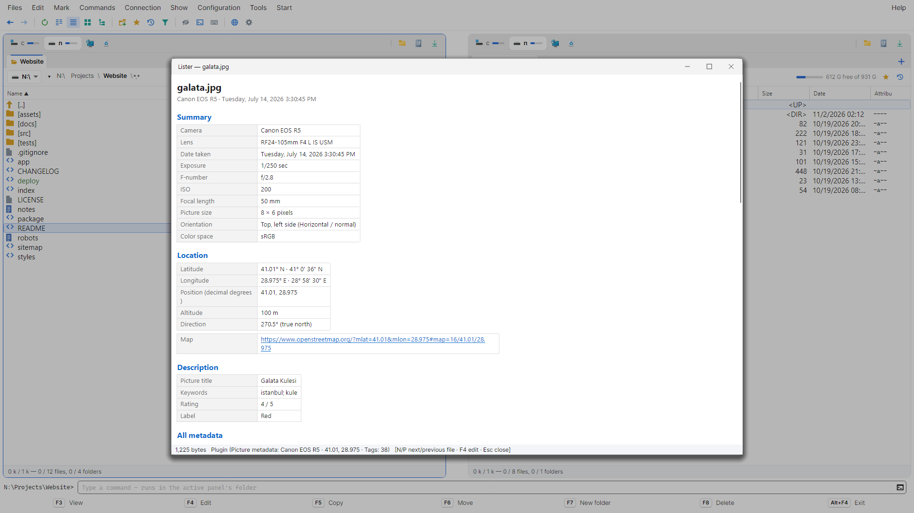

# Plugins

[Back to the README](../../README.md)

A plugin is a .NET assembly that NextCommander loads at start. It can add:

| What | Interface | Where it shows up |
|---|---|---|
| A file system | `IFileSystemProvider` | Paths with the plugin's scheme (`hello://host/folder`) open in a panel; copy, move, delete, view and edit work across it and every other file system. |
| A place to start | `IPluginEntryPoint` (on the file system) | An entry in the **Plugins** menu of the button bar. |
| A place for the current folder | `IPluginFolderEntry` (on the file system) | An entry at the top of the **Plugins** menu while the active panel's folder fits (e.g. *Git history* in a repository). |
| Actions for the current folder | `IPluginFolderActions` (on the file system) | Entries in the **Plugins** menu and at the top of the file list's own menu for the active panel's folder and its selection (e.g. Git's *Stage* and *Commit...*); they can ask through `IPluginDialogs`. |
| A way back up | `IOriginProvider` (on the file system) | ".." from the file system's root goes back to the folder it came from. |
| An archive format to read | `IContainerProvider` (on the file system) | Enter / Ctrl+PgDn on such a file opens it like a folder. |
| Columns | `IColumnProvider` | *Show > Display > Custom view modes > Edit view modes...*: the plugin's fields can be added to a view mode. |
| An archive format to write | `IPackerPlugin` | A packer in the Pack dialog (Alt+F5). |
| A viewer | `IViewerPlugin` | The Lister (F3) shows files it wants (key 6). |
| Actions for its entries | `IPluginEntryActions` (on the file system) | At the top of the file list's right click menu (start a container ...). |
| Settings | `IConfigurablePlugin` | A group on the Plugins page of the configuration; **Configure...** in the plugins window. |

The rclone, Git, SQLite, Docker, Kubernetes, virtual disk, package, viewer and GitHub / GitLab support of
NextCommander are themselves plugins ([src/Plugins/NextCommander.Plugin.Rclone](../../src/Plugins/NextCommander.Plugin.Rclone),
[src/Plugins/NextCommander.Plugin.Git](../../src/Plugins/NextCommander.Plugin.Git),
[src/Plugins/NextCommander.Plugin.Sqlite](../../src/Plugins/NextCommander.Plugin.Sqlite),
[src/Plugins/NextCommander.Plugin.Docker](../../src/Plugins/NextCommander.Plugin.Docker),
[src/Plugins/NextCommander.Plugin.Kubernetes](../../src/Plugins/NextCommander.Plugin.Kubernetes),
[src/Plugins/NextCommander.Plugin.DiskImage](../../src/Plugins/NextCommander.Plugin.DiskImage),
[src/Plugins/NextCommander.Plugin.Packages](../../src/Plugins/NextCommander.Plugin.Packages),
[src/Plugins/NextCommander.Plugin.Viewers](../../src/Plugins/NextCommander.Plugin.Viewers),
[src/Plugins/NextCommander.Plugin.Repositories](../../src/Plugins/NextCommander.Plugin.Repositories); see
[Git](#git), [SQLite](#sqlite), [Docker](#docker), [Kubernetes](#kubernetes), [Virtual disks](#virtual-disks),
[Packages and installers](#packages-and-installers), [Viewers](#viewers) and
[GitHub and GitLab repositories](#github-and-gitlab-repositories) below), and
[tests/SamplePlugin](../../tests/SamplePlugin) is a small example with a column and a `hello://` file system.

- [Git](#git)
- [SQLite](#sqlite)
- [Docker](#docker)
- [Kubernetes](#kubernetes)
- [Virtual disks](#virtual-disks)
- [Packages and installers](#packages-and-installers)
- [Viewers](#viewers)
- [GitHub and GitLab repositories](#github-and-gitlab-repositories)
- [Using plugins](#using-plugins)
- [Writing a plugin](#writing-a-plugin)
- [File systems](#file-systems)
- [Places in the Plugins menu](#places-in-the-plugins-menu)
- [Columns](#columns)
- [Packers and viewers](#packers-and-viewers)
- [Translations](#translations)
- [Testing and finding problems](#testing-and-finding-problems)
- [Shipping a plugin with NextCommander](#shipping-a-plugin-with-nextcommander)

## Git

The Git plugin comes with NextCommander and uses the installed `git` (git-scm.com; or `FM_GIT` with its path).

- **Git history:** while the active panel is in a folder of a repository, the **Plugins** menu offers *Git history*
  at its top. It opens the repository's history as read-only folders: **branches**, **tags** and **commits** (the
  newest 300 of the current branch, named `2026-11-21 23.40 1a2b3c4 subject`). Each holds the files as they are there:
  view an old version with F3, compare it with today's file, or copy it out. A slash in a branch name is shown as `⁄`
  (`feature⁄login`), so the branch stays one folder. ".." from the history's root goes back to the repository.
- **Columns:** *Git status* (Changed, Changed (staged), Added, Deleted, Renamed, Untracked, Ignored, Conflict;
  a folder: *Changes inside* or *Ignored*), *Last commit* (the subject of the last commit that changed the file or
  folder), *Commit author*, *Commit date* and *Commit*. Add them to a view mode (*Show > Display > Custom view modes >
  Edit view modes...*). They are filled in the background: one `git status` per repository every few seconds and one
  `git log` per folder.
- **Writing:** in a repository's working folder the **Plugins** menu (and the file list's own menu: Shift+right click
  on Windows) offers *Git: Stage*, *Unstage*, *Discard changes...* and *Show changes* for the selected files,
  *File history...* for one file (a commit chosen, its changes shown in the Lister), and *Commit...* (with nothing
  staged it offers to commit every change of the files Git knows), *Switch branch...* and *New branch...* for the
  repository. Git's own message is shown when it refuses.
- **Servers and merging:** *Git: Fetch* (and how far the branch is ahead / behind), *Pull*, *Push* (a branch that is
  not on the server yet is pushed and followed once you agree) and *Merge branch...*. A pull or merge with conflicts
  lists the files; while the merge waits, the menu offers *Conflicts...* (a file opens in the merge window: take a side
  for each conflict; saved with none left, it is staged at once), *Finish merge* (once the files are resolved and
  staged) and *Abort merge*. User names and passwords come from git's
  own credential helper (Git Credential Manager on Windows, the keychain on macOS); SSH servers use the keys of the
  SSH agent. Nothing is asked in a terminal: a server that wants a password git has not stored says so.

## SQLite

The SQLite plugin comes with NextCommander and uses the system's SQLite library: `winsqlite3.dll` on Windows,
`libsqlite3.so.0` on Linux (package *libsqlite3-0* / *sqlite-libs*, nearly always there), `libsqlite3.dylib` on macOS;
`FM_SQLITE` names another library. Nothing is installed with it.

- **A database as a folder:** Enter opens a `.sqlite`, `.sqlite3`, `.db3` or `.sdb` file, and a `.db` file when it is
  a SQLite database (Windows' `Thumbs.db` is not); Ctrl+PgDn opens any file that is one. The database shows a folder
  per table and view and `schema.sql` (the statements that make the whole database). A table's folder holds
  `<table>.csv` (UTF-8, a header line; Excel opens it), `<table>.json` (an array of objects; BLOBs as base64) and its
  own `schema.sql` with its indexes and triggers. Copying a CSV or JSON out exports the table; F3 views it. A slash in
  a table's name is shown as `⁄`. ".." from the root goes back to the database file.
- **Read-only:** the database is never changed.
- **Lister (F3) on a database file:** an overview: the number of tables, views and indexes, then each table with its
  row count, its columns (type, primary key, NOT NULL, default) and its first 10 rows, and the indexes.

## Docker

The Docker plugin comes with NextCommander and uses the installed `docker` command (Docker Desktop or Docker
Engine; `FM_DOCKER` names another program with the same commands, such as podman). It works with whatever docker
itself is set to (its current context, `DOCKER_HOST`), so remote engines work too.

- **Docker containers** is listed with the saved connections (Net > Saved connections, and the connections button of
  the button bar). It opens `docker:///`: the folder **(volumes)** and the containers, running and stopped, named
  as in `docker ps`.
- **A container's files:** Enter on a running container shows its file system from `/`. View (F3), edit (F4), copy
  in and out, make folders, rename and delete as in any panel; copied files keep their modification time. Changes
  run as the container's user (or root, see the settings), and a file written over keeps its owner and rights.
  ".." from a container's root goes back to the list.
- **A stopped container** opens too, read-only: its files come through `docker cp` (view, copy out). Listing a
  folder copies everything below it from Docker, so a big one (the root of a large image) takes a while. Changing a
  file says how to start the container.
- **Start, stop, restart, pause, resume:** the right click menu of a container in the list.
- **Volumes:** **(volumes)** lists the Docker volumes; a volume opens like a folder and its files can be changed.
  It is reached through a small helper container that mounts it (`nc-volume-<volume>`, from the image of the
  settings, `busybox` by default, downloaded the first time); the helpers are removed when NextCommander ends.
- **Settings** (*Configuration > Plugins > Docker*): the docker program, the user that works in containers, the
  image for opening volumes.
- **Limits:** a container without a shell (`sh`, for example a "distroless" image) cannot be listed while it runs
  (stopped, it can). Containers and volumes themselves are made and removed with docker.

## Kubernetes

The Kubernetes plugin comes with NextCommander and uses the installed `kubectl` (`FM_KUBECTL` names another one;
Docker Desktop and Rancher Desktop bring one). It works with the kubeconfig kubectl reads itself (`KUBECONFIG`, else
`.kube/config` in the home folder) or the one named in the settings, so every cluster kubectl reaches works, with its
own login (cloud tools, certificates, tokens).

- **Kubernetes** is listed with the saved connections (Net > Saved connections, and the connections button of the
  button bar). It opens `k8s:///`: the contexts of the kubeconfig. A `/` in a context's name (an EKS context is an
  ARN ending in `cluster/name`) is shown as `|`.
- **One folder per level:** a context lists its namespaces (an account that may not list them sees its context's
  own namespace, else `default`); a namespace lists its pods, with the time each was made; a pod lists its
  containers, then a container shows its file system from `/`. The container level is always there, also for a pod
  with one container: a path says by itself which container it is in, and stays the same when a pod gets a second
  one (a sidecar). ".." goes back up level by level, from a context to the list of contexts.
- **A container's files:** view (F3), edit (F4), copy in and out, make folders, rename and delete as in any panel;
  copied files keep their modification time. Everything runs as the container's user through `kubectl exec`, and a
  file written over keeps its owner and rights. Only a running container can be opened.
- **Columns:** *Kubernetes status* (as kubectl's STATUS column: Running, CrashLoopBackOff, Terminating ...; *Current
  context* for the kubeconfig's current context), *Ready containers*, *Restarts* and *Node* can be added to a view
  mode (*Show > Display > Custom view modes > Edit view modes...*).
- **Pod actions** (the file list's own menu and the Plugins menu, for the pods selected in a namespace): **Pod logs**
  (the last 500 lines, of every container with its name in front; in the Lister), **Describe the pod**
  (`kubectl describe`), **Restart the deployment** (`kubectl rollout restart`, only for a pod that belongs to a
  deployment through its replica set), **Delete the pod...** (asks first; a deployment makes it again). Inside a pod
  the logs (of the container the panel is in) and the description are there too.
- **Settings** (*Configuration > Plugins > Kubernetes*): the kubectl program, the kubeconfig file, the number of log
  lines shown.
- **Errors say what to do:** no kubectl, a cluster that does not answer, a login that has expired, an account without
  the right (RBAC), a container that is not running, an image without a shell (`sh`, for example a "distroless"
  one), which cannot be listed. Namespaces, pods and containers themselves are made and removed with kubectl.

## Virtual disks

The disk image plugin comes with NextCommander and reads virtual machine disks itself (with DiscUtils), on every
system and without administrator rights.

- **A disk as a folder:** Enter opens a `.vhd` / `.vhdx` (Hyper-V, Virtual PC), `.vmdk` (VMware: one file, split
  or with snapshots), `.vdi` (VirtualBox) or `.dmg` (macOS, HFS+) on this computer. A disk with several volumes
  shows a folder for each, named by number, label, file system and size (`1 System (NTFS, 500 MB)`); a disk with
  one volume shows its files directly. View (F3), copy out, search (Alt+F7), compare and count folder sizes as in
  any folder. ".." from the root goes back to the disk file.
- **File systems:** NTFS, FAT / exFAT, ext2/3/4, XFS, Btrfs, HFS+, and LVM logical volumes. A volume encrypted with
  BitLocker or LUKS, APFS, ReFS or an unformatted one is listed, and says so when opened.
- **Differencing disks and snapshots** read through their parent disks, which are found next to them.
- **Read-only:** the disk is never changed; copy the files out to change them.
- **Lister (F3) on a disk file:** the format, the disk's size and the file's, the partition table (GPT / MBR), the
  disk files of a differencing chain, and each volume with its type, file system, label, size and how full it is.
- **Mounting** (Windows, `.vhd` / `.vhdx`): *Files > Archive > Mount disc image* lets Windows mount the disk with
  drive letters instead; see [Archives](archives.md).

## Packages and installers

The packages plugin comes with NextCommander and reads software packages and installers itself, on every system,
without dpkg, rpm, msiexec or docker. Everything is read-only: copy the files out to change them. View (F3), copy
out, search (Alt+F7) and compare work as in any folder; ".." from the root goes back to the package file.

- **.deb** (Enter; also `.udeb`, `.ddeb`): the members of the package (`debian-binary`, `control.tar.*`,
  `data.tar.*`); the two tar members are folders of their files (gzip, xz, zstd, bzip2 or not compressed), with
  their modes, times and links.
- **.rpm** (Enter): the files of the payload (a cpio archive compressed with gzip, xz, zstd or bzip2) at their
  installed paths, with sizes, modes and times. Payloads compressed with the old LZMA format, and packages with
  files of 4 GB or more, are refused with a message.
- **.cab** (Enter): the files of a Microsoft Cabinet with their folders, times and attributes. Stored, MSZIP and
  LZX folders are unpacked; Quantum folders (very old cabinets) are listed but their files refuse to open, with a
  message. Files that continue in the next cabinet of a set are left out.
- **.msi / .msm** (Ctrl+PgDn: Enter still starts the installer): the files of the cabinets inside the package, at
  the paths they are installed to (from the File, Component and Directory tables; a folder of the system keeps its
  name, e.g. `ProgramFilesFolder/My App/app.exe`). A file the tables do not name shows under the cabinet's name with
  its name in the cabinet. Files the installer takes from next to the package are not there.
- **Container image archives** (`docker save -o app.tar`, or an OCI image layout in a tar): such a file is a `.tar`,
  which the program opens as an archive (Enter and Ctrl+PgDn). Inside it, *Plugins > Container image* opens the
  same file as images: a folder per image (`example_app_1.0` for `example/app:1.0`) with its `config.json`, a
  folder per layer (`layer 1 (3f4ca61aafcd)`, compressed layers unpacked when opened) and `merged`: the file
  system the layers make together, later layers winning, with whiteouts (`.wh.name`) and opaque folders
  (`.wh..wh..opq`) applied. Only a `.tar` with `manifest.json`, or `index.json` and `oci-layout`, at its root
  offers it.
- **Lister (F3) on a package:** a .deb's or .rpm's name, version, architecture, description, dependencies (and
  what an rpm provides) and the .deb's control files; a cabinet's folders with their compression, blocks and
  sizes; an .msi's product name, version, manufacturer, product and upgrade codes and its cabinets; an image
  archive's images with their tags, platform, entrypoint, command, environment, ports, labels and layers (size,
  compression and the command that made each).
- **Size:** compressed parts are unpacked once when first opened, into memory or, beyond 32 MB, a temporary file
  deleted when the package is closed (a minute after its last use). An .msi is read into memory as a whole.

## Viewers

The viewers plugin comes with NextCommander and adds views to the Lister (F3) and Quick View. They open by
themselves for their files (the picture metadata view excepted: it is next to the picture); key 1 shows the plain text
(or 3 the bytes) as before.

| Files | View |
|---|---|
| `.csv`, `.tsv`, `.tab` | A table: the separator is found by itself (comma, semicolon, tab, bar), quoted fields and line breaks in them are read, the first row is the header. A click on a column header sorts by it (numbers as numbers); columns can be resized and moved. |
| `.json`, `.geojson`, `.har`, `.webmanifest`, `.xml`, `.plist`, `.gpx`, `.kml`, `.resx`, `.yaml`, `.yml` | A tree that folds, values colored by kind, the first two levels open. A file that cannot be read says where, then shows its text. Project and code files (`.csproj`, `.xaml`, `.config` ...) and `.svg` stay as they were. |
| `.eml`, `.msg` (Outlook) | The mail: sender, recipients, date, subject, the attachments, and the body with the mail's own pictures. Pictures from the internet are not loaded (they could tell the sender the mail was read), and scripts are left out. |
| `.epub` | The book: title, author, publisher, cover, contents and the chapters with their pictures. |
| `.ipynb` | The notebook: Markdown cells, code with its number and its outputs (text, tables, pictures, errors). |
| `.cer`, `.crt`, `.der`, `.pem`, `.p7b`, `.pfx`, `.p12` | Each certificate from the leaf to the root: subject, issuer, validity (and whether it is valid now), key, algorithms, fingerprints, uses and alternative names. A `.pfx` with a password says so. Nothing is installed. |
| `.exe`, `.dll`, `.sys`, `.ocx`, `.scr`, `.cpl`, `.efi` | The version information, architecture, kind (window, console, driver, library; .NET), build time, sections, and who signed it. The signature is shown, not checked; Windows' own files are often signed in a catalog instead. |
| `.ttf`, `.otf`, `.ttc`, `.woff`, `.woff2` | The font: family, style, weight, glyphs, sample lines at six sizes (with the Turkish letters) and a table of its characters, drawn from the file (nothing is installed). |
| `.vcf`, `.ics` | Contacts as cards (photo, phones, e-mails, addresses, notes); events in order of time with their place, organizer, attendees and repetition. |
| `.jpg`, `.jpeg`, `.png`, `.tif`, `.tiff`, `.heic`, `.heif`, `.webp`, `.gif`, `.bmp`; camera RAW: `.cr2`, `.cr3`, `.nef`, `.nrw`, `.arw`, `.orf`, `.rw2`, `.dng`, `.raf`, `.pef`, `.srw` | The picture's metadata, **next to the picture**: a picture the Lister can show still opens as the picture (key 4), key 6 shows its metadata (HEIC and the RAW files the Lister cannot draw open in it). A summary (camera, lens, date taken in your language's format, exposure, f-number, ISO, focal length, flash, picture size, orientation, color space); the location (latitude and longitude in decimal degrees and in degrees, minutes and seconds, altitude, direction, GPS time, and the OpenStreetMap address of the place as a link that opens in the browser); the description (IPTC / XMP title, caption, keywords, creator, copyright, XMP rating and label); the other EXIF tags; then every directory and tag the file holds, each in a table with its id. A picture without EXIF, IPTC or XMP says so. |



## GitHub and GitLab repositories

The repositories plugin comes with NextCommander and browses repositories on GitHub and GitLab through their web
APIs, without cloning them. It works with GitHub Enterprise Server and with a GitLab server of your own (their
addresses are settings), and goes through the program's proxy (*Configuration > Operation > Proxy*).

- **GitHub repositories** and **GitLab repositories** are listed with the saved connections (Connection > Saved
  connections, and the connections button of the button bar). They open `github:///` and `gitlab:///`: your own
  repositories (with an access token: the ones you own, collaborate on or reach through an organization; GitLab: the
  projects you are a member of), the ones named in the settings and the ones opened in this run, as `owner⁄name`
  (GitLab `group⁄subgroup⁄project`).
- **Any other repository** opens by its path in the path line, `github://dotnet/runtime` or
  `gitlab://gitlab-org/gitlab` (a GitLab subgroup's slashes as `|`: `gitlab://group|sub/project`), or with
  **Open a repository...** of the Plugins menu (and the file list's own menu) in the root: type `owner/name` or paste
  the repository's address; it is listed at the root afterwards. `github://owner/` lists an owner's repositories
  (a GitLab group: its subgroups and projects).
- **A repository** shows the folders **branches**, **tags** and **releases** and the files of its default branch.
  Each branch and tag holds its files as they are there (a slash in a name is shown as `⁄`: `feature⁄login`); each
  release is a folder of its assets (GitLab: the release's links). View (F3), compare and copy out as in any folder;
  a file's time is the time of its commit. A file kept with Git LFS shows its pointer. A submodule is left out, and
  so is a top-level folder of the default branch named like one of the three folders (open it under
  `branches/<default branch>`).
- **Read-only:** nothing is written to the server.
- **Open in browser** (the file list's right click menu) opens the page of a repository, folder, file or release.
- **Clone the repository...** (the Plugins menu, inside a repository or with one selected) asks for a folder and runs
  the installed `git clone` into a new folder there (the branch or tag you are in is checked out). The access token
  goes to git for this one command only (through the environment, not stored in the clone). The plugin cannot learn
  the other panel's folder, so the folder is asked for; the last one is offered again.
- **Settings** (*Configuration > Plugins > GitHub / GitLab repositories*): the GitHub API address
  (`https://api.github.com`, or `https://<server>/api/v3` for GitHub Enterprise), the GitHub access token, the
  GitHub repositories to list, the GitLab address (`https://gitlab.com`), the GitLab access token (scope
  `read_api`), the GitLab projects to list. The tokens are kept in the password store (with the master password
  when there is one), never in the settings file, and asked for only when a request needs them.
- **Errors say what to do:** the API's request limit (GitHub allows 60 requests an hour without a token, 5000 with
  one) is reported with the time it resets; a repository that is not found without a token may be a private one
  that needs a token; a refused token, and a server that cannot be reached (network, proxy), are named as such.
- **Limits:** the first 3000 repositories, branches or tags of a list are shown, and the newest 500 releases. A very big tree that GitHub cuts
  short (or a GitLab tree over 2000 entries) is read folder by folder. GitLab's tree does not give sizes: a file's
  size is asked for when it is opened or copied, and shows as 0 in the list; GitLab release links have no size.
  Release source archives (zip / tar.gz) are not listed.

## Using plugins

### Installing

A plugin is a folder with a `plugin.json` and the plugin's assembly. Put the folder into one of the two plugin
folders and start NextCommander again:

| Folder | For |
|---|---|
| `plugins` in the [settings folder](settings-folder.md) (`%APPDATA%\NextCommander\plugins`, `~/.config/NextCommander/plugins`, `~/Library/Application Support/NextCommander/plugins`) | Your own plugins. They survive updates of the program. |
| `plugins` next to the program | The plugins that come with NextCommander (rclone). A setup or update replaces this folder. |

```text
plugins/
  hello/
    plugin.json
    Hello.Plugin.dll
    Hello.Plugin.deps.json      (when the plugin has dependencies)
    SomeLibrary.dll             (the plugin's own dependencies)
```

Every subfolder with a `plugin.json` is one plugin; other folders are ignored.

### Turning plugins on and off

*Configuration > Options > Operation > Plugins* lists every installed plugin with a check box. Unchecked plugins are
not loaded; the change takes effect after a restart. A plugin that is not installed any more stays in the list,
unchecked, until you check it again (the list is the `DisabledPlugins` setting).

### A plugin's settings

A plugin with settings has its own group on the same page (*Configuration > Options > Operation > Plugins*), titled
with its name; the search of the configuration finds them too. Its **Configure...** button in the plugins window
opens the configuration there, and so does the message a plugin gives when it cannot be used (for example when
its program is not found). The settings take effect with Apply / OK, without a restart unless the setting says so;
a value the plugin cannot use (a program that is not there) is refused with the reason next to the buttons.

| Plugin | Settings |
|---|---|
| Git | the git program; how often the Git columns read a repository's status; how many commits the history lists |
| Docker | the docker program (podman works too); the user commands run as inside a container; the image for opening volumes |
| Kubernetes | the kubectl program; the kubeconfig file; the number of log lines Pod logs shows |
| rclone | the rclone program; the rclone.conf with the remotes |
| SQLite | the SQLite library (after a restart); the rows of each table in the F3 overview |

An empty program path means what it meant before: the environment variable (`FM_GIT`, `FM_DOCKER`, `FM_KUBECTL`,
`FM_RCLONE`, `FM_SQLITE`), then the PATH and the usual folders. The values are kept in the settings file under the plugin's name
(`PluginSettings`); a value left at its default is not stored.

### The Plugins menu

The **Plugins** button of the button bar (next to the connection manager) lists the places the plugins offer, such
as *rclone > rclone remotes*, and ends with **Plugins...**, the plugins window. The button shows only while
at least one plugin is loaded; *Configuration > Options > Layout > Button bars > Plugins button* hides it for good. The command
is `nc_PluginsMenu` (for a shortcut or the command line); `nc_Plugins` opens the plugins window.

### The plugins window

**Plugins...** lists every installed plugin: its name, version and description, its state (*Enabled*, *Disabled*,
*Error*, or *On / Off after a restart* when it was changed since the start), what it adds (file systems, column
providers, packers, viewers) and its folder.
- **Search** (Ctrl+F) by name, kind or folder; the chips **All**, **File systems**, **Column providers** and
  **Disabled** filter the list and show how many plugins each has.
- On a plugin: **copy its path**, **open its folder** in the panel, **configure it** (a plugin with settings, see
  [A plugin's settings](#a-plugins-settings)), or **turn it on / off** (the same as *Configuration > Plugins*). A
  plugin turned off whose folder is gone can be removed from the list.
- **+** installs a plugin from a zip file (with its `plugin.json` at the top or in one folder) or from a
  `plugin.json` file: it is copied to the plugins folder of the settings folder, under its name; an older copy there is
  replaced (turn a loaded plugin off and restart before replacing it, its files are in use).
- Plugins are loaded at the start: after a change the window offers **Restart now**.
- **Open** (Enter, or a double click) opens the plugin's place when it has one (rclone remotes ...), otherwise its folder.

### When a plugin does not load

The plugins window marks such a plugin as *Error*; the reason is in the tool tip of the state, for example:

| Message | Meaning |
|---|---|
| `plugin.json: "Assembly" is missing.` | The manifest names no assembly. |
| `Assembly not found: ...` | The file named in `Assembly` is not in the folder (or points outside it, which is not allowed). |
| `No file system, column, packer or viewer found in the plugin.` | The assembly has no public class with a parameterless constructor implementing one of the interfaces. |
| A type load or missing method error | The plugin was built against another version of NextCommander. Get a version built for yours. |

The program log (`logs/nextcommander-<date>.log` in the settings folder) has a line for every plugin: what it added,
or why it was not loaded.

### Safety

A plugin runs inside NextCommander with your rights: it can read and change your files and use the network. Install
plugins only from people you trust. Plugins are not part of an exported configuration (*Export settings*); copy the
`plugins` folder yourself.

## Writing a plugin

### What you need

- The .NET SDK NextCommander is built with (see `global.json`; .NET 10).
- The NextCommander source (this repository): a plugin is compiled against `NextCommander.Core`. The published
  program is a single file, so it has no `NextCommander.Core.dll` to reference.

### The project

```xml
<Project Sdk="Microsoft.NET.Sdk">
  <PropertyGroup>
    <TargetFramework>net10.0</TargetFramework>
    <Nullable>enable</Nullable>
    <ImplicitUsings>enable</ImplicitUsings>
    <!-- writes Hello.Plugin.deps.json, which the loader uses to find the plugin's own dependencies -->
    <EnableDynamicLoading>true</EnableDynamicLoading>
  </PropertyGroup>
  <ItemGroup>
    <!-- compiled against NextCommander.Core, but the application's copy is used at run time: do not copy it -->
    <ProjectReference Include="..\NextCommander\src\NextCommander.Core\NextCommander.Core.csproj" Private="false" />
  </ItemGroup>
</Project>
```

`Private="false"` keeps `NextCommander.Core.dll` out of the plugin's output. Your own NuGet packages are copied next
to the plugin and loaded from its folder. Packages of `NextCommander.Core` itself (such as `Blake3.dll`) may appear in
the output too; the program's copies are used, so they can be left out.

### plugin.json

```json
{
  "Name": "hello",
  "Assembly": "Hello.Plugin.dll",
  "Description": "Two read-only files at hello://",
  "Version": "1.0"
}
```

| Field | |
|---|---|
| `Name` | The plugin's name in the Plugins list and in *Configuration > Plugins* (turning it off is stored by this name). Without it the folder name is used. |
| `Assembly` | The main assembly, relative to the folder. Required. |
| `Description` | Optional. |
| `Version` | Optional; shown after the name in the Plugins list. |

### How it is loaded

1. At start NextCommander reads every `plugin.json` in the two plugin folders (settings folder first) and skips the
   plugins turned off in *Configuration > Plugins*.
2. The main assembly is loaded into its own load context. Its dependencies come from the plugin's folder (through its
   `.deps.json`, native libraries too); `NextCommander.Core`, `System.*` and every assembly the program has already
   loaded (Avalonia, for example) are shared with the program. That is why the plugin's types implement the program's
   interfaces, and why a plugin cannot bring its own copy of them.
3. Every **public, non-abstract class with a parameterless constructor** that implements `IFileSystemProvider`,
   `IColumnProvider`, `IPackerPlugin` or `IViewerPlugin` is created once. One class can implement several of them.
4. File systems join the program's file systems, columns the column list, packers the Pack dialog, viewers the
   Lister.
5. When the program ends, file systems that implement `IDisposable` are disposed (stop your background processes and
   connections there).

The constructor runs at start, on the way to the main window: keep it fast. Look for programs, read configuration
files and connect later, when the first call comes.

## File systems

A file system has a **scheme** (`hello`) and handles the paths with it. Paths are `VfsPath` values:
`VfsPath.Create("hello", "host", "/folder/file.txt")` is shown as `hello://host/folder/file.txt`; `Authority` is the
part after `//` (a server, an account, a device; empty is fine) and `Path` always starts with `/`.

```csharp
using System.Text;
using NextCommander.Core.Vfs;

namespace Hello.Plugin;

/// <summary>hello:/// with two read-only files.</summary>
public sealed class HelloFileSystem : IFileSystemProvider
{
    private static readonly string[] s_names = ["a.txt", "b.txt"];

    public string Scheme => "hello";

    public ProviderCapabilities Capabilities => ProviderCapabilities.Read;

    public Task<IReadOnlyList<VfsEntry>> ListAsync(VfsPath directory, CancellationToken cancellationToken) =>
        directory.Path == "/"
            ? Task.FromResult<IReadOnlyList<VfsEntry>>([.. s_names.Select(n => Entry(directory, n))])
            : throw new DirectoryNotFoundException(directory.ToString());

    public Task<VfsEntry?> GetEntryAsync(VfsPath path, CancellationToken cancellationToken) =>
        Task.FromResult(path.Path == "/" ? new VfsEntry { Name = "hello", Path = path, IsDirectory = true }
            : s_names.Contains(path.Name) ? Entry(path.Parent!, path.Name) : null);

    public Task<Stream> OpenReadAsync(VfsPath path, CancellationToken cancellationToken) =>
        Task.FromResult<Stream>(new MemoryStream(Encoding.UTF8.GetBytes("hello from " + path.Name)));

    public Task<Stream> OpenWriteAsync(VfsPath path, bool overwrite, CancellationToken cancellationToken) => throw new NotSupportedException();

    public Task CreateDirectoryAsync(VfsPath path, CancellationToken cancellationToken) => throw new NotSupportedException();

    public Task DeleteAsync(VfsPath path, bool recursive, CancellationToken cancellationToken) => throw new NotSupportedException();

    public Task MoveAsync(VfsPath source, VfsPath destination, bool overwrite, CancellationToken cancellationToken) => throw new NotSupportedException();

    public Task SetTimesAsync(VfsPath path, DateTime? creationTime, DateTime? lastWriteTime, CancellationToken cancellationToken) => Task.CompletedTask;

    private static VfsEntry Entry(VfsPath folder, string name) => new()
    {
        Name = name,
        Path = folder.Combine(name),
        Size = Encoding.UTF8.GetByteCount("hello from " + name),
        LastWriteTime = new DateTime(2024, 1, 1, 0, 0, 0, DateTimeKind.Local),
    };
}
```

Type `hello:///` in the path line (or open it from a [place in the Plugins menu](#places-in-the-plugins-menu)) to see
it in a panel.

### The members

| Member | What NextCommander expects |
|---|---|
| `Scheme` | Lower case, unique. A scheme the program already handles (`file`, `archive`, `sftp`, `ftp`, `s3`, `rclone` ...) never reaches the plugin: built-in file systems come first. |
| `Capabilities` | What the file system can do: `Read`, `Write` (new files and folders, delete), `Rename` (`MoveAsync` inside the file system), `SetTimes`, `Watch`, `Links`, `Trash`. Commands that need a missing capability are not offered or report that the file system cannot do it. |
| `CanHandle` | Default: the scheme matches. Override only to handle part of a scheme. |
| `ListAsync` | The entries of a folder, without `.` and `..`. Throw `DirectoryNotFoundException` for a folder that does not exist. |
| `GetEntryAsync` | One entry, or **null** when it does not exist (not an exception). For the root (`/`) return a folder entry. |
| `OpenReadAsync` | A readable stream. It does not need to seek; the Lister and copies read it from the start. |
| `OpenWriteAsync` | A writable stream for a new or replaced file. When the target needs the length first (an HTTP PUT, a device), return an `UploadOnCloseStream`: it collects the data in a temporary file and uploads it when the stream is closed. With `overwrite: false` and an existing file, throw `IOException`. |
| `CreateDirectoryAsync` | Create the folder and its missing parents. |
| `DeleteAsync` | A file or empty folder; with `recursive: true` a whole folder tree. |
| `MoveAsync` | Rename or move inside the file system. Throw `CrossDeviceMoveException` when it cannot be done without copying the data (another account, another drive): the program then copies and deletes. |
| `SetTimesAsync` | Set the times after a copy; do nothing when the file system cannot (and leave `SetTimes` out of `Capabilities`). |
| `Watch` | Optional: call `onChanged` when the folder changes, and stop when the returned object is disposed. The panel then refreshes by itself. Return null (the default) when you cannot. |

`VfsEntry` holds `Name`, `Path`, `IsDirectory`, `Size`, `LastWriteTime` (local time), optional `CreationTime`,
`LastAccessTime`, `Attributes` (hidden, read-only ...), `UnixMode`, `IsLink` and `LinkTarget`.

### Errors

The program shows the exception's `Message` to the user, so write messages a user can understand. Use these types:

| Exception | When | What the program does |
|---|---|---|
| `IOException` | Anything that went wrong: the server cannot be reached, the service refused, the data is damaged. | Opening a folder: a message, the panel stays where it was. In a copy or delete: the error question (retry / skip / cancel) with the message. |
| `DirectoryNotFoundException`, `FileNotFoundException` | The folder or file does not exist. | As above. |
| `UnauthorizedAccessException` | No permission for this folder or file. | A folder of a reachable server that may not be read shows `<Read error!>`; in an operation: the error question. |
| `NotSupportedException` | The file system cannot do this at all. | A message. |
| `CrossDeviceMoveException` | `MoveAsync` across accounts or drives. | Copy and delete instead. |
| `OperationCanceledException` | The user cancelled. | Nothing: honour `cancellationToken` in long calls. |

Turn the errors of the libraries you use (`HttpRequestException`, `SocketException`, JSON errors, the errors of an
SDK) into one of these, usually `IOException` with the original as the inner exception. Other exception types are not
expected from a file system and may end up as an unexpected error. The rclone plugin's `ErrorOf` is an example: it
maps the API's answers to `FileNotFoundException`, `UnauthorizedAccessException` or `IOException`.

### Threads

Every method can be called from a background thread, and several at the same time (a copy reads several files, the
panel lists while a column provider reads). Do not touch the user interface from a file system, and protect your
own shared state (a connection, a cache) with a lock or a `SemaphoreSlim`.

### Optional interfaces

| Interface | Use |
|---|---|
| `IUploadTimeSupport` | The service can only take the modification time with the upload: `PrepareUpload(path, time)` is called before `OpenWriteAsync`. |
| `IVolumeSpaceProvider` | `GetSpaceAsync(path)`: size and free space, shown in the panel's footer like a drive's. |
| `ILinkSupport`, `IAttributeSupport` | Creating symbolic links; setting attributes and Unix permissions. |
| `IContainerProvider` | Files that open like folders (an archive format): `CanOpen(file, force)` decides, `GetRoot(file)` returns the path of the archive's root folder in your scheme. `force` is true for Ctrl+PgDn (formats only opened on request). |
| `IFlushableProvider` | Changes kept in memory and written later: `FlushAsync` is called after each operation and when the program ends. |
| `IDisposable` | Called when the program ends. |

## Places in the Plugins menu

A file system can offer a place to start by also implementing `IPluginEntryPoint`
(`NextCommander.Core.Plugins`). It appears in the Plugins menu under its group:

```csharp
public sealed class HelloFileSystem : IFileSystemProvider, IPluginEntryPoint
{
    // ... the file system ...

    public string EntryName => "Hello files";

    public string EntryGroup => "hello";

    public VfsPath EntryRoot => VfsPath.Create("hello", string.Empty, "/");

    // null: the place can be opened; otherwise the message shown instead (a missing program, no configuration ...)
    public string? Unavailable => null;
}
```

Choosing the entry opens `EntryRoot` in the active panel, or shows `Unavailable` when it is not null. The rclone
plugin uses it to explain how to install rclone when it is missing.

A place that depends on the folder of the active panel implements `IPluginFolderEntry` instead: `RootFor(folder)`
returns the folder to open, or null when the entry does not fit. It is called each time the menu opens, so keep it
cheap (the Git plugin looks for a `.git` folder above). Such entries come first in the Plugins menu.

```csharp
public string EntryName => "Git history";

public string EntryGroup => "Git";

public VfsPath? RootFor(VfsPath folder) =>
    folder.IsLocal && RepositoryOf(folder.Path) is { } repository ? RootOf(repository) : null;
```

Actions for the folder of the active panel and its selection come from `IPluginFolderActions`: `ActionsFor(folder,
selected, dialogs)` returns `PluginAction`s (name, icon, `RunAsync` giving a message or null; the folder is read again
afterwards). It is called when a menu opens, so keep it cheap. `IPluginDialogs` lends the program's dialogs:
`PromptAsync`, `ChooseAsync` (one of a list), `ConfirmAsync` and `ShowTextAsync(fileName, text)` (the Lister; a
`.diff` name colors a difference). The Git plugin's `GitActions` is an example.

With `IOriginProvider`, ".." from a root of the file system goes back where it came from: `OriginOf(root)` returns
that folder and the name to put the cursor on (or null).

## Columns

A column provider offers fields that the user can add to a view mode (*Show > Display > Custom view modes > Edit view modes...*).

```csharp
using NextCommander.Core.Columns;
using NextCommander.Core.Vfs;

public sealed class ReversedNameColumns : IColumnProvider
{
    public string Id => "sample";

    public string DisplayName => "Sample plugin";

    // field ids are "<provider id>.<field>"
    public IReadOnlyList<ColumnField> Fields { get; } = [new("sample.reversed", "Reversed name")];

    public bool Supports(VfsEntry entry) => !entry.IsDirectory;

    public Task<IReadOnlyDictionary<string, object?>> GetValuesAsync(VfsEntry entry, IReadOnlyCollection<string> fieldIds,
        ProviderRegistry registry, CancellationToken cancellationToken) =>
        Task.FromResult<IReadOnlyDictionary<string, object?>>(
            new Dictionary<string, object?> { ["sample.reversed"] = new string(entry.Name.Reverse().ToArray()) });
}
```

- `Supports` is called for every row: keep it cheap (the extension, folder or not). `GetValuesAsync` runs in the
  background; return null for a value that is not available.
- `ColumnKind` (`Text`, `Number`, `Size`, `Date`) of a field tells what kind of value it is (a size is shown in the
  size format, a date in the date format).
- To read the file, use `registry.Resolve(entry.Path).OpenReadAsync(entry.Path, cancellationToken)`: that works on
  every file system, not just the local disk.

## Packers and viewers

### Packers (Alt+F5)

```csharp
public sealed class CpioPacker : IPackerPlugin
{
    public string FormatName => "cpio";

    public string Extension => "cpio";

    public bool SupportsPassword => false;

    public async Task PackAsync(IReadOnlyList<PackSource> sources, Stream output, string? password,
        IProgress<long> progress, CancellationToken cancellationToken)
    {
        foreach (var source in sources)
        {
            // source.Name uses '/' and is relative to the archive root; folders have IsDirectory
            if (!source.IsDirectory)
            {
                await using var data = await source.OpenAsync(cancellationToken);
                // ... write a header and copy data to output, reporting the bytes read
            }
        }
    }
}
```

The format appears among the packers of the Pack dialog. Reading such archives is a separate job: an
`IContainerProvider` file system in the same plugin.

### Viewers (Lister, F3)

```csharp
public sealed class LogViewer : IViewerPlugin
{
    public string Name => "Log viewer";

    // the file name and its first bytes (at most 4 KB)
    public bool CanView(string fileName, ReadOnlySpan<byte> header) => fileName.EndsWith(".log", StringComparison.OrdinalIgnoreCase);

    public async Task<ViewerContent> ViewAsync(Stream content, string fileName, bool dark, CancellationToken cancellationToken)
    {
        using var reader = new StreamReader(content);
        var text = await reader.ReadToEndAsync(cancellationToken);
        return new ViewerContent { Html = $"<pre>{System.Net.WebUtility.HtmlEncode(text)}</pre>", Status = "Log" };
    }
}
```

`ViewerContent` holds HTML (shown like the document preview), plain `Text`, or an Avalonia `Control` of your own,
plus a `Status` line. `dark` tells whether the program shows a dark theme. A viewer that returns a `Control`
references Avalonia: use the same Avalonia version as NextCommander (`Directory.Packages.props`) and do not copy it
(`Private="false"`); the program's copy is used. The first viewer whose `CanView` says yes gets the file; the Lister
opens it in its plugin mode (key 6). A viewer that adds a view next to the Lister's own sets `IsDefaultView => false`:
a picture then opens as a picture, and the viewer is its key 6.

## Settings

A plugin does not draw a settings window of its own: it says what can be set, and the program shows it with its
own controls on the Plugins page of the configuration (a group per plugin, with the program's look, translations,
search, Apply / OK and Cancel), stores the values under the plugin's name and gives them to the plugin.

```csharp
public sealed class HelloSettings : IConfigurablePlugin
{
    public string SettingsTitle => "Hello";

    public IReadOnlyList<PluginSetting> Settings { get; } =
    [
        new("program", PluginSettingKind.Program, "hello program") { Description = "Empty: hello on the PATH." },
        new("greeting", PluginSettingKind.Text, "Greeting") { Default = "Hello" },
        new("rows", PluginSettingKind.Number, "Rows") { Default = "10", Min = 1, Max = 100 },
        new("mode", PluginSettingKind.Choice, "Mode") { Default = "fast", Choices = [("fast", "Fast"), ("safe", "Safe")] },
    ];

    // OK / Apply are refused while this says something (shown next to the buttons)
    public string? Validate(IPluginSettingValues values) =>
        values.Get("program") is { } program && !File.Exists(program) ? $"The program was not found: {program}" : null;

    // at the start and after every change (no restart)
    public void Apply(IPluginSettingValues values) => HelloTool.Program = values.Get("program");
}
```

- **Where:** any public class of the plugin with a parameterless constructor, its own settings class or one of
  its file systems, columns, viewers (the same instance is used for both). One `IConfigurablePlugin` per plugin.
- **Kinds:** `Text`, `Number` (`Min`, `Max`), `Toggle` ("true" / "false"), `Choice` (`Choices`: value and text),
  `Program` and `File` (with a Browse button), `Folder` (with a folder picker), `Secret` (typed hidden, kept in the password store; see below).
- **Values** are texts: `values.Get(key)` gives the value or the setting's `Default` (null when empty);
  `GetBool` and `GetNumber` read them as such. A value equal to the default is not stored.
- **Applying:** `Apply` runs when the plugin is loaded (before anything uses it) and after every Apply / OK of the
  configuration. Objects made at the start (a file system's tool ...) must read the current value when they need
  it, not keep the one they were made with. A setting that takes effect only after a restart says so in its
  `Description`.
- **Texts** (labels, descriptions, choice texts, `Validate`'s messages) are English; their translations go into
  the plugin's `languages` folder like its other texts. Prefer patterns with a fixed start ("The program was not
  found: {0}") to ones that are only a hole and a word ("{0} rows"): a pattern matches whole texts anywhere in
  the program.
- **Secrets** (a password, a token, a key): use `PluginSettingKind.Secret`. It is typed hidden and kept in the
  program's password store (with the master password when there is one), never in the settings file; the field
  shows whether one is saved and has a **Forget** button. Ask for it with `await values.GetSecretAsync(key)` when
  it is needed (connecting ...), not in `Apply`: a locked store asks for the master password. Keep the values
  object `Apply` gets. Other kinds are stored as plain text. The repositories plugin's access tokens are an
  example (`RepositoriesSettings`: the token is asked for once at the first request and kept until the next `Apply`).

## Actions in the file list menu

A file system plugin can offer actions for its own entries (start a container, refresh a remote ...): they are at
the top of the file list's right click menu while the cursor is on such an entry.

```csharp
public IReadOnlyList<PluginAction> ActionsFor(VfsEntry entry) =>
    IsContainer(entry)
        ? [new("Start the container", PluginActionIcon.Start, async ct => { await StartAsync(entry, ct); return null; })]
        : [];
```

`ActionsFor` is called when the menu opens: keep it cheap (no network). `RunAsync` returns a message to show, or
null; an `IOException` is shown as the message; the folder is read again afterwards. The icon is one of
`PluginActionIcon` (Start, Stop, Restart, Pause, Delete, Refresh, Info, Other), drawn through the icon pack. The
name is English; its translation goes into the plugin's languages folder.

## Translations

A plugin brings its own translations in a `languages` folder next to its assembly, in the same form as the program's
language files ([Languages](languages.md)): `en.json` maps a key to each English text of the plugin, and every other
language file maps the same keys to its translations.

```text
plugins/hello/
  Hello.Plugin.dll
  plugin.json
  languages/
    en.json     { "Hello.Places": "Hello places", "Hello.NotFound": "Not found: {0}" }
    tr.json     { "Hello.Places": "Hello yerleri", "Hello.NotFound": "Bulunamadı: {0}" }
```

- Write the texts in the code in English, as they are in `en.json`; nothing else is needed in the code. What the
  program shows (menu entries, column names, messages of exceptions) is translated through these files. A text the
  plugin translates itself, e.g. a column's value, uses `NextCommander.Core.Localization.Localizer.T("Text")`.
- `{0}`, `{1}` stand for the parts that change (a name, a number); every translation keeps them.
- When a language is loaded, the files of the plugins that are turned on are joined to the program's. When the program
  has the same English text, its own translation is used, so a text of the plugin that means something else needs
  English of its own (the Git plugin says *Changed*, since *Modified* is the program's date column).
- A plugin without a file for a language shows its texts in English in that language.

## Testing and finding problems

- **Unit tests:** create your classes directly in a test project and call them; the file system interface needs no
  program around it. The program's own tests do the same (`tests/NextCommander.Core.Tests/RcloneTests.cs` runs the
  rclone plugin against a fake API).
- **Loading test:** `PluginLoader.LoadAll([folder])` loads a plugin folder exactly as the program does and fills
  `LoadedPlugin.Error` when something is wrong (`RcloneTests.Loads_as_a_plugin_with_its_entry_point`).
- **In the program:** build the plugin, copy the output and `plugin.json` into `<settings folder>/plugins/<name>`,
  start NextCommander, then check **Plugins...** and the log. A post-build step that copies the files saves time
  (Windows settings folder; on Linux `$(HOME)/.config/NextCommander/plugins/hello`):

  ```xml
  <Target Name="CopyToNextCommander" AfterTargets="Build">
    <ItemGroup>
      <PluginFiles Include="$(OutDir)**\*" />
      <PluginFiles Include="plugin.json" />
    </ItemGroup>
    <Copy SourceFiles="@(PluginFiles)" DestinationFolder="$(APPDATA)\NextCommander\plugins\hello\%(RecursiveDir)" />
  </Target>
  ```

- **Debugging:** start NextCommander from your IDE (or attach the debugger to the running `NextCommander` process);
  breakpoints in the plugin work as usual.
- **Updating a plugin:** the program keeps the plugin's assembly open while it runs. Close NextCommander, replace the
  files, start it again.

## Shipping a plugin with NextCommander

Plugins that come with the program live in `src/Plugins/<Project>` and are built with it:

1. Make the project as above, in `src/Plugins/NextCommander.Plugin.<Name>`, with its `plugin.json` in the project
   folder. Add it to `NextCommander.slnx`.
2. In `src/NextCommander.App/NextCommander.App.csproj`, add it like the rclone plugin:

   ```xml
   <ProjectReference Include="..\Plugins\NextCommander.Plugin.Hello\NextCommander.Plugin.Hello.csproj"
                     ReferenceOutputAssembly="false" OutputItemType="NcShippedPlugin" PluginFolder="hello" />
   ```

   The application does not reference the assembly. The build copies it with the `plugin.json` of the project
   folder to `plugins/hello` next to the program, in the build output and in the publish folder (outside the single
   file), so the zip, the setup and the Linux and macOS packages contain it.
3. Texts the user sees (`EntryName`, `Unavailable`, error messages) are written in English; put their
   translations into the plugin's own `languages` folder (see [Translations](#translations)), with a file for every
   language the program ships (en, tr, de, es, fr, zh). The build copies the folder to `plugins/hello/languages`.
   A plugin with packages of its own (like the disk image plugin with DiscUtils) sets
   `CopyLocalLockFileAssemblies`, references the Core with `ExcludeAssets="runtime;native"` (the program's packages
   are shared, not copied) and has a target `NcPluginDependencies` returning its `ReferenceCopyLocalPaths`: the
   build puts those assemblies and the plugin's `.deps.json` into its folder, where its load context finds them.
4. Add tests to `tests/NextCommander.Core.Tests` (reference the plugin project there).
