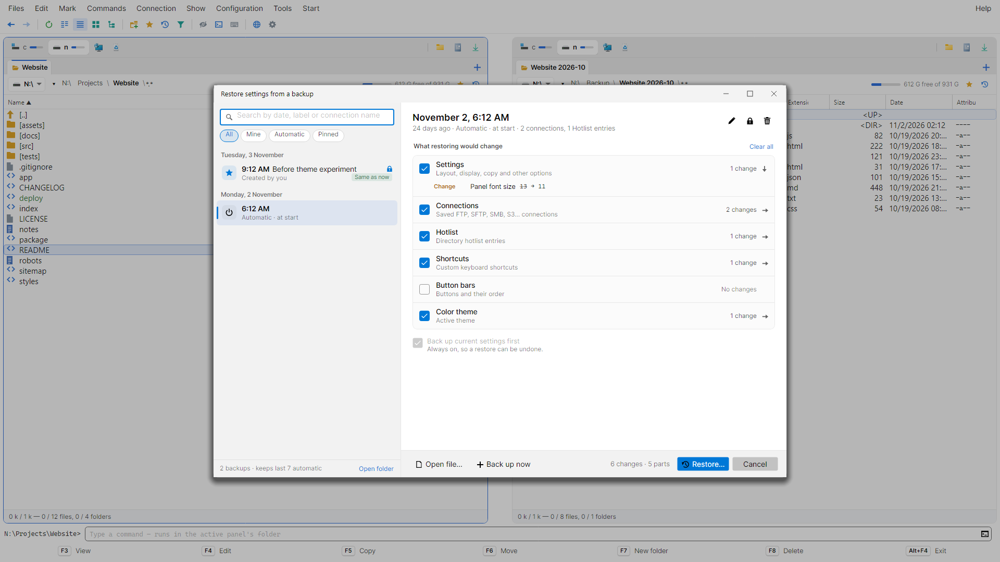

# Settings folder

[Back to the README](../../README.md)

NextCommander keeps your settings, saved passwords and your own themes, icon packs and languages in one folder.

## Where it is

| System | Folder |
|---|---|
| Windows | `%APPDATA%\NextCommander` (usually `C:\Users\<you>\AppData\Roaming\NextCommander`) |
| Linux | `~/.config/NextCommander` (or `$XDG_CONFIG_HOME/NextCommander` if that is set) |
| macOS | `~/Library/Application Support/NextCommander` |

The quickest way to open it: the **Open settings folder** button on the *Misc.* page of the
[Configuration window](configuration.md).

## Portable mode

If a file named `portable.json` is next to the program, NextCommander keeps everything in the program's own
folder instead. The portable zip for Windows already contains this file, so you can run NextCommander from a USB
stick and take your settings with you.

## What is inside

| Item | Contents |
|---|---|
| `settings.json` | All your settings, written by the Configuration window. You never need to edit it by hand. |
| `secrets.json` | Saved passwords, encrypted (see [Connections](connections.md#saved-passwords-and-the-master-password)). |
| `themes/` | Your own [color themes](themes.md). |
| `iconpacks/` | Your own [icon packs](icon-packs.md). |
| `languages/` | Your own [language files](languages.md). |
| `plugins/` | Plugins, one subfolder each. A `plugins` folder next to the program works too. |
| `index/` | The [file index](tools.md#file-index). |
| `thumbs/` | Thumbnails kept on disk (when that option is on). |
| `logs/` | The program log (`nextcommander-<date>.log`, can be switched off under *Log file*), the operation log `operations.log` when it is on and no other file is given, and a crash report if NextCommander ever fails to start. |

The `themes`, `iconpacks` and `languages` folders are created when you first need them; you can also create them
yourself. A file in one of them replaces a built-in file with the same name.

## Automatic backups

Each time NextCommander starts and its settings load, `settings.json` is copied into `backups/` inside the settings
folder (`settings-<date>-<time>.json`), unless it is the same as the newest copy there. A copy is also made just before
a restore and before an import. Of these automatic backups the last **7** are kept; your own backups and pinned ones
stay until you delete them (what is noted about each backup is in `backups/index.json`). If `settings.json` is damaged,
it is kept as `settings.json.corrupt` and the newest backup that loads takes its place; a message at the start says
which one.

*Configuration > Restore settings from a backup...* (also a button on the *Misc.* page of the Configuration window)
opens a window with the backups on the left, by day, the newest first: when and why each was made (at start, before a
restore or an import, by you, added from a file), its name, a lock when it is pinned, *Same as now* for the settings in
use and *Duplicate* for one that holds the same settings as the one below it. A search (date, name, connection or
Hotlist names) and the filters *All*, *Mine*, *Automatic*, *Pinned* narrow the list.

On the right, for the backup chosen, is what restoring it would change, part by part: **Settings** (every option; the
window and the panels' folders stay), **Connections**, **Hotlist**, **Shortcuts**, **Button bars** and **Color theme**.
Each part shows how many changes it has and, opened, each change (added back, removed, changed from → to). Only the
parts ticked are restored; the rest stays as it is. *Restore...* asks first, keeps the settings in use as a backup and
starts NextCommander again; that backup ("before Restore") is how a restore is undone.

- **Back up now** keeps the settings as they are, under a name you type; **Open file...** adds a settings file (for
  example one from another computer) to the backups.
- F2 or the pencil names the chosen backup, the lock pins it (never removed automatically), Del or the bin deletes it
  (*Undo* in the list's footer brings it back; a pinned one must be unpinned first). *Open folder* shows `backups/`.

## Backing up and moving to another computer

The easiest way: *Configuration > Export settings...* writes one zip file with `settings.json` (all options,
connections, the Hotlist, shortcuts, button bars ...) and your own themes, icon packs and language files. On the new
installation, *Configuration > Import settings...* reads it back: it shows what the file holds, keeps the current
settings in `backups/` inside the settings folder and starts NextCommander again with the imported ones. Both are also
buttons on the *Misc.* page of the Configuration window.

- Saved passwords go along only when a master password protects them (the export asks); the master password is then
  needed on the new computer too. Without a master password they only open on the computer they were saved on.
- The file index, thumbnails, logs and plugins are not part of the export.

You can also do it by hand: close NextCommander and copy the whole folder. To move your settings to another computer, copy the folder to the
same place there. On Windows, saved passwords that are not protected by a master password are tied to your user
account on the first computer and need to be entered again on the new one.

## Former name

NextCommander used to be called FileManager. On the first start, if there is no `NextCommander` settings folder
yet, the settings of the old `FileManager` folder are copied over. The old folder is left as it was.
