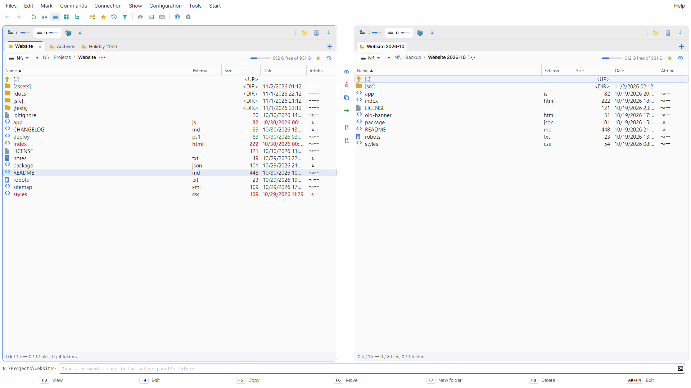
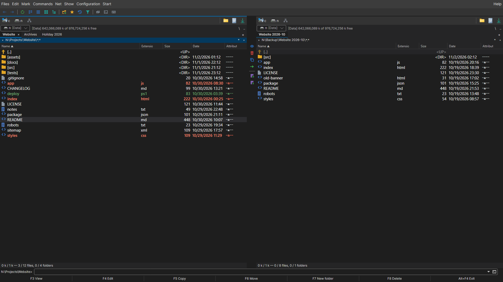
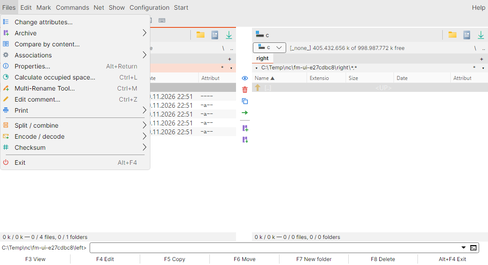
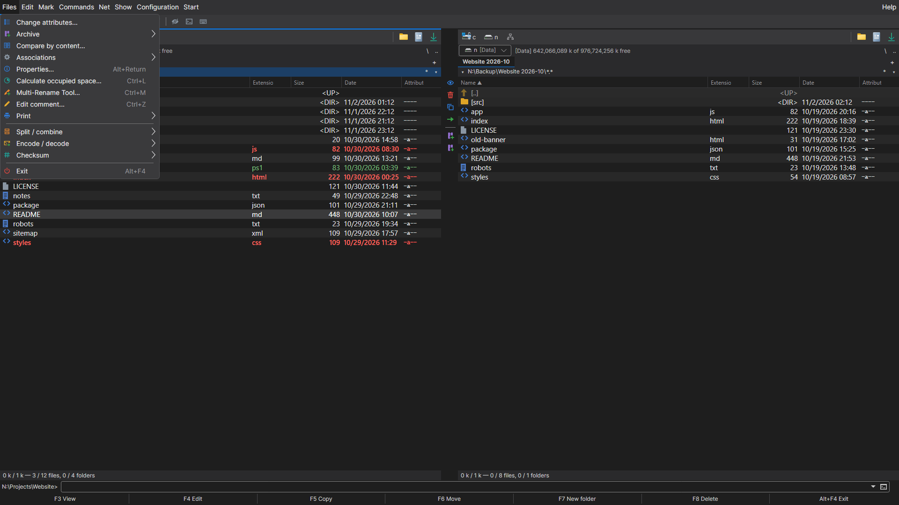
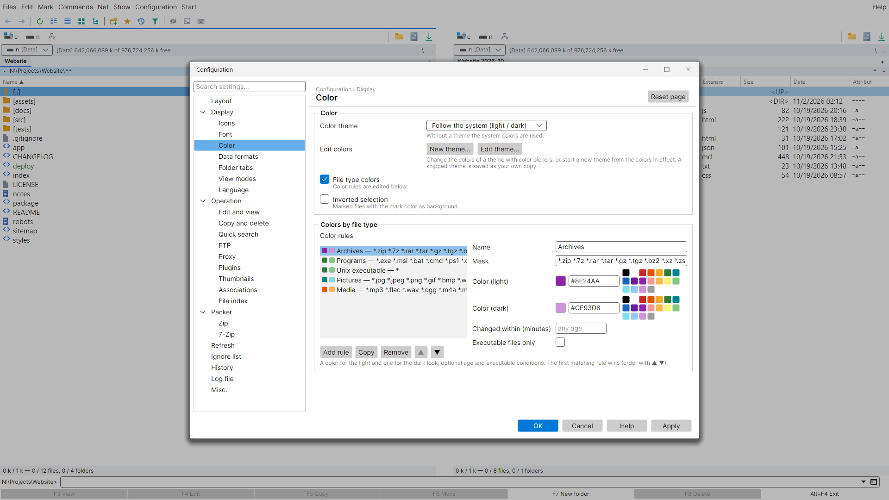

# Color themes

[Back to the README](../../README.md)

## Choosing a theme

Open *Configuration > Options > Display > Color* and pick a **Color theme**, or use the
*Configuration > Color theme* menu. These themes come with NextCommander:

| Theme | Look |
|---|---|
| Follow the system (light / dark) | The default. Uses your system's colors and accent color while the system is in light mode, and the Dark theme in dark mode. It switches by itself when your system switches. |
| System colors (light) | Always your system's light colors and accent color. |
| Dark | A dark theme in the colors of Visual Studio Code's "Dark+". |
| macOS | The light look of the macOS Finder: blue accent, white list, blue folders. |
| macOS Dark | The dark macOS look. |
| Ubuntu | The light Ubuntu (Yaru) look: orange accent, light gray window, orange folders. |
| Ubuntu Dark | The dark Ubuntu (Yaru) look. |

*Configuration > Dark <-> Normal* (Ctrl+Shift+D) switches quickly between the system colors and the Dark theme.

| | |
|---|---|
|  System colors |  Dark |
|  Ubuntu |  macOS Dark |

## Making your own theme

1. On the *Display > Color* page, choose the theme closest to what you want.
2. Click **New theme...** to start from the colors in effect, or **Edit theme...** to change the chosen theme.
3. In the theme editor, give the theme a name and choose its look (**Light** or **Dark**).
   - The parts of the window are listed in groups (window, controls, menus, file list ...). Each row has the color
     (a picker and its `#RRGGBB` value), what it colors and its key. A dot marks a color the theme sets;
     **Default** leaves the part to the light or dark look again.
   - Where text is read on a color, the row shows the contrast (green, or red with "low" when it is below the
     usual minimum: 4.5:1 for text, 3:1 for the accent and marked files).
   - On the right, the **live preview** shows a dialog and a file panel in the colors; click a part of it to find its
     row. Under it, one click sets an **accent** color, and **Readability** counts the contrast checks that pass.
   - **Search colors** (Ctrl+F) finds a part by its name or key; **Reset all** leaves every part to the look.
4. Click **Save**. The theme is chosen in the list; click Apply or OK.

Your themes are saved in the `themes` folder of the [settings folder](settings-folder.md). Editing a theme that
comes with NextCommander saves your own copy there; the copy is used instead of the shipped theme of the same file
name.

### Color keys

The parts of the window the theme editor lists:

| Key | What it colors |
|---|---|
| `Accent` | Accent color: selected items, focus frame, check boxes |
| `Window.Background` | Background of windows and dialog boxes |
| `Window.Text` | General text color |
| `Window.ErrorText` | Error messages |
| `Controls.Background` | Background of drop-down menus, input boxes and buttons |
| `Controls.HoverBackground` | Background of controls under the mouse |
| `Controls.Border` | Borders of controls |
| `Controls.SecondaryText` | Secondary texts and icons |
| `Controls.DisabledBackground` | Background of disabled controls |
| `Controls.DisabledText` | Text of disabled controls |
| `Lists.HoverBackground` | Row under the mouse in lists (settings, dialog boxes) |
| `Lists.SelectedBackground` | Selected row in lists |
| `MenuBar.Background` | Background of the main menu bar |
| `MenuBar.Text` | Text of the main menu bar |
| `Menu.Background` | Background of drop-down and context menus |
| `Menu.Border` | Frame of drop-down and context menus |
| `Menu.Text` | Text of menu items |
| `Menu.HoverBackground` | Menu item under the mouse (and an open submenu); left out, the active tab's color (`Tabs.ActiveBackground`). The item also gets an accent line on the left, like the selected tab |
| `Menu.HoverText` | Text of the menu item under the mouse |
| `Menu.GestureText` | Shortcut keys shown in menus |
| `Menu.DisabledText` | Disabled menu items (also the ones that need a selection while nothing is selected) |
| `ButtonBar.Background` | Background of the button bar |
| `Drives.Icon` | Icons on the drive buttons |
| `Tabs.Background` | Folder tab strip |
| `Tabs.ActiveBackground` | Active tab |
| `Tabs.PassiveLine` | Faint underline of the selected tab in the inactive panel |
| `Panel.HeaderBackground` | Panel header (free space line) and thumbnail boxes |
| `Panel.ActiveAccent` | Marker color of the active panel |
| `Panel.ActivePathBackground` | Path line of the active panel |
| `Panel.StatusBackground` | Status line of the panel |
| `FileList.Background` | Background of the file list |
| `FileList.AlternateBackground` | Alternate rows of the file list |
| `FileList.Text` | Text of the file list |
| `FileList.MarkedText` | Marked (selected) files |
| `FileList.HiddenText` | Hidden and system files |
| `FileList.FolderIcon` | Folder icon |
| `FileList.FileIcon` | File icon |
| `FileList.CursorBackground` | Cursor bar (active panel) |
| `FileList.CursorText` | Text on the cursor bar |
| `FileList.InactiveCursorBackground` | Cursor bar (inactive panel) |
| `FileList.HoverBackground` | Row under the mouse |
| `FileList.HeaderBackground` | Column headers |
| `FileList.HeaderHoverBackground` | Column header under the mouse |
| `FileList.HeaderText` | Text of the column headers |
| `FileList.GridLines` | Grid lines |
| `FunctionKeys.Border` | Line between the function keys (F3 … F8) |
| `Lister.Background` | Background of Lister (F3) and the editor |
| `Lister.Text` | Text of Lister (F3) and the editor |
| `Compare.Added` | Compare: background of added lines |
| `Compare.AddedMark` | Compare: added characters inside a changed line |
| `Compare.AddedText` | Compare: + signs and the tag of the right file |
| `Compare.Removed` | Compare: background of removed lines |
| `Compare.RemovedMark` | Compare: removed characters inside a changed line |
| `Compare.RemovedText` | Compare: − signs and the tag of the left file |
| `Compare.Changed` | Compare: changed differences in the overview strip |
| `Compare.Moved` | Compare: background of moved lines |
| `Compare.MovedText` | Compare: ↕ signs of moved lines |
| `Compare.Current` | Compare: frame of the current difference |
| `Merge.Left` | Merge: changes of the left side (the backgrounds are made lighter from it) |
| `Merge.Right` | Merge: changes of the right side |
| `Merge.Both` | Merge: the same change on both sides, nothing left to resolve |
| `Merge.Conflict` | Merge: conflicts |

## File type colors

Besides the theme, files can be colored by type: archives in purple, programs in green, pictures in teal,
media in orange, and so on. Turn this on or off with **File type colors** on the *Display > Color* page, or with
*Show > What is shown > File type colors*.

The rules are edited in the **Color rules** box on the same page. Each rule has:

- **Name:** a name for the rule.
- **Mask:** which files it applies to, for example `*.zip *.7z *.rar`.
- **LightColor** and **DarkColor:** the text color in light and in dark themes.
- **MaxAgeMinutes** (optional): only files changed within this many minutes, for example to highlight new files.
- **ExecutableOnly** (optional): only programs and executable files.

The first rule that matches a file wins. The box checks your rules as you type; Apply and OK stay refused while
a rule has a mistake.

**Inverted selection** on the same page draws marked files with the mark color as their background instead of
as their text color.
