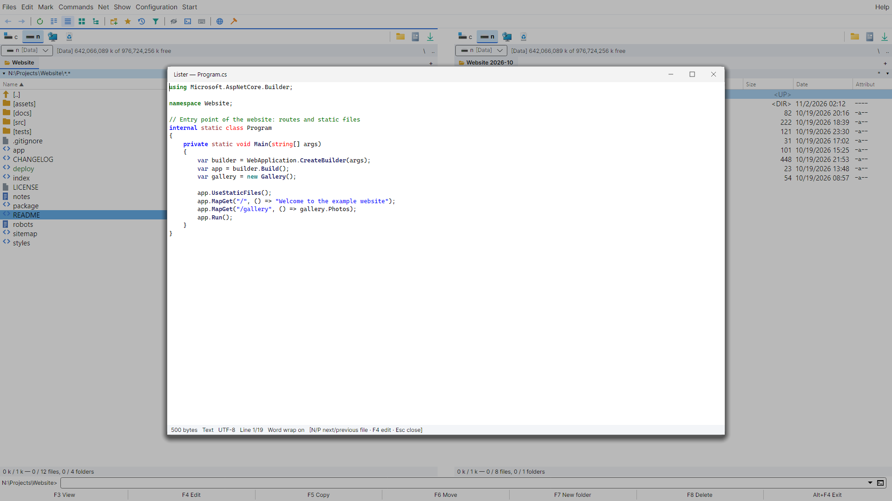
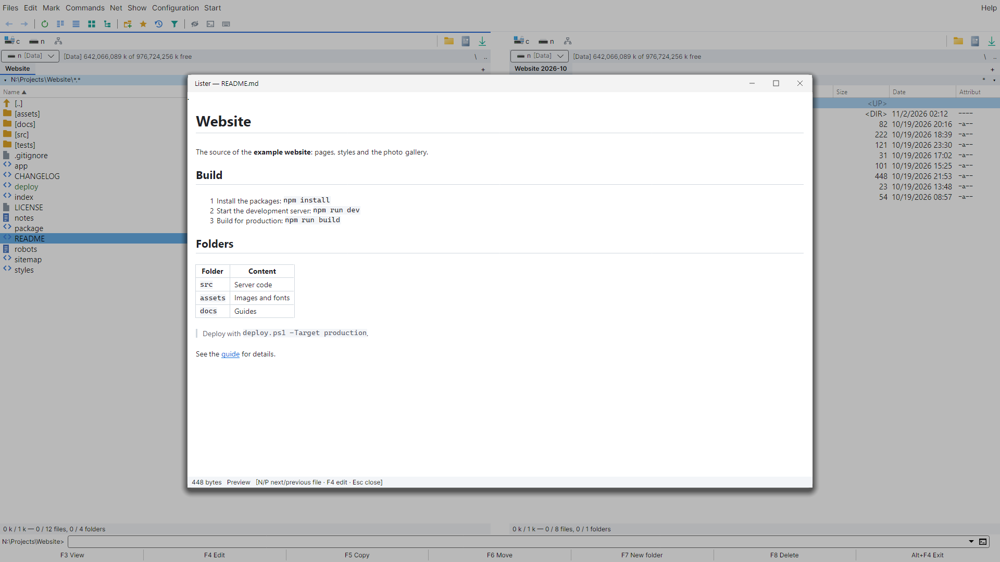
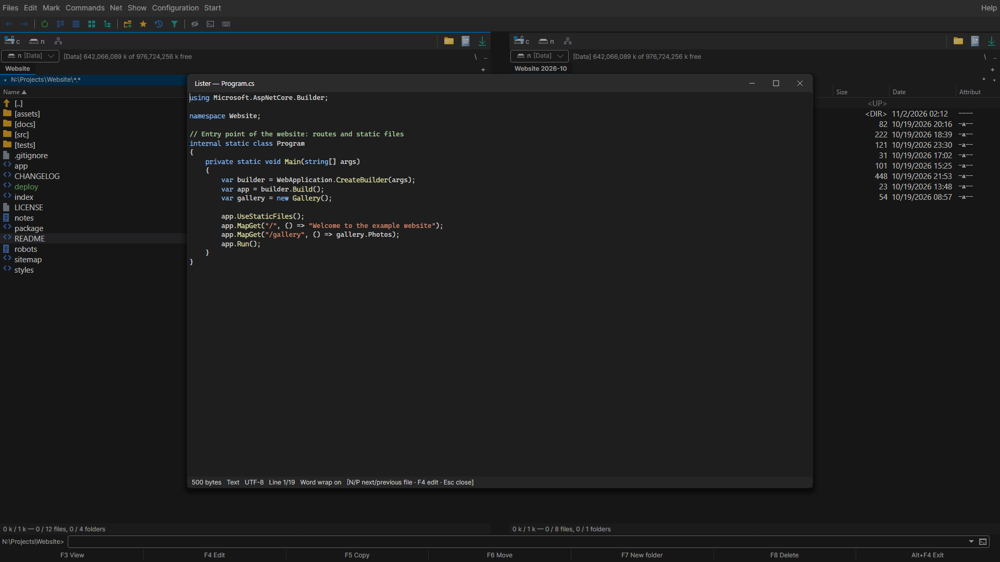
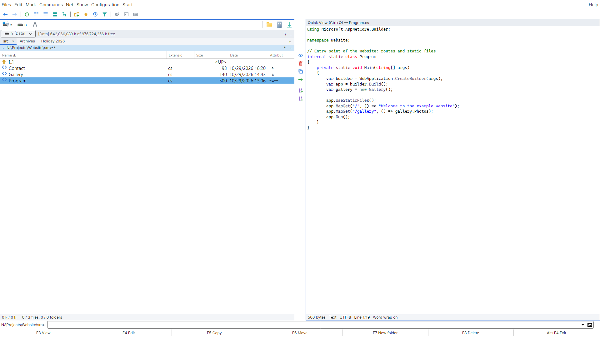
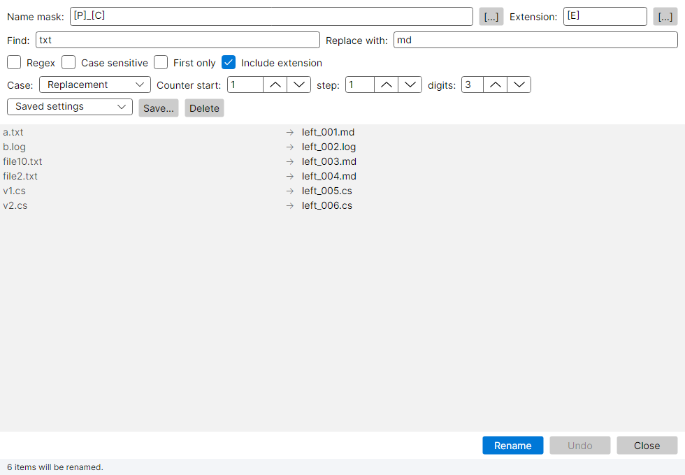
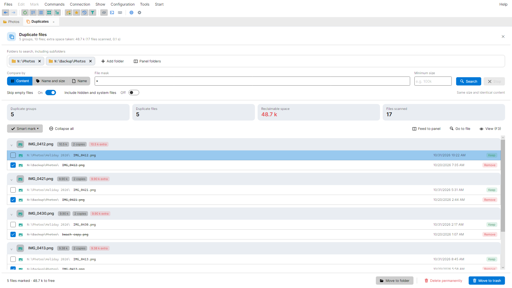

# Tools

[Back to the README](../../README.md)

- [Lister (F3)](#lister-f3)
- [Quick View (Ctrl+Q)](#quick-view-ctrlq)
- [Editor (F4)](#editor-f4)
- [Find files (Alt+F7)](#find-files-altf7)
- [Multi-Rename Tool (Ctrl+M)](#multi-rename-tool-ctrlm)
- [Synchronize directories](#synchronize-directories)
- [Compare by content](#compare-by-content)
- [Duplicate files](#duplicate-files)
- [Folder sizes](#folder-sizes)
- [Checksums](#checksums)
- [Split and combine](#split-and-combine)
- [More file tools](#more-file-tools)
- [Built-in terminal](#built-in-terminal)
- [File index](#file-index)

## Lister (F3)

Lister shows a file without changing it. The number keys switch between its views:

| Key | View |
|---|---|
| 1 | Text, with syntax colors for source code and clickable links |
| 2 | Binary (fixed width) |
| 3 | Hex |
| 4 | Image: fit to the window or zoom, rotate with L / R, camera RAW previews |
| 5 | Preview of HTML, Markdown and RTF files |
| 6 | A view added by a plugin |
| 7 | Audio and video |

- **Encoding:** detected automatically. A / S / U / 8 show the text as ANSI, DOS, UTF-16 or UTF-8; the right-click
  menu lists every code page.
- **Big files** open at once: only the visible part is read.
- **Find:** F7 opens the search bar (case, whole word, regular expression, hex); F3 / Shift+F3 find the next and
  previous match.
- **N / P** go to the next / previous file of the panel (only the selected files, if there are any).
- **W** turns word wrap on and off; Ctrl+mouse wheel changes the font size.
- **F4** edits the file, **F2** reloads it. Lister also reloads by itself when the file changes.
- **Previews** of HTML and Markdown do not load pictures from the internet; links open in your browser.
- **Audio and video** play with the VLC player installed on your computer (not included). Play and pause, jump
  10 or 60 seconds, change speed and volume, choose chapters, and continue where you left off.

## Quick View (Ctrl+Q)

Quick View shows the file under the cursor in place of the other panel, and follows the cursor as you move.
Tab moves into the view and back.

## Editor (F4)

F4 opens the built-in text editor; Shift+F4 creates a new file.

- It keeps the file's encoding and line endings; you can change both from its menu.
- Ctrl+S saves, Ctrl+F finds, Ctrl+H replaces, Ctrl+G goes to a line.
- *View > Font...* picks the editor's font and size (fixed-width fonts first, with a preview); it is kept for the
  next files. The same setting is *Font > Editor font* in the Configuration window; left empty, the editor uses the
  Lister's font.
- It asks before closing with unsaved changes, and warns when another program changed the file.
- It warns and does not save if a character cannot be stored in the file's encoding.
- You can use another editor instead: set it on the *Operation > Edit and view* page of the
  [Configuration window](configuration.md), also per file type (for example a word processor for `*.docx`).
  Binary files open with your external editor or the system's program.

## Find files (Alt+F7)

- **Search for:** a name pattern such as `*.cs *.xaml`, or a regular expression. Add `| obj\ bin\` to skip
  folders: `*.cs | obj\ bin\`.
- **Search in:** one or more folders separated by `;`, or *All drives*. You can limit the depth and search for
  files, folders or both.
- **Content:** find text inside files, also in UTF-16 text and inside Office, OpenDocument and EPUB files.
  Options: case sensitive, whole words, regular expression, *Not containing*, and *Skip binary files* (programs,
  images and archives are not read). Several files are read at the same time. Each result shows the line of its first
  match with its number, and F3 opens the Lister at that match (F3 there goes to the next one).
- **Advanced:** size (`10k`, `2M`), date (`2024-05-01`, or `7d` for the last seven days), attributes, skipping
  hidden folders, searching only in the previous results, and finding duplicates.
- **Results:** each line has the icon of its kind (folder, document, picture, archive ...). F3 views, F4 edits,
  Enter goes to the file, Shift+Enter opens it with its program, Delete moves it to the trash (Shift+Delete deletes
  it permanently), Ctrl+C copies the full path. Several results can be selected with Ctrl and Shift.
  - **Right click** on a result: open it, go to it in the panel, show it in the system file manager, view, edit,
    copy the path or the name, delete, remove it from the list only, and on Windows its properties.
  - **Export...** saves the results as a list of paths (`.txt`, one a line; *LOADLIST* opens it in a panel) or as
    a table for a spreadsheet (`.csv`: path, name, folder, type, size, modified date, and the group when duplicates
    were searched).
  - **Feed to panel** shows all results in a panel, where you can copy, move or delete them like normal files.
- **Saved searches:** save a search and run it again later.
- With the [file index](#file-index) on, name searches answer almost at once.

*Commands > Find files in separate process...* (Alt+Shift+F7) runs a search in its own window while you keep
working.

## Multi-Rename Tool (Ctrl+M)

Renames many files at once. The list shows the old and new names live as you type.

- **Name mask** and **Extension:** build the new name from placeholders. `[N]` is the old name (also parts:
  `[N2-5]` characters 2 to 5), `[E]` the extension, `[P]` the parent folder, `[C]` a counter, `[YMD]` and `[hms]`
  the date and time, `[S]` the size. The `[...]` buttons insert them.
- **Find / Replace with:** replace text in the names, with several terms separated by `|`, regular expressions,
  *First only* and *Include extension*.
- **Case:** lower case, UPPER CASE, First letter upper, Every Word Upper.
- **Counter:** start, step and number of digits.
- Names that would clash, already exist or are invalid are marked and skipped.
- A `/` in the new name moves the file into that subfolder.
- **Undo** reverts the last renaming. Settings can be saved and loaded.

## Synchronize directories

*Commands > Synchronize directories...* compares two folders and makes them equal. It opens in place of the panels as a
page of its own, with a **Synchronize** tab next to the files tab: the files tab takes you back to the panels while the
comparison stays open; the tab's `×`, the `×` at its top right or Esc close it.

- **The folders** are at the top, each with its file count and size; the folder button picks one, ⇄ swaps them.
  The comparison runs when the window opens and again with **Compare** (F5) or when an option changes.
- **Options** are chips: *Subfolders*, *By content*, *Ignore date*, *One-way (left → right)* (right-only files are
  not copied back), *Skip hidden*, and a file **Mask** (`*.cs *.md`).
- **Filters** with their counts show or hide *Different*, *Left only*, *Right only* and *Identical* files;
  **Filter by name** narrows the list.
- **The list is a tree**: folders open and close, and show how many changes they hold. Each line has the size and
  date on both sides (the newer date is marked), the status (left only, right only, left newer, right newer,
  different, identical) and the **action**: click it to go to the next action that fits (copy to the right, copy
  to the left, skip, delete); on a folder it sets the action of all its files. ← / → and Delete do the same for
  the line under the cursor; double click (or Enter) compares a file's contents.
- **Check boxes** select files (a folder: all its files, Ctrl+A: all). With files selected, a bar offers *Copy →*,
  *Copy ←*, *Skip*, *Delete left*, *Delete right* and *Compare by content* for all of them.
- Below, the plan tells how much goes to each side and how much is deleted. **Synchronize** shows a summary first
  (with the choice to send deleted files to the Recycle Bin), runs the operations and compares again; the files
  made identical are then shown.

## Compare by content

*Files > Compare by content...* compares two files: the two marked files, or the files under the cursor in the
two panels.

- The bar shows the file, how many differences there are and how many lines were added (+) and removed (−).
- **Split** shows the two files side by side (they scroll together); **Inline** shows one column, the removed lines
  of each difference above the added ones. The left file is tagged *Original*, the right one *Current*.
- Each line has its number in its file and a − / + sign; removed lines are red, added lines green, the changed
  characters inside a line are marked, a missing line on one side is hatched. The code keeps its syntax colors.
- The current difference is framed; the counter shows which one it is (2 / 5). F2 / Shift+F2 (or j / k, or the
  arrows) go to the next / previous one, around from the last to the first. A click on a line of a difference makes
  it the current one.
- The strip on the right edge shows every difference in its place in the file (green added, red removed, amber
  changed); a click goes there.
- **Ignore case** and **Ignore whitespace** compare again at once.
- **Edit** opens both files as text: change them and press **Edit** or **Compare** again to compare the edited
  texts (the files themselves are not changed). **Compare** (F5) otherwise reads the files again.
- The status line shows the number of lines of both files, the language and the encoding. Esc closes the window.
- Binary files show a list of the differing bytes.

## Duplicate files

*Commands > Duplicate files...* finds files that exist more than once.

- Choose the folders to search (the two panels' folders to start with).
- Compare by content, by name and size, or by name only; set a file mask and a minimum size.
- Results come in groups, the group wasting the most space first. The status line shows how much space the extra
  copies take.
- Mark files by hand, or with **Mark**: keep the newest, oldest, shortest path or longest path in each group,
  and so on. Rules always leave at least one copy of each file; you are warned if you marked all copies of a
  group yourself.
- Then **Move to trash**, **Delete permanently**, **Move to folder...**, or **Feed to panel**.

## Folder sizes

*Commands > Folder sizes...* shows what takes up the space in a folder, also on servers and cloud drives. It opens in
place of the other panel and shows the folder of the panel next to it: go to another folder there and it is scanned
anew. *Rescan* reads it again, the ✕ button or Esc puts the panel back.

- At the top, a tree of folders and files from largest to smallest, with a bar, the size, the share in percent,
  the file count and the newest date.
- On the right, the file types with their total size.
- At the bottom, a map where every file is a rectangle in the color of its type, sized by how big it is. Click
  a rectangle to find the file in the tree; double click shows it in the panel.
- **Show in panel**, **Open**, **Move to trash** (Shift+Delete deletes permanently), **Go down to the largest**.

## Checksums

*Files > Checksum*:

- **Create checksums (MD5/SHA)...:** CRC32 (SFV), MD5, SHA-1, SHA-256, SHA-384, SHA-512, BLAKE3 and, where the
  system supports it, SHA-3. One file for all selected files, or one per file.
- **Verify checksums:** reads checksum files in the common formats and lists the files that are OK, different or
  missing.

## Split and combine

*Files > Split / combine*:

- **Split file...** cuts a big file into parts `.001`, `.002`, … plus a small `.crc` file with the original
  name, size and checksum.
- **Combine files...** puts the parts together again and checks the result against the `.crc` file.

## More file tools

- **Change attributes...** (*Files*): read-only, hidden, system and archive flags, and the modification time,
  also for subfolders.
- **Properties...** (Alt+Enter): on Windows the Explorer properties window; elsewhere NextCommander's own window
  with dates, attributes, Unix permissions and the folder size.
- **Calculate occupied space...** (Ctrl+L): total size and file and folder count of the selection.
- **Edit comment...** (Ctrl+Z): a comment for a file, stored in a `descript.ion` file (the 4DOS format other file managers read too).
  *Show > Display > Comments* (Ctrl+Shift+F2) shows them.
- **Encode / decode:** MIME (Base64), UUE and XXE.
- **Print:** print the file list, or send the selected files to the printer.
- **Associations:** choose which program, or Lister or the editor, opens a file type with Enter.
  Shift+Enter (*Open with...*) offers a list of programs.
- **Background transfer manager...** (*Commands*): running and waiting jobs with their speed and time left;
  pause, stop after the current file, or cancel.
- **System information...** (*Commands*): operating system, memory and drives.
- **Branch View** (Ctrl+B): all files of all subfolders in one list. Ctrl+Shift+B does the same for the selected
  folders only.

## Built-in terminal

Press Ctrl+` (or *Commands > Internal terminal*, or the terminal button at the end of the command line) to
open a terminal at the bottom of the window. Press it again to hide it; the shell keeps running.

- It is a real terminal: colors and full-screen programs such as vim, mc, top and less work, and Ctrl+C stops the
  running program.
- It starts in the active panel's folder. **Panel folder** moves it to the current panel folder, **Clear**
  clears the screen, **Stop** restarts the shell.
- **Tabs:** `+` opens another terminal, `▾` lists the installed shells (on Windows cmd, Windows PowerShell,
  PowerShell 7, Git Bash and WSL; elsewhere your shells). `exit` or the tab's `×` closes it.
- Drag its top edge to change its height. The □ button (or a double click on its title, or the internal terminal
  button of the button bar) maximizes it: it becomes a page of its own with a **Terminal** tab next to the files tab,
  and the files tab takes you back to the panels while its shells keep running. The tab's `×` (or ❐) puts it back
  below the panels.
- While the terminal has the focus, all keys go to the shell; only Ctrl+` returns. Ctrl+Shift+C / Ctrl+Shift+V
  copy and paste, and a right click copies the selection or pastes. The mouse wheel and Shift+Page Up / Page Down
  scroll back.
- The default shell and the terminal font are set on the *Misc.* and *Display > Font* pages of the
  [Configuration window](configuration.md). The open terminal tabs come back the next time you start
  NextCommander.

*Commands > Open command prompt window* (Ctrl+Alt+T) opens your system's own terminal window in the current
folder instead.

## File index

NextCommander can keep its own index of your files, so that searches, duplicate files and folder sizes answer
almost at once. It is on by default (*Configuration > Options > Operation > File index*).

- On Windows it indexes all fixed drives, on Linux and macOS your home folder; you can choose other folders and
  leave some out (for example `node_modules`). The trash and system folders are always left out.
- The first scan runs in the background at low priority and can take a few minutes. After that, only changed
  folders are read, and changes are followed while NextCommander runs.
- Finding what changed while NextCommander was closed:
  - By default a folder is read again when its time changed. That happens when something in it was added,
    removed or renamed, but not when only the contents of a file changed; such a file keeps its old size and
    date in the index (searches by name are not affected).
  - **Use the NTFS change journal at start** (Windows, on by default): the disk's own list of changes names the
    folders to read again, including files whose contents changed. It needs no administrator rights. When the
    list cannot tell (another file system, or so many changes that the list has wrapped), the folder times are
    compared.
  - **Check every folder again (hours)**: after this many hours every folder is read again, on any system. This
    takes as long as the first scan; 0 (the default) turns it off.
- The settings page shows the number of files and folders indexed and the last update, and has a **Rebuild**
  button.
- *Find files* uses it with the **Use file index** option. If you have Everything (Windows), plocate (Linux) or
  Spotlight (macOS), Find files can use those too.
