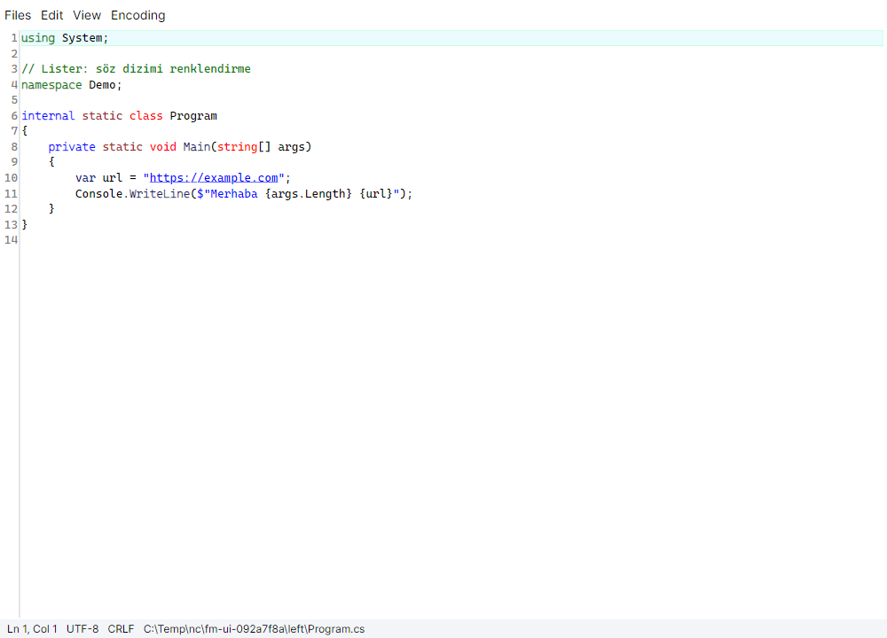
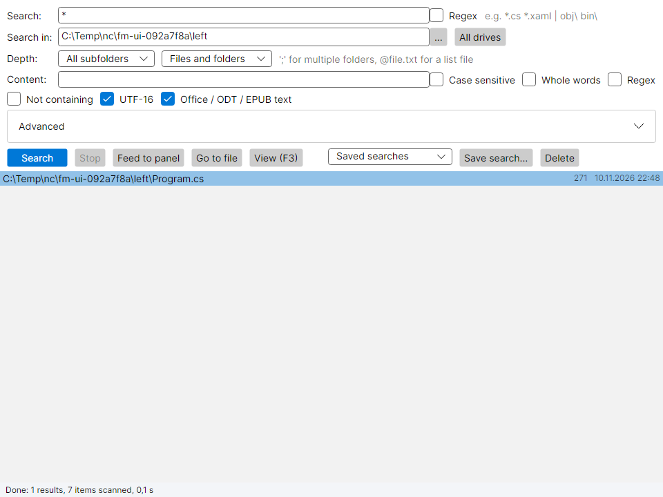
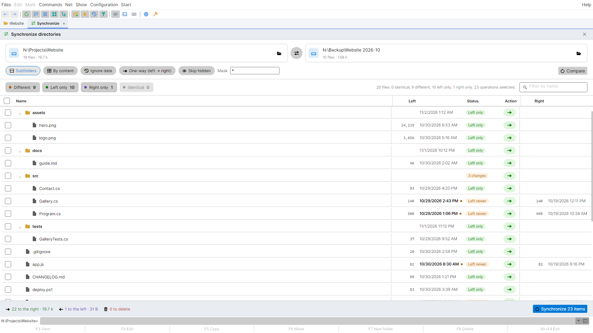
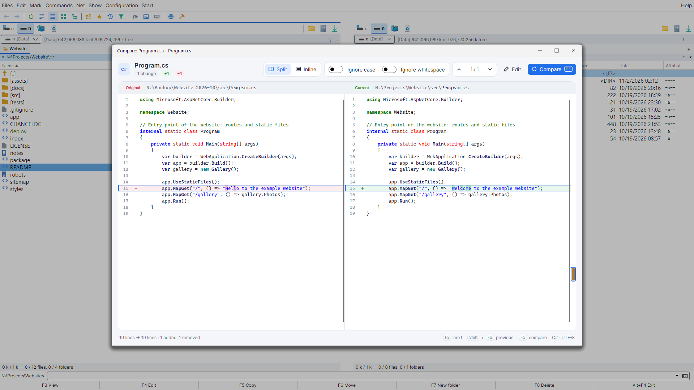
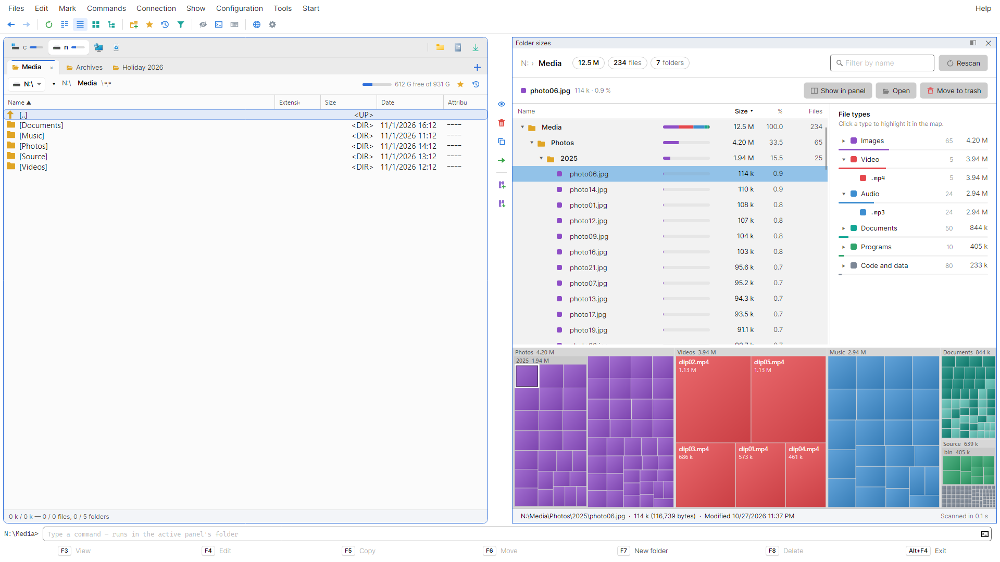

# Tools

[Back to the README](../../README.md)

- [Lister (F3)](#lister-f3)
- [Quick View (Ctrl+Q)](#quick-view-ctrlq)
- [Command palette (Ctrl+Shift+P)](#command-palette-ctrlshiftp)
- [Undo (Ctrl+Z)](#undo-ctrlz)
- [Editor (F4)](#editor-f4)
- [Find files (Alt+F7)](#find-files-altf7)
- [Multi-Rename Tool (Ctrl+M)](#multi-rename-tool-ctrlm)
- [Synchronize directories](#synchronize-directories)
- [Compare by content](#compare-by-content)
- [Duplicate files](#duplicate-files)
- [Folder sizes](#folder-sizes)
- [Checksums](#checksums)
- [Split and combine](#split-and-combine)
- [More file tools](#more-file-tools)
- [Built-in terminal](#built-in-terminal)
- [File index](#file-index)

## Lister (F3)

Lister shows a file without changing it. The number keys switch between its views:

| Key | View |
|---|---|
| 1 | Text, with syntax colors for source code and clickable links |
| 2 | Binary (fixed width) |
| 3 | Hex |
| 4 | Image: fit to the window or zoom, rotate with L / R, camera RAW previews |
| 5 | Preview of documents: PDF pages, Word / Excel / PowerPoint and OpenDocument files, HTML, Markdown, RTF |
| 6 | A view added by a plugin |
| 7 | Audio and video |

- **Encoding:** detected automatically. A / S / U / 8 show the text as ANSI, DOS, UTF-16 or UTF-8; the right-click
  menu lists every code page.
- **Big files** open at once: only the visible part is read.
- **Find:** F7 opens the search bar (case, whole word, regular expression, hex); F3 / Shift+F3 find the next and
  previous match.
- **N / P** go to the next / previous file of the panel (only the selected files, if there are any).
- **W** turns word wrap on and off; Ctrl+mouse wheel changes the font size.
- **F4** edits the file, **F2** reloads it. Lister also reloads by itself when the file changes.
- **Previews** of HTML and Markdown do not load pictures from the internet; links open in your browser.
- **Documents** open in the preview (also in the Quick View panel, Ctrl+Q):
  - **PDF:** the pages one below the other; only the pages near the view are drawn, so big PDFs open at once.
    Ctrl+mouse wheel (or Ctrl + / Ctrl -) zooms, Ctrl+0 fits the width again; the status line shows the page.
    **F7** finds text in the pages (F3 / Shift+F3 the next / previous match, which is marked and scrolled to);
    drag with the mouse to select text, also across pages (dragging past the top or bottom scrolls; Shift+click
    extends the selection), Ctrl+A selects the page's text, Ctrl+C copies it (each page's part on a line of its own).
    A protected PDF asks for its password (again when it is wrong).
  - **Word, Excel, PowerPoint** (docx, xlsx, pptx and their macro / template kinds) and **OpenDocument** (odt, ods,
    odp) are read without Office: text with headings, emphasis, lists, tables and pictures; every visible sheet of a
    workbook as a table with column letters and row numbers (dates as dates); the slides with their titles and texts.
    It is a preview of the content, not of the layout; long documents are cut (the end shows "(…)").
  - **Old Office files** (doc, xls, ppt of Office 97-2003): with LibreOffice installed they are converted to PDF
    (the real layout); without it their text is read directly: the document's paragraphs with its headings, tables
    and the bold / italic / underlined / struck-through words, the visible sheets of a workbook (texts, numbers,
    dates, formula results; bold cells), the slides' titles and texts.
  - **Other documents** (Visio, Publisher, WordPerfect, Keynote ...) are converted to PDF by **LibreOffice** when it
    is installed (once: the PDF is kept in the temporary folder); otherwise they show as binary.
  - *Configuration > Edit and view > Open PDF, Office, HTML, Markdown and RTF files with preview* off opens them as
    text / hex; key 5 still shows the preview.
- **Audio and video** play with the VLC player installed on your computer (not included). Play and pause, jump
  10 or 60 seconds, change speed and volume, choose chapters, and continue where you left off.

## Quick View (Ctrl+Q)

Quick View shows the file under the cursor in place of the other panel, and follows the cursor as you move.
Tab moves into the view and back.

The ⇄ button in its title moves it: in place of the other panel, below the file list or right of it. Below or right of
the file list both panels stay; the Quick View is in the active panel and goes with it when you switch panels, and the
line between the list and the view can be dragged. The place is kept (*Configuration > Options > Edit/View > Lister*).

## Command palette (Ctrl+Shift+P)

Ctrl+Shift+P (Commands > Command palette...) opens a box at the top of the window. Type a few words: it finds every
command with its description and shortcut, your most used folders, the Hotlist entries and the saved connections.
Each word you type has to appear (the start of a word counts most, then a part of a word, then its letters in order:
`nmk` finds *nc_MkDir*); case and accents do not matter. ↑ / ↓ choose, Enter runs, Esc closes. With nothing typed it
lists what you used last.

## Undo (Ctrl+Z)

Ctrl+Z (Edit > Undo) undoes the last file operation, after asking; pressed again it undoes the one before (up to 30):

- **Copy**: the copies are removed (into the recycle bin for local files), then the folders the copy made. A file the
  copy overwrote cannot be brought back; its copy is kept and you are told.
- **Move**: everything goes back where it was (renamed back where it can be, else copied back).
- **Rename** and the **Multi-Rename Tool**: the old names come back.
- **New folder**: the folders are removed while they are still empty.
- **Delete into the recycle bin**: the files come back from it (Windows and Linux; on macOS use the Trash).

Deleting for good, copying through Windows Explorer and operations done again with administrator rights cannot be
undone. While a text box has the focus (command line, quick filter), Ctrl+Z undoes typing as usual. Editing a comment
moved from Ctrl+Z to Ctrl+Alt+Z, copying the folder path from Ctrl+Shift+P to Ctrl+Alt+P.

## Editor (F4)

F4 opens the built-in text editor; Shift+F4 creates a new file.

- It keeps the file's encoding and line endings; you can change both from its menu.
- Ctrl+S saves, Ctrl+F finds, Ctrl+H replaces, Ctrl+G goes to a line.
- *View > Font...* picks the editor's font and size (fixed-width fonts first, with a preview); it is kept for the
  next files. The same setting is *Font > Editor font* in the Configuration window; left empty, the editor uses the
  Lister's font.
- It asks before closing with unsaved changes, and warns when another program changed the file.
- It warns and does not save if a character cannot be stored in the file's encoding.
- You can use another editor instead: set it on the *Operation > Edit and view* page of the
  [Configuration window](configuration.md), also per file type (for example a word processor for `*.docx`).
  Binary files open with your external editor or the system's program.

## Find files (Alt+F7)

- **Search for:** a name pattern such as `*.cs *.xaml`, or a regular expression. Add `| obj\ bin\` to skip
  folders: `*.cs | obj\ bin\`.
- **Search in:** one or more folders separated by `;`, or *All drives*. You can limit the depth and search for
  files, folders or both.
- **Content:** find text inside files, also in UTF-16 text and inside Office, OpenDocument and EPUB files.
  Options: case sensitive, whole words, regular expression, *Not containing*, and *Skip binary files* (programs,
  images and archives are not read). Several files are read at the same time. Each result shows the line of its first
  match with its number, and F3 opens the Lister at that match (F3 there goes to the next one).
- **Advanced:** size (`10k`, `2M`), date (`2024-05-01`, or `7d` for the last seven days), attributes, skipping
  hidden folders, searching only in the previous results, and finding duplicates.
- **Results:** each line has the icon of its kind (folder, document, picture, archive ...). F3 views, F4 edits,
  Enter goes to the file, Shift+Enter opens it with its program, Delete moves it to the trash (Shift+Delete deletes
  it permanently), Ctrl+C copies the full path. Several results can be selected with Ctrl and Shift.
  - **Right click** on a result: open it, go to it in the panel, show it in the system file manager, view, edit,
    copy the path or the name, delete, remove it from the list only, and on Windows its properties.
  - **Export...** saves the results as a list of paths (`.txt`, one a line; *LOADLIST* opens it in a panel) or as
    a table for a spreadsheet (`.csv`: path, name, folder, type, size, modified date, and the group when duplicates
    were searched).
  - **Feed to panel** shows all results in a panel, where you can copy, move or delete them like normal files.
- **Saved searches:** save a search and run it again later.
- With the [file index](#file-index) on, name searches answer almost at once.

*Commands > Find files in separate process...* (Alt+Shift+F7) runs a search in its own window while you keep
working.

## Multi-Rename Tool (Ctrl+M)

Renames many files at once. The list shows the old and new names live as you type.

- **Name mask** and **Extension:** build the new name from placeholders. `[N]` is the old name (also parts:
  `[N2-5]` characters 2 to 5), `[E]` the extension, `[P]` the parent folder, `[C]` a counter, `[YMD]` and `[hms]`
  the date and time, `[S]` the size. The `[...]` buttons insert them.
- **Find / Replace with:** replace text in the names, with several terms separated by `|`, regular expressions,
  *First only* and *Include extension*.
- **Case:** lower case, UPPER CASE, First letter upper, Every Word Upper.
- **Counter:** start, step and number of digits.
- Names that would clash, already exist or are invalid are marked and skipped.
- A `/` in the new name moves the file into that subfolder.
- **Undo** reverts the last renaming. Settings can be saved and loaded.

## Synchronize directories

*Commands > Synchronize directories...* compares two folders and makes them equal. It opens in place of the panels as a
page of its own, with a **Synchronize** tab next to the files tab: the files tab takes you back to the panels while the
comparison stays open; the tab's `×`, the `×` at its top right or Esc close it.

- **The folders** are at the top, each with its file count and size; the folder button picks one, ⇄ swaps them.
  The comparison runs when the window opens and again with **Compare** (F5) or when an option changes.
- **Options** are chips: *Subfolders*, *By content*, *Ignore date*, *One-way (left → right)* (right-only files are
  not copied back), *Skip hidden*, and a file **Mask** (`*.cs *.md`).
- **Filters** with their counts show or hide *Different*, *Left only*, *Right only* and *Identical* files;
  **Filter by name** narrows the list.
- **The list is a tree**: folders open and close, and show how many changes they hold. Each line has the size and
  date on both sides (the newer date is marked), the status (left only, right only, left newer, right newer,
  different, identical) and the **action**: click it to go to the next action that fits (copy to the right, copy
  to the left, skip, delete); on a folder it sets the action of all its files. ← / → and Delete do the same for
  the line under the cursor; double click (or Enter) compares a file's contents.
- **Check boxes** select files (a folder: all its files, Ctrl+A: all). With files selected, a bar offers *Copy →*,
  *Copy ←*, *Skip*, *Delete left*, *Delete right* and *Compare by content* for all of them.
- Below, the plan tells how much goes to each side and how much is deleted. **Synchronize** shows a summary first
  (with the choice to send deleted files to the Recycle Bin), runs the operations and compares again; the files
  made identical are then shown.

## Compare by content

*Files > Compare by content...* compares two files: the two marked files, or the files under the cursor in the
two panels.

- The bar shows the file, how many differences there are and how many lines were added (+) and removed (−).
- **Split** shows the two files side by side (they scroll together); **Inline** shows one column, the removed lines
  of each difference above the added ones. The left file is tagged *Original*, the right one *Current*.
- Each line has its number in its file and a − / + sign; removed lines are red, added lines green, the changed
  characters inside a line are marked, a missing line on one side is hatched. The code keeps its syntax colors.
- The current difference is framed; the counter shows which one it is (2 / 5). F2 / Shift+F2 (or j / k, or the
  arrows) go to the next / previous one, around from the last to the first. A click on a line of a difference makes
  it the current one.
- The strip on the right edge shows every difference in its place in the file (green added, red removed, amber
  changed); a click goes there.
- **Ignore case** and **Ignore whitespace** compare again at once.
- **Edit** opens both files as text: change them and press **Edit** or **Compare** again to compare the edited
  texts (the files themselves are not changed). **Compare** (F5) otherwise reads the files again.
- The status line shows the number of lines of both files, the language and the encoding. Esc closes the window.
- Binary files show a list of the differing bytes.

## Duplicate files

*Commands > Duplicate files...* finds files that exist more than once. It opens as a page of its own with a
**Duplicates** tab next to the files tab (like *Synchronize directories*): the files tab takes you back to the
panels while it stays open; its ✕, its tab's × or Esc closes it. **Go to file** and **Feed to panel** show the files.

- Choose the folders to search (the two panels' folders to start with): each is a chip with ✕; **Add folder** and
  **Panel folders** add more.
- Compare by content, by name and size, or by name only; set a file mask and a minimum size.
- After the search, four numbers sum it up: duplicate groups, duplicate files, the space you could free and the
  files scanned.
- Results come in groups, the group wasting the most space first. Each group shows the file's size, how many copies
  there are and the extra space they take; click its header (or Space / Enter) to fold it, or **Collapse all**.
- Mark files by hand, or with **Smart mark**: keep the newest, oldest, shortest path or longest path in each group,
  and so on. Every file shows *Keep* or *Remove*. Rules always leave at least one copy of each file; you are warned
  if you marked all copies of a group yourself.
- Then **Move to trash**, **Delete permanently**, **Move to folder**, or **Feed to panel**.

## Folder sizes

*Commands > Folder sizes...* shows what takes up the space in a folder, also on servers and cloud drives. It opens in
place of the other panel and shows the folder of the panel next to it: go to another folder there and it is scanned
anew. *Rescan* (F5) reads it again; the ✕ button or Esc puts the panel back. The **Maximize** button of its title line moves it, scan and all, to a page of
its own with a tab (like duplicate files): both panels are back under the files tab, and *Back into the panel* (the
button in the same place) puts it over the other panel again; its tab's ×, ✕ or Esc close it. On its page, where no
panel is next to it, *Folder...* scans another folder (chosen in the folder tree, on servers too).

- **At the top:** the path of the folder shown (click a part to go back up to it), its size, files and folders, a
  **filter** by name (Ctrl+F; it keeps the matching names and the folders down to them), *Folder...* (on its page)
  and *Rescan* / *Stop*.
- **Below it:** the selected file or folder with its size and share, and what can be done with it: **Open in map**
  (zoom into a folder), **Go to largest** (the largest file in it), **Show in panel**, **Open**, **Move to trash**.
  Deleting asks right there (*Keep* / *Move to trash*); Shift+Delete deletes permanently.
- **The tree:** folders and files from largest to smallest. A click on a column header sorts by name, size, file
  count or date, again the other way round. A folder's bar shows the types in it in their colors. ▸ / → open a
  folder, ← closes it; a double click or Enter zooms into a folder (a file: shows it in the panel), Backspace goes up.
- **File types** (right): the categories (video, audio, programs, archives, images, documents, code and data, other)
  with their size and share; ▸ shows their extensions. A click on a category or an extension highlights its files in
  the map, *Show all* ends it.
- **The map** (bottom): every file is a rectangle in the color of its type, sized by how big it is; folders large
  enough have a strip with their name and size. Click a rectangle to find it in the tree; a double click zooms into
  its folder, *Up to ...* goes back. The tooltip and the footer show the item under the pointer.

## Checksums

*Files > Checksum*:

- **Create checksums (MD5/SHA)...:** the algorithm is chosen on cards: MD5, SHA-1, **SHA-256** (recommended: what
  download pages and Linux images publish), SHA-512, BLAKE3 (the fastest), CRC32 (an .sfv file; finds copy errors only)
  and SHA-384 and, where the system supports it, SHA-3. A line under the cards says what each is good for; the old ones
  are marked. The result goes into **one checksum file** (its name follows the algorithm's extension; **…** chooses
  another folder), **a file beside each file**, or **only the clipboard** (no file is written). The **preview** shows
  the lines in the *Standard* format (`hash *name`, read by sha256sum and most tools) or the *BSD style*
  (`SHA256 (name) = hash`, macOS and BSD). **Create** reads the files in the dialog with its progress, then shows the
  checksums (*Copy* copies them); **Done** closes it. An **expected checksum** pasted under the preview is compared
  with the result (*Match* names the file; one of another length offers that algorithm); pasted before, it chooses
  the algorithm of its length when only one has it.
- **Verify checksums:** reads the selected checksum files (md5sum / sha256sum, BSD and SFV lines) in a window of its
  own. On top the **verdict** ("The file is intact", "2 of 12 files have a problem"; the progress while checking,
  **Check again** or F5) with the algorithm, the checksum file and when it was checked. Below, a row per file, the
  problems first: **Damaged** (the checksum differs: the expected and the actual one, the different digits marked),
  **Missing** (listed, not found), **Unreadable** (with the reason, e.g. in use) and **OK**. With more than one file
  the chips filter by state and a box by name (Ctrl+F). A row's buttons show the file in the panel, copy its checksum
  or check it again; a click selects rows (Ctrl+click more). The main button selects in the panel the selected rows,
  else the files with problems, else all of them; **Save report** writes a text file of every result.

## Split and combine

*Files > Split / combine*:

- **Split file...** cuts a big file into parts `.001`, `.002`, … plus a small `.crc` file with the original
  name, size and checksum.
- **Combine files...** puts the parts together again and checks the result against the `.crc` file.

## More file tools

- **Change attributes...** (*Files*): read-only, hidden, system and archive flags, and the modification time,
  also for subfolders.
- **Properties...** (Alt+Enter): on Windows the Explorer properties window; elsewhere NextCommander's own window
  with dates, attributes, Unix permissions and the folder size.
- **Calculate occupied space...** (Ctrl+L): total size and file and folder count of the selection.
- **Edit comment...** (Ctrl+Alt+Z): a comment for a file, stored in a `descript.ion` file (the 4DOS format other file managers read too).
  *Show > Display > Comments* (Ctrl+Shift+F2) shows them.
- **Encode / decode:** MIME (Base64), UUE and XXE.
- **Print:** print the file list, or send the selected files to the printer.
- **Associations:** choose which program, or Lister or the editor, opens a file type with Enter.
  Shift+Enter (*Open with...*) offers a list of programs.
- **Background transfer manager...** (*Commands*): running and waiting jobs with their speed and time left;
  pause, stop after the current file, or cancel.
- **System information...** (*Commands*): the program's version, the operating system, computer, user, CPU
  cores, memory, uptime, the settings folder (copy or open it) and every drive with how full it is. **Copy details**
  (Ctrl+C) copies all of it as text for a problem report.
- **Branch View** (Ctrl+B): all files of all subfolders in one list. Ctrl+Shift+B does the same for the selected
  folders only.

## Built-in terminal

Press Ctrl+` (or *Commands > Internal terminal*, or the internal terminal button of the button bar) to open the
terminal as a page of its own: a **Terminal** tab appears next to the files tab. Ctrl+` on that page goes back to the
files (the shells keep running) and again to the terminal. Telnet, SSH, rsh and serial sessions open there too.

The terminal button at the end of the **command line** opens it at the **bottom of the window**, below the panels
instead; while it has the focus there, Ctrl+` hides it (the shell keeps running).

- **Tabs** of the terminal sit next to its title; when there are more than fit, they scroll sideways (with the mouse
  wheel; the active tab is brought into view) and the buttons on the right stay in place.

- It is a real terminal: colors and full-screen programs such as vim, mc, top and less work, and Ctrl+C stops the
  running program.
- It starts in the active panel's folder. **Panel folder** moves it to the current panel folder, **Clear**
  clears the screen, **Stop** restarts the shell.
- **Tabs:** `+` opens another terminal, `▾` lists the installed shells (on Windows cmd, Windows PowerShell,
  PowerShell 7, Git Bash and WSL; elsewhere your shells). `exit` or the tab's `×` closes it.
- Words such as *error*, *failed*, *warning*, *done* are colored in the output (red, amber, green) where the program
  writes them without a color of its own. *Configuration > Misc. > Internal terminal* turns it off and edits the words
  and colors (whole words, case ignored; the first entry that matches wins).
- **Snippets ▾** lists your saved commands: a click types one into the active tab (with Enter, or left on the line
  to finish when *Press Enter after it* is off; with *Type in all* into every checked tab). *Edit saved commands...*
  opens the list on the *Misc.* page of the Configuration window (name in the menu, command, Enter).
- **Monitor** (an SSH tab) shows a bar with its server's CPU, memory and root disk use, the network rates, the load
  and the uptime, read every 3 seconds over a second SSH connection with the session's login (Linux servers: it reads
  /proc; others say there are no counters). Each SSH tab has its own; the bar follows the active tab.
- **Split ▾** shows two tabs side by side or one above the other, or four (two by two): the active tab and the ones
  after it (new shells when there are not enough tabs). The active pane is framed and takes the keys and the buttons;
  a click into another pane makes it the active one, and a tab chosen in the tab strip takes the active pane's place.
  *One terminal* goes back.
- **Type in all** types into several tabs at once: while it is on (● Type in all), each tab has a check box, and the
  keys, pasted text and command lines typed in one tab go to every checked tab as well (e.g. the same command on
  several servers). The terminal's own answers stay with their tab; a tab of the line console takes whole lines.
- **Find** (Ctrl+Shift+F in the terminal) opens a search bar over the output: the matches in the scrollback and on
  the screen are marked, the newest is shown first; Enter (↑) goes to older ones, Shift+Enter (↓) to newer ones, round
  at the ends, and the count shows where you are. **Aa** matches the case. Esc closes it.
- **Log** writes the output of the active tab to a text file from now on (*Log this tab to a file*): plain text
  without colors and control codes, a line with the session and the time at the start and the end. While a tab is
  logged the button shows **● Log** in red and its tip names the file; *Stop logging* ends the file, and so does
  closing the tab. *Open the log folder* shows the folder in the active panel. The files are named after the tab
  (an SSH / Telnet session after its connection) and the time, in `logs/terminal` of the settings folder or the
  folder set on the *Misc.* page, which can also log every new tab.
- Below the panels, drag its top edge to change its height. The □ button (or a double click on its title) makes it a
  page of its own with a **Terminal** tab next to the files tab; the files tab takes you back to the panels while its
  shells keep running. The tab's `×` (or ❐) puts it back below the panels.
- While the terminal has the focus, all keys go to the shell; only Ctrl+` returns to the files. Ctrl+Shift+C / Ctrl+Shift+V
  copy and paste, and a right click copies the selection or pastes. The mouse wheel and Shift+Page Up / Page Down
  scroll back.
- The default shell and the terminal font are set on the *Misc.* and *Display > Font* pages of the
  [Configuration window](configuration.md). The open terminal tabs come back the next time you start
  NextCommander.

*Commands > Open command prompt window* (Ctrl+Alt+T) opens your system's own terminal window in the current
folder instead. It is no longer on the default button bar; *Configuration > Button bar...* can add it.

## File index

NextCommander can keep its own index of your files, so that searches, duplicate files and folder sizes answer
almost at once. It is on by default (*Configuration > Options > Operation > File index*).

- On Windows it indexes all fixed drives, on Linux and macOS your home folder; you can choose other folders and
  leave some out (for example `node_modules`). The trash and system folders are always left out.
- The first scan runs in the background at low priority and can take a few minutes. After that, only changed
  folders are read, and changes are followed while NextCommander runs.
- Finding what changed while NextCommander was closed:
  - By default a folder is read again when its time changed. That happens when something in it was added,
    removed or renamed, but not when only the contents of a file changed; such a file keeps its old size and
    date in the index (searches by name are not affected).
  - **Use the NTFS change journal at start** (Windows, on by default): the disk's own list of changes names the
    folders to read again, including files whose contents changed. It needs no administrator rights. When the
    list cannot tell (another file system, or so many changes that the list has wrapped), the folder times are
    compared.
  - **Check every folder again (hours)**: after this many hours every folder is read again, on any system. This
    takes as long as the first scan; 0 (the default) turns it off.
- The settings page shows the number of files and folders indexed and the last update, and has a **Rebuild**
  button.
- *Find files* uses it with the **Use file index** option. If you have Everything (Windows), plocate (Linux) or
  Spotlight (macOS), Find files can use those too.
